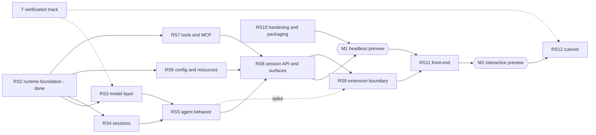

# Roadmap

Rust Coding Agent only. Owned by the orchestration session; an implementation session reports its row and its evidence in the PR body instead of editing this file.

Last updated: 2026-10-26

This file replaces the former roadmap on the owner's instruction (2026-10-26). The former roadmap tracked the TypeScript lines — durable migration, context governance N4–N8, the TUI rewrite N9, the Bun release phases, and the release rows. It is preserved in git at `88ef45bb0:ROADMAP.md`. Those lines are not tracked here. By decision #49 the TypeScript CLI is retired after the parity gate, so each of them is re-audited against the Rust Coding Agent after cutover instead of continuing in parallel. Production maintenance of the TypeScript CLI (security, release fixes, regressions) continues outside this roadmap under the rules in `AGENTS.md`.

Future sizes are relative planning estimates (S, M, L, XL), not delivery dates. A task is not done because code exists; it is done when the exit gate of its phase has verified evidence. Nothing here is a parity claim until the gate for it has passed.

## Direction (owner, 2026-10-26)

1. **Core before front-end.** Finish the headless agent — model layer, sessions, behavior, resources, tools, protocols — and fill in its content first. The front-end (terminal UI or anything else) is the last build step and is only a client.
2. **One session API.** Every user-visible operation is a method on a front-end-neutral session API in the library. Print mode, JSON mode, RPC, and any UI are adapters over it. The 33 RPC commands and the built-in slash commands are the list of operations that API must contain.
3. **Evidence, not assertion.** Loopback servers instead of real providers, mutation checks for every new test, and differential runs against the TypeScript CLI for every behavior that must match. A difference that is deliberate is registered in the source as `PARITY-DEVIATION(<id>)` with its reason and summarized in the parity note.
4. **Windows and Linux together.** The Windows runner has never executed `rust.yml`; getting it to run is a prerequisite for more Windows-specific code, not a late task.
5. **Dependency policy unchanged.** Exact `=` versions, `default-features = false`, `unsafe_code = "forbid"` in our crates, tokio only in network crates and the executable (decision #47).
6. **Reference projects are inputs, not dependencies.** See [Reference inputs](#reference-inputs).

## Baseline (verified 2026-10-26)

`main` is 36 commits ahead of `origin/main` (`b506c86e2`); none is pushed. `main` is protected and requires the "Merge gate" check, so the commits reach GitHub through a short-lived branch and a pull request. 357 tests pass; `cargo fmt`, `cargo clippy -D warnings`, and `cargo test` are clean on Linux; the Windows clippy check passes for every crate except `provider-http` and `cli`, which compile C code and cannot be cross-checked from Linux.

| Crate | Lines | Tests | State |
| --- | --- | --- | --- |
| `core` | 520 | 4 | ids, cancellation, ordered content-block model with compatibility views, usage without cost |
| `runtime` | 2,600 | 20 | agent loop, sequential and parallel tools, retry with backoff, server `Retry-After`, cancellation, tool timing, unknown-outcome state, process-group ownership |
| `session` | 2,060 | 21 (+2 crash-lock integration) | Rust-native journal: versioned header, operating-system lock, v2-compatible v3 message codec, linear entry projection with parent links, append-only records, corruption detection, fork and clone by prefix |
| `provider` / `provider-http` | 218 / 6,354 | 2 / 75 | six wire APIs (`openai-completions`, `openai-responses`, `anthropic-messages`, `google-generative-ai`, `google-vertex`, `openai-codex-responses`); text and tool calls only |
| `auth` | 857 | 12 | `auth.json` read and write under a file lock, OAuth credentials, single refresh |
| `models` | 1,202 | 15 | models.dev catalog, provider table, cache shared with the TypeScript CLI |
| `tools` | 3,220 | 66 | `read`, `write`, `edit`, `bash`, `grep`, `find`, `ls` with the TypeScript schemas and limits |
| `protocol` | 1,074 | 15 | JSONL records for 13 of the 23 session event types, session header, RPC and event name tables |
| `cli` | 8,414 | 107 | print and JSON modes, argument parser, system prompt, stdin and `@file`, sessions flags, `login`, `logout`, `--list-models`, signals (exit 130, 143, 129) |

Known gaps against the frozen contract (`compat/coding-agent/cli-surface.json`):

- **Model layer:** content-block storage now exists, but providers and JSON events still lack thinking blocks, image blocks, `toolcall_delta`, reasoning effort, prompt-cache control, and `usage.cost`; `Retry-After` is now parsed and used for admission retries; Codex sends no `reasoning`.
- **Sessions:** `--resume`, `--fork`, export, import, listing, the entry model behind `get_entries` and `get_tree`.
- **Behavior:** no steering or follow-up queues, no compaction, no thinking levels, no user shell commands, no tool hooks; 10 of the 23 event types missing.
- **Resources:** no `settings.json`, `models.json`, trust, skills, prompt templates, themes, keybindings, `SYSTEM.md`, MCP, proxy or CA configuration.
- **Tools:** `read` now rejects non-regular files and files over 16 MiB and decodes UTF-16 BOM files, but has no image input; `edit` has no fuzzy match or diff details; no PowerShell tool, `tool_search`, or codemode.
- **Surfaces:** no RPC mode (exits 2), no interactive mode (exits 2), no subcommands except `login` and `logout`, no `--help` text parity, no extensions.

## Analysis

### Why the core comes first

A front-end renders what the core produces, and the core is still missing most of that. Today an assistant message is flat text plus tool calls. The TypeScript message has content blocks: thinking with a signature, images, and tool calls whose arguments stream in. Adding them changes the message type, the session codec, the JSON events (`thinking_*`, `toolcall_delta`), and what every wire API sends back on the next turn. A terminal UI built now would be rebuilt when those arrive. The same holds for compaction events, queue events, and the entry tree behind `/tree`, `/fork`, and `/resume`.

The operations a UI needs — switch model, fork, clone, compact, set thinking level, queue a steering message, export — are already the RPC commands, so they are core operations whatever draws them. Building the core first also forces the session API and the render projection (see RS8) to exist as library surfaces, which keeps the front-end choice open.

### GPUI instead of a terminal UI

What I found, from the crates.io and GitHub records on 2026-10-26:

| Fact | Evidence |
| --- | --- |
| GPUI is a GPU-accelerated **desktop window** framework from Zed; it has no terminal backend | `crates/gpui/Cargo.toml`: categories `gui`, keywords `desktop`, `gui`; default features `font-kit`, `wayland`, `x11`, `windows-manifest` — windowing backends only |
| Pre-1.0, breaking changes between versions, needs the latest stable Rust | `crates/gpui/README.md`; Zed pins toolchain 1.98.1 |
| Published `gpui` 0.2.2 dates from 2025-10-22; Zed's repository moves daily | crates.io API; GitHub commits (last on `crates/gpui`: 2026-10-23) |
| `gpui` 0.2.2 has about 65 non-optional direct dependencies, including `cocoa`, `metal`, `windows`, `oo7`, `smol`, `resvg`, `taffy` | crates.io dependency list |
| `gpui-component` 0.8.0 (Apache-2.0, updated 2026-10-19) workspace contains `gpui-kit`; it builds on `gpui-pre-*` snapshots and says any snapshot may change the API | `longbridge/gpui-component` `Cargo.toml` |
| Licenses are Apache-2.0 for `gpui` and `gpui-component`; the Zed repository as a whole reports no single license | crates.io; GitHub API |

What follows:

1. **It cannot be the terminal interactive mode.** The contract's interactive mode is "stdin and stdout are TTYs": it must work over SSH, in tmux, in Windows Terminal, and in a container without a display. GPUI needs a window system and a GPU path, so it can only be an additional desktop client, not a replacement for the terminal mode.
2. **Choosing it instead of a terminal UI removes contract surface.** The terminal editor, the 51-token terminal themes, `keybindings.json`, the `--tui-mode` option, and the extensions' terminal components would have no home. That is a deliberate reduction the owner must record, not an implementation detail.
3. **It does not fit our policies as they stand.** The workspace `rust-version` is 1.85 and GPUI needs the latest stable, so a GPUI crate would sit in its own workspace with its own toolchain. A second async runtime (`smol`) and an API that moves between snapshots mean continuous maintenance, and each dependency needs the exact-pin review.
4. **It is a good fit as a second client.** Rebon-Code shows the shape: a render projection with no terminal types, painted by a terminal client and by a separate GPUI desktop app. Its desktop app is closed and outside its tree, so there is no code to learn from, only the architecture.

What I could not verify: that `gpui` builds on our Windows and Linux hosts, its idle memory and startup cost, and whether `gpui-component` covers the markdown, diff, and editor needs.

Recommendation: do not choose now. Keep the front-end contract (session API, render projection, RPC) so that a terminal client and a GPUI client can both be built on it, and decide at gate G-UI (RS11) with a time-boxed spike for each candidate. If the product remains the terminal Coding Agent that decision #45 describes, the terminal UI is required for parity and GPUI is an addition.

## Milestones and phases

Milestones: **M1 headless preview** (print, JSON, RPC, all content, no interactive mode, extensions per RS9 status); **M2 interactive preview** (adds the front-end); **M3 cutover** (owner acceptance, decision #45, #49).

RS3, RS4, RS6, and RS7 have disjoint write sets and run in parallel. RS5 needs the content blocks of RS3 and the entry model of RS4. Track T runs throughout.

### RS0–RS2: done

RS0 froze the contract (`compat/coding-agent/cli-surface.json`: four modes, 13 command surfaces, 44 options, 23 event types, 33 RPC commands, persistence, environment, error contracts, exit codes). RS1 created the workspace and crate boundaries. RS2 built the single-agent runtime. Remaining RS2 leftovers (retry limits read from settings, a non-streaming fallback after a stream failure) live in RS3 and RS6.

### RS3: model layer (L)

What the model sees and what comes back, for every wire API.

- **Message model v3:** content blocks — text, thinking (text, signature, redacted), image, tool call with partial arguments — plus assistant metadata (`api`, provider, model, usage with cost, stop reason, error message). New session codec version with a reader for v2.
- **Streaming events:** `thinking_start/delta/end`, `toolcall_start/delta/end`, and the `message_update` usage field with cost.
- **Provider capabilities per wire API:** reasoning and thinking requests (budget, effort, adaptive where the API has it) and their replay rules (signatures, redacted blocks, encrypted reasoning, `reasoning_content`); prompt-cache control and `NYAN_CACHE_RETENTION`; image input; cost from the catalog including tiered prices.
- **Failure model:** stable error classes (authentication, rate limit, overloaded, context overflow, media too large, tool-pairing, connection); `Retry-After` in seconds and HTTP-date form; retry limits and delays read from settings (RS6); stream watchdog and non-streaming fallback; the "input plus `max_tokens` exceeds the window" retry that shrinks `max_tokens` without counting against the backoff.
- **Catalog and providers:** fill the catalog gaps listed in the parity note within the scope of #53; Codex `reasoning`, service tier, and optionally WebSocket and continuation.
- **Exit gate:** for each wire API, request bodies produced by the TypeScript provider and by Rust for the same scripted conversation are equal after normalization, over at least text, tools, thinking, images, and cache scenarios; a signed-thinking conversation survives a replay and a model switch; the error-class table is covered by a test per status and body shape; every new test has a recorded mutation check.
- **Inputs:** thinking and signature replay rules and the vendor compatibility table from Rebon-Code `rebon-api`; cache placement and retry headers from the providers' own documentation, not from either reference project.

### RS4: sessions and persistence (L)

- **Crash safety first:** an operating-system advisory lock that the kernel releases when the process dies (`File::try_lock` is stable since Rust 1.89, so the workspace `rust-version` is 1.89 under the recommendation of decision #54); one atomic-replace helper shared by `auth.json`, settings, and the file tools, with the Windows retry loop for access-denied and sharing violations; a session directory key from a normalized cwd identity (Windows case folding, `\\?\` removal) with a sidecar that records the real cwd.
- **Entry model that matches RPC:** entry ids, parent links, labels, `get_entries`, `get_tree` (linear, per the TypeScript contract), `get_fork_messages`, `fork`, `clone`, `switch_session`, `set_session_name`, `get_session_stats`; `--resume` listing, `--fork`, `--export`, and import.
- **Recovery:** resume of an interrupted run, with the choice between refusing (today) and synthesizing results for orphan tool calls decided against the TypeScript behavior; session metadata appended again at the tail after compaction, because recovery reads the tail; unknown outcomes surfaced, never reported as success.
- **Legacy import:** an explicit command for the legacy JSONL store; the durable SQLite store waits on decision #59.
- **Exit gate:** the journal is truncated at every byte offset of a recorded session and each truncation either recovers or reports corruption; two processes contend for one session on Linux and on the Windows runner; a process killed with `SIGKILL` leaves a session that opens; fork, clone, and tree results equal the TypeScript RPC results for recorded fixtures.
- **Inputs:** lock semantics, Windows lock-error mapping, and the rewrite-versus-append lessons from Rebon-Code `rebon-session`.

### RS5: agent behavior (L)

- **Queues:** `steer`, `follow_up`, `clear_queue`, steering modes, `abort`, `abort_retry`, `abort_bash`, with `queue_update`.
- **Thinking levels:** set, cycle, available levels per model, scoped models and model cycling, `thinking_level_changed`.
- **Compaction:** manual, automatic, and on overflow, following the TypeScript compaction contract; summarization retry events; thresholds measured by us, not copied; the tail of the conversation protected; large tool results spilled to files with a replacement decision that is persisted so a resumed session keeps a byte-identical prefix.
- **User shell commands:** the `bash` RPC command and the `!` and `!!` prefixes, with `bash_execution_update`.
- **Hook points in the core:** before and after tool call (can block, fail safe), before agent start, context assembly. The trust gate (RS6) and extensions (RS9) attach here.
- **Events:** `queue_update`, `entry_appended`, `session_info_changed`, `thinking_level_changed`, `compaction_start/end`, `auto_retry_*`, `summarization_retry_*`, so all 23 session event types exist.
- **Exit gate:** at least 30 scripted-provider scenarios (tool loops, steer during a tool, abort mid-stream, overflow then compaction then retry, retry exhaustion, compaction failure) run through the TypeScript CLI and the Rust CLI against the same loopback server; the normalized event sequences are equal or each difference is a registered `PARITY-DEVIATION`.

### RS6: configuration, resources, and network (M–L)

- **Settings:** user and project `settings.json` with merge, per-key tolerance (an invalid key is reported and ignored, the rest still load), unknown keys preserved on write, atomic writes, and a cross-process lock; offline mode; the `NYAN_*` environment surface and process markers from the contract.
- **Configuration files:** `models.json` (custom providers and models), `keybindings.json` and themes (parse and validate now, consumed by the front-end later), `SYSTEM.md` and `APPEND_SYSTEM.md`.
- **Trust:** `--approve` and `--no-approve`, a trust store, and a gate so that project-level configuration that can execute something — extensions, MCP servers, key commands, environment injection — does nothing before the project is trusted.
- **Skills and prompt templates:** discovery roots, frontmatter, de-duplication by real path, `--skill`, `--no-skills`, `--prompt-template`, `--no-prompt-templates`, argument syntax exactly as the TypeScript documentation defines it.
- **Network configuration:** `HTTP_PROXY`, `HTTPS_PROXY`, `NO_PROXY`, SOCKS proxies resolved at the proxy, extra CA certificates (including `NODE_EXTRA_CA_CERTS` as a compatibility variable) merged with the system roots, using the reqwest and rustls stack of #47.
- **Exit gate:** directory-tree fixtures resolve to the same resource lists and prompt text in the TypeScript and Rust CLIs; a project with executable configuration does nothing before trust, with a test that fails if the gate is removed; proxy and CA behavior is shown against a loopback proxy.

### RS7: tools and MCP (L)

- **Built-in tools to TypeScript parity:** `read` (device, FIFO, and size guards; UTF-16 BOM; images), `edit` (fuzzy matching, diff details, atomic write, refuse to edit a file that is not valid UTF-8 rather than write it back damaged), `write` (atomic), `bash` and a PowerShell tool on Windows (shell resolution, output encoding), `grep` that streams large files, `find` and `ls` ordering, output spilled to a file when truncated, `tool_search`.
- **MCP client:** a time-boxed spike chooses the official `rmcp` crate or a small client of our own after its dependency tree is reviewed; stdio and streamable HTTP; OAuth with the client metadata URL only when the operator sets `NYAN_MCP_CLIENT_METADATA_URL`; `nyan mcp add|remove|list|login|logout`; user and project configuration merge behind the trust gate; `--no-mcp`; tool name normalization; result truncation; reconnection only for remote transports; a fake MCP server written in Rust for the tests.
- **Codemode:** decision #57.
- **Exit gate:** a table of fixture workspaces crossed with tool calls produces equal normalized output from the TypeScript tool and the Rust tool, covering CRLF, BOM, symlinks, non-UTF-8 files, very large files, and Windows paths on the Windows runner; MCP end-to-end tests cover stdio and HTTP, session expiry, OAuth, and a server killed mid-call.
- **Inputs:** edge-case checklists listed in [Reference inputs](#reference-inputs).

### RS8: session API, render projection, and surfaces (L)

- **Session API:** one front-end-neutral crate exposing commands in and events out. Print, JSON, and RPC are thin adapters over it.
- **Render projection:** a crate with no terminal or window types that turns messages into a display model (markdown blocks, tool-call summaries, diffs, collapsed read and search groups). Tests keep it free of UI dependencies. Both a terminal client and a GPUI client would paint it.
- **JSON and RPC:** all 23 events, all 33 RPC commands, the extension UI request and response shapes, exit codes, stdout and stderr ownership, the process markers and tool session variables.
- **CLI:** all 44 options and dynamic flags, `auth`, `login`, `logout`, `mcp`, `export`, `--help`, `--version`, `--list-models`, the update check (URLs only from the environment, per `AGENTS.md`), and self-update from GitHub releases.
- **Package management:** `install`, `remove`, `update`, `list`, `config` for packages; the extension part waits on RS9, the skill, prompt-template, and theme parts do not.
- **Wire contract tests:** recorded TypeScript RPC transcripts as byte-level fixtures; key-set assertions; a new command variant must not change the protocol version; `cargo test --workspace` in CI, because Cargo feature unification can break serde enums in ways per-crate tests miss.
- **Exit gate:** the same recorded RPC transcripts pass against the TypeScript and Rust CLIs; the flag surface is locked with parse tests; the JSON event discriminants are equal; the render projection has a test that fails if it gains a terminal dependency.

### RS9: extension boundary (XL, gated by decision #56)

- **First:** decision #56, informed by a spike that runs in parallel with RS5. Options: an optional out-of-process bridge to the user's own `node` that speaks a typed JSONL protocol; a process-based plugin protocol in any language; an embedded script or WASM runtime; or no extensions, with MCP as the only tool extension point.
- **Then:** the chosen boundary for the 41 event subscriptions and 31 API members of the contract (`registerTool`, `registerCommand`, `registerShortcut`, `registerFlag`, `registerProvider`, `registerMcpServer`, session controls, UI), the extension UI subprotocol, and the built-in extensions that exist in TypeScript today.
- **Exit gate:** every member has a row — native, bridged, or reduced by the owner — and nothing is dropped silently; handler error semantics are tested (a failing `tool_call` handler blocks the tool, a failing tool becomes an error result, other handler failures are reported and the run continues).
- **Inputs:** the plugin protocol shape of Rebon-Code `rebon-plugin-protocol` — one terminal outcome per call, scope generations, a manifest that bounds what a plugin may call, identity injected by the host.

### RS10: hardening, packaging, headless preview (L)

- Windows-native evidence for shell resolution, Job Objects, locks, console input, and signals; a cross-platform matrix in CI.
- Recovery drills: kill during append, kill during a tool, disk full, corrupted settings.
- Baselines against the TypeScript CLI for startup time, resident memory, and binary size.
- Fuzzing of the SSE decoder, the JSONL reader, and the session codec; dependency audit with `cargo-deny` and `cargo-audit`.
- Release workflow: archives for Linux and Windows (macOS if the owner wants it), SHA-256 file, provenance; signing per the owner's decision (#62); the preview keeps the distinct name `nyan-coding-agent`.
- **Exit gate (M1):** every row of the parity matrix is `verified` or `reduced by owner`; the headless preview is published separately from the TypeScript `nyan`.

### RS11: front-end (gate G-UI, then L–XL)

- **G-UI:** decision #55 after one time-boxed spike per candidate: terminal UI with `ratatui` and `crossterm` (decision #48, kept until the gate), GPUI with `gpui-component`, or both. The spike measures what the analysis could not: build on both operating systems, text rendering of markdown and diffs, startup, idle memory.
- **Terminal UI scope if chosen:** multi-line editor with kill ring, word movement, undo, history, paste handling, including the Windows paste-burst case; `@file` and `/command` completion; streaming markdown; tool-call and diff views; thinking blocks; selectors for model, session, tree, and settings; queue display; themes and keybindings; image protocols; extension UI; hotkeys; status line; clipboard through OSC 52; resize, suspend, and resume; main-screen and alternate-screen modes.
- **Exit gate (M2):** the interactive checklist from the contract passes in pty-driven tests (the interactive-testing skill) and a manual Windows Terminal and conhost matrix.

### RS12: cutover

Owner acceptance of the complete parity and rollback evidence; the executable `nyan` switches to Rust; migration guide; the TypeScript CLI is retired by decision #49; each deferred TypeScript line is re-audited against the Rust Coding Agent.

## Track T: verification (runs throughout)

| Item | What | Needed by |
| --- | --- | --- |
| T0 | Publish the local commits through a branch and pull request so `.github/workflows/rust.yml` finally runs on a Windows runner; fix what it finds before adding Windows-specific code | now |
| T1 | Differential harness: one loopback server per wire API serving scripted replies; run the TypeScript and Rust CLIs against it; normalize timestamps and ids; compare requests, events, exit codes, files | RS3 |
| T2 | TypeScript-generated golden corpus (requests, sessions, RPC transcripts, resource trees) with the TypeScript commit recorded in each fixture | RS3 |
| T3 | Coverage guard: every TypeScript tool, event type, RPC command, option, and setting key is covered by a test or waived with a reason, and a test fails when a new one appears in the contract | RS8 |
| T4 | `cargo nextest` for process isolation, `clippy::disallowed_methods` so subprocesses and HTTP clients are only built through our wrappers, `cargo check` for the Windows target | RS3 |
| T5 | Mutation-check log: each new test records the change that made it fail | always |

## Reference inputs

Two repositories were studied on 2026-10-26: Rebon-Code (`RebonAI/Rebon-Code`, Apache-2.0) and CometixCode (`Haleclipse/CometixCode`, AGPL-3.0). The notes are in `/tmp/study/notes/` and are not in the repository.

| Source | Use | Rule |
| --- | --- | --- |
| Rebon-Code | Adapt small original modules with attribution; learn designs | Keep copyright and license headers on any adapted file, mark the change, and add the entry to a `NOTICE` file when the first file is adapted. Its prompts and tool descriptions are not used |
| CometixCode | Behavior and edge-case checklists; the test method | No code taken. Nothing in this plan needs it, and the checklists can be rebuilt from the TypeScript CLI, Node, Microsoft, and provider documentation |

Candidates by phase (each is a choice made when the phase starts, not a commitment):

- RS3: thinking, signature, and redacted-block rules; vendor compatibility table; error classification structure.
- RS4: lock and atomic-write behavior on Windows; orphan tool-call repair; tail-metadata re-append; resume listing.
- RS5: compaction ladder, tail protection, token accounting from the last server usage plus an estimate; summarization retry on prompt-too-long by dropping the oldest tool-call group.
- RS6: settings layering and per-key tolerance; trust gate; skill discovery and de-duplication; proxy and CA rules.
- RS7: read, edit, and write edge cases (devices, FIFOs, size, BOM, line endings, invalid UTF-8, symlink chains, Windows path forms such as alternate data streams and short names, Git Bash path conversion, PowerShell output encoding); output truncation (adapted from codex-rs through Rebon-Code, Apache-2.0); MCP integration hazards (protocol version pinning, proxy for OAuth requests, session expiry detection, SSRF checks on metadata discovery, `.cmd` launching on Windows).
- RS8: schema and golden guards, the byte-level wire contract with compatibility matrix, one command catalog shared by every surface, the rule that an unavailable command explains itself instead of being sent to the model as a prompt.
- RS9: the plugin protocol shape (see RS9).
- RS11: renderer split, streaming markdown stable-prefix idea, ratatui inline-viewport patches (about 330 lines, adapt from the ratatui 0.29 base), terminal restore guards, paste-burst handling, ambiguous-width probing.
- Optional, only if the owner adds them (neither is in the parity contract): a permission-prompt system (Rebon-Code `rebon-shell-policy` is the leaf worth testing first) and a Linux sandbox (bubblewrap argument builder).

Not used: either project's engine, plugin kernel, MCP client, SSE parser (Rebon-Code's splits multi-byte characters; ours does not), default hosted endpoints, borrowed third-party OAuth client ids, or JavaScript engines.

## Next slices

Reversible work that does not wait on a decision, in order. Done 2026-10-26: the operating-system lock for sessions and `auth.json`, the atomic-replace crate `nyan-coding-agent-fs` used by `write`, `edit`, and `auth.json`, and `edit` refusing non-UTF-8 files (`PARITY-DEVIATION(edit-non-utf8)`).

1. T0: open a pull request from `rust-core-preview` so the Windows runner runs; `rust.yml` is not on `origin/main` yet, so `workflow_dispatch` cannot start it and only a pull request does. Needs the owner's go-ahead to open the PR.
2. RS4: add the session cwd sidecar and wire entry projection into the front-end-neutral session API.
3. RS3: migrate the remaining provider request/replay paths from compatibility fields to ordered content blocks and add thinking/image streaming events.
4. T1: differential harness skeleton with one wire API, so RS3 has its gate.

## Write sets

What a line may touch, so parallel work conflicts only where the dependency order already serializes it. A path not listed for a line is not its to change; ask the orchestration session to add it here first.

| Line | Writes | Collides with |
| --- | --- | --- |
| Orchestration (every session) | `ROADMAP.md`, `packages/coding-agent/CHANGELOG.md`, `docs/handoff/`, root manifests and lockfiles, `.github/quality/policy.json` | nothing: it is the only writer |
| RS3 model layer | `rust/crates/nyan-coding-agent-core`, `-provider`, `-provider-http`, `-models`, the message parts of `-protocol` | RS4 and RS5 read the message type; RS3 lands the type first |
| RS4 sessions | `rust/crates/nyan-coding-agent-session`, the session parts of `-cli` | RS5 depends on its entry model |
| RS5 agent behavior | `rust/crates/nyan-coding-agent-runtime` | needs RS3 and RS4 merged |
| RS6 configuration and resources | new `-config` and `-resources` crates, `-auth` | none until RS8 wires them |
| RS7 tools and MCP | `rust/crates/nyan-coding-agent-tools`, new `-mcp` crate | none |
| RS8 surfaces | new `-session-api` and `-render` crates, `-protocol`, `-cli` | every line above lands first |
| RS9 extension boundary | new `-extensions` crate | decision #56 |
| Track T | `rust/tools/**`, `compat/coding-agent/**`, `.github/workflows/rust.yml`, fixtures | workflow changes need CI coordination |
| TypeScript packages | `packages/**` is outside this roadmap | production maintenance only |

## Decisions waiting on the owner

Do not close or reinterpret these entries without an owner decision. Work continues on the reversible part with the recommendation. Decisions #45–#53 are resolved and recorded below.

| # | Question | Recommendation | Blocks |
| --- | --- | --- | --- |
| 54 | Which `rust-version`? Today 1.85. Rust 1.89 stabilizes `File::try_lock`, which gives a crash-safe session lock with no new dependency; `ratatui` 0.30 needs 1.88; GPUI needs the latest stable | Raise the workspace to 1.89 when RS4 starts; keep any GPUI crate in its own workspace. Applied on 2026-10-26 as a reversible step (`rust-version = "1.89"`); awaiting confirmation | RS4 lock |
| 55 | Front-end: terminal UI (decision #48, `ratatui` and `crossterm`), GPUI desktop app, or both? GPUI cannot be the terminal mode, so choosing it alone removes the terminal interactive mode, themes, keybindings, and terminal extension components from the contract | Decide at gate G-UI after a spike; the terminal UI stays required for parity, and GPUI is an addition. #48 stays in force until then | RS11 |
| 56 | Extension boundary after the TypeScript runtime is retired: out-of-process bridge to the user's `node`, a plugin protocol for any language, an embedded runtime, or MCP only? | Typed JSONL protocol with an optional bridge for existing TypeScript extensions; no Node on the ordinary path (#46) | RS9 |
| 57 | Codemode (TypeScript runs model-written JavaScript against injected tools): drop it, embed an engine, or run it through the bridge? | Defer to RS9; do not embed an engine in the core | RS7, RS9 |
| 58 | Durable-only commands `tasks` and `agents` (sub-agents): in the Rust parity scope? | Out of scope for M1; revisit after RS9 | RS5 |
| 59 | Import of the TypeScript durable SQLite sessions: a one-time importer that needs a SQLite reader (a C dependency), or legacy JSONL only? | JSONL importer in RS4; SQLite only if the owner has sessions worth keeping | RS4 |
| 60 | Provider long tail: `openrouter`, `opencode`, `cloudflare-ai-gateway`, `github-copilot`, Anthropic subscription OAuth, Vertex application-default credentials — add any of them? #53 keeps them refused with a reason | Add on demand, one wire detail at a time | RS3 |
| 61 | A plain line-oriented REPL for daily use of the Rust agent before the front-end exists? It is not parity work (about 300 lines) | Yes, as a development tool, off by default | none |
| 62 | Release signing and update channel for the Rust preview (the Bun signing decision #13 was deferred) | Publish SHA-256 files and provenance now; defer signing | RS10 |

## Resolved decisions carried from the former roadmap

| # | Decision | Resolved |
| --- | --- | --- |
| 45 | The Rust Coding Agent is a complete, nearly pure Rust rewrite of the current CLI; the TypeScript CLI is the behavior reference until the parity gate | 2026-10-23 |
| 46 | No Node on the ordinary Rust runtime path; an optional isolated compatibility bridge may be considered for extensions (RS9) | 2026-10-23 |
| 47 | `reqwest` with rustls on `tokio`; exact versions, `default-features = false`; tokio only in network crates and the executable | 2026-10-23 |
| 48 | `ratatui` with `crossterm` for the terminal UI. Revisited by decision #55: the front-end choice is deferred to gate G-UI | 2026-10-23, revisited 2026-10-26 |
| 49 | The Rust implementation becomes the main line and the TypeScript CLI is retired after the gate; Rust owns `nyan`, `NYAN_*`, `~/.nyan/agent/`, `.nyan/`; one session store (`sessions/<cwd hash>/<id>.session`); older stores only as explicit import sources | 2026-10-23 |
| 50 | Providers are built by wire API, not by provider; CLIProxyAPI is the owner's addition | 2026-10-23 |
| 51 | A model exists only after a login produced a model list; the default is chosen from that list; Rust has its own `login` | 2026-10-23 |
| 52 | The model catalog is fetched from models.dev at run time and cached in the TypeScript CLI's `models-dev-cache.json` | 2026-10-23 |
| 53 | Provider scope: `meta`, `azure`, `minimax`, `minimax-cn`, `kimi-coding`, `vercel-ai-gateway`, `mistral`, and `amazon-bedrock` removed (their adapters are deleted); `opencode-go` and `openai-codex` required | 2026-10-23 |

## Done

| Date | Item | Evidence |
| --- | --- | --- |
| 2026-10-23 | RS0 contract frozen | `compat/coding-agent/cli-surface.json` at `24424b129` |
| 2026-10-23 | RS1 workspace and crate boundaries | `rust/` workspace; fmt, clippy, test on Linux; Windows clippy for the pure crates |
| 2026-10-26 | RS4 crash-safe locks: the session and `auth.json` locks are operating-system locks the kernel drops when the process dies, with a test that kills the holder; the old create-new lock files left a session locked for good after a crash and the old `auth.json` stale-lock timer could steal a lock held during a slow refresh. Atomic file replacement (`nyan-coding-agent-fs`): readers never see a torn file under concurrent writers, symlinks and modes are kept, Windows rename retry. `rust-version` is 1.89 | 345 passing tests; mutation checks recorded for each; Linux only, the Windows runner has not executed them |
| 2026-10-26 | RS3/RS4/RS7 incremental core work: ordered content blocks with a v3 session codec and v2 reader, runtime synchronization for streamed text/tool calls, Anthropic replay of thinking/image/text blocks, `Retry-After` parsing for milliseconds, seconds, and HTTP-date, stable provider classes for rate limits/overload/context/media/tool-pairing/connection failures, normalized cwd identities, `read` guards for devices/FIFOs, size, and UTF-16 BOM files, and a linear session entry projection with parent links and fork-message lookup | 357 passing tests; new behavior mutation-checked; Linux only, the Windows runner has not executed them |
| 2026-10-23 – 10-26 | RS2 runtime foundation, journal sessions, six wire APIs, `auth.json` and Codex OAuth, models.dev catalog, built-in tools, print and JSON modes, `login`, signals, retry backoff, deletion of the out-of-scope adapters | 36 local commits ending at `b506c86e2`; 332 passing tests; loopback servers only, no real provider or credential was used; the Windows runner has not executed any of it |
