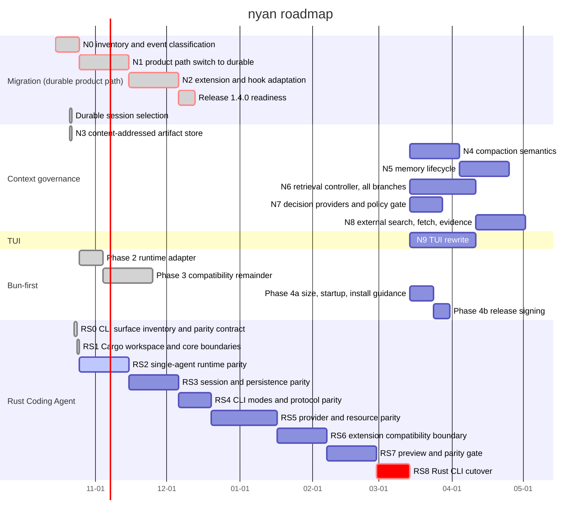

# Roadmap

Planned work and its status. Owned by the orchestration session; an implementation session reports its row and its evidence in the PR body instead of editing this file.

Last updated: 2026-10-23

Parallelism rule (owner, 2026-10-21): concurrency is bounded by the dependency graph and by disjoint write sets, not by a fixed count of active lines. The orchestration session owns the shared documents — this file, `packages/coding-agent/CHANGELOG.md`, `docs/handoff/`, `docs/layers.json`, the root manifests, and `install-lock` — and every other session leaves them alone, reporting its roadmap row and changelog entry in the PR body for the orchestration session to fold in. A line may start when its dependencies are merged and its write set (see [Write sets](#write-sets)) does not overlap a line that is still open; where two lines need the same file, the earlier start holds it until it merges. This replaces the former "no more than two roadmap lines may be active" rule, which shipped with the first version of this file (`f0d0720eb`) without a recorded reason: every conflict observed since was in the shared documents rather than in code, including two `main` merges and one `ROADMAP.md` conflict in the two parallel PRs of 2026-10-21.

This roadmap is the single source of truth for planned work and status. Future dates are estimates, not delivery commitments. A task is not considered done merely because source code, a design, or an external Pactile asset exists; its status requires verified Nyan repository or GitHub evidence. Owner recommendations below are planning assumptions, not owner decisions.

## Timeline

The Queue table records complete multi-parent dependencies where the compact Gantt representation uses one primary predecessor. Critical bars identify work waiting on an owner decision or on a task blocked by one. GitHub's current Mermaid renderer keeps the today marker on by default but rejects an explicit `todayMarker on` directive and its style form for this chart; the valid chart therefore relies on that default.

The verified baseline is `origin/main` at `24424b129` after durable session selection (#155), the N3 content-addressed artifact store (#152), and the first N4 context primitives (#168), with the settled N4 handoff recorded in #170. The Nyan tree has 12 packages; it has no separate `packages/context`, `packages/retrieval`, or `packages/decision` package, while the durable artifact and context primitives now live under `packages/durable`. Pactile's source, tests, design documents, evidence fixtures, and the external retrieval worker are migration inputs, not Nyan completion evidence. The 1.4.3 release is published; the Rust Coding Agent rewrite is now the only active implementation line. The owner selected the Rust rewrite on 2026-10-23; RS0 and RS1 are complete and RS2 is active, while the remaining original roadmap work is frozen behind the Rust parity gate.

### Rust Coding Agent rewrite (2026-10-23)

The owner selected a nearly pure Rust rewrite of the complete Coding Agent CLI. The current TypeScript CLI remains the production and behavior reference while Rust is built. The Rust line owns the terminal Coding Agent, its interactive/print/JSON/RPC interfaces, providers, tools, sessions, persistence, recovery, and compatibility surfaces. Rust owns the normal runtime and does not start Node on the ordinary path. An optional isolated compatibility bridge may be considered for existing TypeScript extensions, but it is an RS6 gate and is not part of the Rust core.

The parity contract and stage gates are in [the Rust Coding Agent parity note](.agents/notes/proposed/architecture/2026-10-23-rust-coding-agent-parity.md). RS0 is closed: the surface inventory is frozen at `origin/main` `24424b129`. RS1 has created the Cargo workspace and native crate boundaries; the agent runtime and parity implementation do not exist yet. The Rust preview must use a distinct executable or release channel until the RS8 cutover gate is accepted.

### Priority freeze (2026-10-23)

Until RS8 is accepted, the only active implementation line is RS0–RS8. Existing TypeScript work remains allowed for production maintenance, security, provider compatibility, release fixes, and regressions. The remaining pre-Rust feature queue — unfinished Context Governance, retrieval, memory, decision providers, external search, the TUI rewrite, Bun release hardening, and codemode admission — is deliberately deferred behind the Rust cutover. Already-merged slices remain recorded as verified history, not permission to continue the line. Its design notes and historical evidence remain useful inputs; no new implementation branch for those items starts before RS8. After RS8, each deferred line must be re-audited against the Rust Coding Agent before activation.

### Status key

| Status | Meaning |
| --- | --- |
| Done | Implemented or formally published in Nyan and supported by repository or GitHub evidence |
| Active | Implementation is currently in progress and has a defined gate |
| Partial | A related Nyan slice exists, but the requested item is not complete |
| Queued | No Nyan implementation has started; it is scheduled in the Queue |
| Deferred | Intentionally paused behind the Rust Coding Agent cutover; existing evidence or design may remain, but no new implementation starts before its dependency gate |
| Blocked | Queued work cannot cross an owner decision, permission, evidence, or readiness gate |
| Reference | Design, source, test, or evaluation material exists outside Nyan and still needs a governed port |
| Out of scope | Explicitly excluded from this roadmap |

### Item assessment

The following assessment covers every numbered item from the handoff. A source file, test, design note, or successful probe in Pactile is not counted as a Nyan implementation.

#### Rust Coding Agent assessment

| Item | Status | Judgement and destination |
| --- | --- | --- |
| RS0 | Done | The CLI surface matrix is frozen at `origin/main` `24424b129`: four modes, 13 top-level command surfaces, 44 common options, command-specific options, dynamic extension flags, 23 session event types, 33 RPC commands, RPC extension UI, persistence, environment, extension behavior, error contracts, and exit-code contracts. Evidence: [parity note](.agents/notes/proposed/architecture/2026-10-23-rust-coding-agent-parity.md) and [surface inventory](compat/coding-agent/cli-surface.json). |
| RS1 | Done | The Cargo workspace under `rust/` has library-first crates for core, session, provider, tools, protocol, and CLI. The boundary uses only the Rust standard library and keeps the ordinary path independent of Node. Evidence: `cargo fmt --all -- --check`, `cargo check --workspace --all-targets`, `cargo clippy --workspace --all-targets -- -D warnings`, workspace tests, and CLI version/help smoke checks all pass. |
| RS2 | Active | The initial executor-neutral runtime now covers provider stream events, assistant lifecycle, sequential and parallel tool loops, live tool updates, retry admission and recovery before output, stable unsupported/stream/turn-limit errors, cancellation, explicit unknown-effect outcomes, and platform-native process-group cancellation. `nyan-coding-agent-tools` captures stdout/stderr through a pinned safe Rust wrapper over process groups/Job Objects, and `.github/workflows/rust.yml` schedules the Rust gate on Linux and Windows. Continue with the remaining terminal outcomes and effect-recovery cases. Depends on RS1. |
| RS3 | Queued | Implement versioned persistence, locks, continuation, fork/clone behavior, export, crash recovery, and the compatibility path for existing session data. The session crate has an isolated Rust-native versioned-file, lock lease, append-only journal, replay, provider-neutral message codec, NativeSession reopen, session-id selection, fork/clone message-prefix, incomplete-run detection, and runtime `run_persistent` integration groundwork slice, but RS3 does not open until the RS2 runtime gate is accepted. Depends on RS2. |
| RS4 | Queued | Implement interactive, print, JSONL, and RPC CLI modes with stable flags, exit codes, stdout/stderr ownership, and signal behavior. Groundwork: the Rust executable runs `--print` and `--mode json` end to end for the OpenAI provider (loopback-verified), with the argument parser, app-mode resolution, JSONL encoder, and print/JSON exit semantics ported; sessions, tools, stdin prompts, RPC, and the interactive UI are not wired. Depends on RS2 and RS3. |
| RS5 | Queued | Port providers, model selection, credentials, built-in tools, MCP, skills, prompt templates, settings, trust, and other current CLI resources. The HTTP/TLS stack is settled by Decision #47; `nyan-coding-agent-provider-http` has an SSE decoder and an OpenAI-compatible streaming adapter verified against a loopback server, but RS5 does not open until RS4 is accepted. Depends on RS4. |
| RS6 | Queued | Decide and verify the extension compatibility boundary. Rust remains the normal runtime; any TypeScript bridge is optional, isolated, typed, and never silently substitutes for a missing surface. Depends on RS5. |
| RS7 | Queued | Run differential CLI tests, session/recovery tests, real terminal checks, multi-platform builds, startup/memory/performance checks, and a separately published Rust preview. Depends on RS6. |
| RS8 | Queued | Switch the default executable only after the owner accepts the complete parity evidence and a rollback path. Depends on RS7. |

#### Bun-first assessment

| Item | Status | Judgement and destination |
| --- | --- | --- |
| Phase 1 CI and parity | Done | PR #10 added seven-package Bun CI; PRs #12, #13, and #14 covered the remaining package and HTTP differences. |
| Phase 2 runtime adapter | Done | Closed 2026-10-17 by [PR #32](https://github.com/blxzer77/nyan/pull/32). Every inline runtime-identity check in `coding-agent` and `ai` goes through `runtime.ts`. Evidence: PR [CI run 38946496262](https://github.com/blxzer77/nyan/actions/runs/38946496262) (Ubuntu Node and Bun suites, Windows build and check) and [release dry run 38946495937](https://github.com/blxzer77/nyan/actions/runs/38946495937) (six binaries, archives, `SHA256SUMS`, binary smoke with the update smoke test). The boundary and the checks are recorded in [the parallelization note](.agents/notes/implemented/architecture/2026-10-16-bun-runtime-adapter-parallelization.md). |
| Phase 3 HTTP, WebSocket, SQLite, subprocess, and worker work | Done | Bun native fetch and idle-timeout behavior are implemented by PR #13, and WebSocket-related parity fixes are merged. Batch 1 (transport error classification, certificate failures are no longer retried) is merged in [PR #35](https://github.com/blxzer77/nyan/pull/35). Batch 2 gives the two HTTP backends one home (`core/http/`), makes a changed idle timeout reach clients that already hold the fetch on Bun, and adds a one-time warning when `NODE_OPTIONS=--use-system-ca` is set under Bun. Batch 4 runs the durable session store on Bun's own SQLite (`bun:sqlite`, with the Node semantics the storage relies on) so that closing a session releases its files on Windows, and fixes the test-only `--preload` and large-file cases. Batch 5a skips Node's `registerHooks` source resolver under Bun, where tsconfig paths are native, and adds offline `--version` and `--list-models` smoke tests under both runtimes. Batch 5b adds Linux subprocess evidence for the coding-agent bash tool and durable `NodeExecutionEnv`: aborting a command kills its child and grandchild, and stdout/stderr remain complete in the spill file; the new tests pass under Node and Bun. Batch 5c adds direct worker evidence for terminating a synchronous wasm loop and interrupting a microtask loop on abort; the tests pass under Node and Bun. Batch 5d fixes retry classification for certificate-error URLs and Bedrock's prefixed 503 form, shares certificate and fetch-ownership helpers, and tests both runtimes. The former Windows+Bun `EBUSY` and `--preload` failures are fixed by batch 4; the large-file `file-operations` case is a documented Windows+Bun test skip because it is an environment limitation, and CI's Bun matrix runs on Ubuntu only. Closed on 2026-10-19; the gate evidence is under [Active](#active). Not verified: batch 5 on Windows, Git Bash, and macOS (there is no Windows host; the owner tracks Windows coverage separately), and the source CLI and image-resize worker inside a compiled binary. |
| Phase 4a size, startup, and install guidance | Partial | Standalone Bun binaries are released by PR #7 and release attestation is present through PR #15. Size/startup benchmarks and provider-independent install documentation remain and are Queue 14a, which needs no owner decision; the signing certificate scope is Queue 14b behind Decision #13. |

#### Compression and context pipeline assessment

| Item | Status | Judgement and destination |
| --- | --- | --- |
| C1 | Queued | Port Pactile's pure ContextSnapshot, ContextDelta, validated cut-point, source-basis hash, and stale-validation contracts into durable's generic Context Governance runtime in N4. Keep the contracts independent of coding-agent while making durable the Nyan operation runtime. |
| C2 | Partial | Port the Context Surgery decision as settled on 2026-10-22: `continue`, `mask`, `compact` — no `blocked` state, because every case that would have produced it has a better answer (the original bytes stay in the immutable entry, so there is nothing to fail to read; a mask that does not lower the estimate falls through to compaction; a missing model is the existing failure). Masking clears rather than externalizes: the entry keeps its bytes and only stops being sent, so there is no artifact and no content hash on this path. Protected regions come from `src/context/protection.ts`. The pure admission, basis, and protection slice is implemented in #168; the remaining operation wiring is deferred to N4 after RS8. |
| C3 | Queued | Make durable's ContextOperation the Context Pipeline: The durable compaction task runs hooks and provider work, revalidates the basis, and commits only against an unchanged conversation; the coding-agent layer supplies product configuration. Implement across N1, N2, and N4; do not add a Host or a second agent loop. |
| C4 | Partial | Nyan already has LLM summaries, split-turn summaries, file-operation details, thinking omission, and summary failure checks. Add Pactile's structured checkpoint/fact boundaries, source binding, and fail-closed validation in N4 and B8; existing summary code is not completion evidence. |
| C5 | Queued | No governed Nyan context pipeline exists. Make the durable compaction task the lifecycle owner and durable storage the transcript owner in N4. |
| C6 | Partial | Replace the single threshold decision with the admission policy in [`the N4 design note`](.agents/notes/proposed/architecture/2026-10-22-n4-slices-and-admission-design.md): continue below budget, else clear the tool results that are old enough and large enough, and compact only if the re-measured context is still over budget. No `blocked` branch. The measurement behind it: across 22 real durable sessions tool results are 94.9% of the estimated context, and clearing them alone takes every over-budget session back under a 200k and a 128k budget, so this is the main path rather than an optimization. `decideAdmission` is merged in `src/context/admission.ts`; wiring it into the compaction task is N4 slice E, deferred until RS8. |
| C7 | Blocked | Review interaction and `/context review` are product-shape decisions. Do not create Pactile's App review UI or an approval chain until the owner decides whether Nyan should gate actions. |
| C8 | Blocked | Immutable approval grants are not a compression prerequisite for the current TUI design. Keep the contract visible, but defer implementation until the approval/product decision in N4. |
| C9 | Queued | Port CDR/CAR and snapshot/receipt validation as pure checks in N4; verify their real use on the durable path in N4. A receipt or assurance field alone is not evidence. |
| C10 | Queued | Make durable the owner of receipt creation, persistence, checkpoints, and recovery in N3 and N4, verified against the durability of the compaction task. |
| C11 | Queued | Add artifact intents, content-addressed artifacts, memory facts, disclosure metadata, and incomplete-operation recovery through durable in N3 and N4. A tool result cannot be masked merely because its tool appears rerunnable. |
| C12 | Queued | Port the post-compaction audit and fail-closed outcomes in N4: provider failure, summary truncation, stale basis, artifact loss, append failure, and reload mismatch must leave live context unchanged or explicitly blocked. |
| C13 | Queued | Port ContextUnitManifest, anchors, protected-region rules, and source fingerprints in N4. Bind them to durable conversations and entries rather than Pactile workspace/worktree admission. |
| C14 | Queued | Port the reversible context actions in N4. Lossy compression, masking without recoverable artifacts, and permanent drop remain separately authorized and are not silently enabled by the compression controller. |
| G1 | Queued | No governed context coordinator is attached to the agent loop. Implement as a durable task in N4. |
| G2 | Queued | No ContextUnitizer exists for transcript, retrieval pack, or artifact inputs. Implement in N4. |
| G3 | Queued | No Compression Controller exists. Implement the Pactile decision and commit pipeline on the durable compaction task in N4; it must be authoritative for context changes, not proposal-only. |
| G4 | Queued | No deterministic allow, deny, or review gate exists. Implement in N4. |
| G5 | Queued | Recovery, expansion, blocking, supersession, and regression cases are absent. Implement in N4. |
| G7 | Queued | No isolated evaluation controller exists. Implement in N4 without writing product state. |

#### Memory, host, and agent seam assessment

| Item | Status | Judgement and destination |
| --- | --- | --- |
| M1 | Queued | Fact schema, safety scanning, durability, recovery, and authorization are only in Pactile. Port and split in N4 and B3. |
| M2 | Queued | The Pactile ArtifactStore is not integrated in Nyan. Port its contract into durable's Context Governance runtime in N4 and implement the durable-owned artifact store in N3. |
| M3 | Queued | Nyan scope must use git root or cwd rather than Pactile workspace scope. Decide the cross-session location before N5. |
| M4 | Queued | No Nyan `memory_read` ToolDefinition or renderer exists. Implement in N2. |
| M5 | Queued | Durable-owned memory ports are not integrated in Nyan and have no coding-agent session/scope port. Implement in N3 and B3. |
| M6 | Blocked | Memory promotion is not implemented and requires the approval carrier in Owner Decision #11. Queue in N5. |
| M7 | Queued | No `/memory` view and delete flow exists. Implement in N5. |
| G8 | Blocked | Retention and cleanup policy was open in Pactile and still has no Nyan policy. Decide and implement in N5. |
| H1 | Queued | No Nyan ContextOperation ledger is integrated yet. Durable is the selected owner; implement the product-side integration and recovery checks in N1 through N4. |
| H2 | Queued | Durable tool effect intents and receipts are not integrated in coding-agent. Implement in N3 and bind them to the compaction task in N4. |
| H3 | Queued | No durable-backed ContextOperation RuntimeStore is integrated into coding-agent yet. Implement and verify it in N3; do not add a parallel coding-agent SQLite authority. |
| H4 | Queued | No durable-owned content-addressed ArtifactStore is integrated in Nyan. Implement it in N3 and expose it through the ContextOperation runtime. |
| H5 | Queued | Pactile path, case-fold, and NFC utilities are not in Nyan. Reconcile with existing path utilities in N4 and B2. |
| H6 | Queued | No governed run-session composition root exists in the product path. Compose it on the durable Harness in N1. |
| H7 | Queued | No governed checkpoint entry exists in Nyan JSONL sessions. Implement in N2. |
| H8 | Queued | Pactile validation and fingerprint helpers are not in Nyan. Port to N4. |
| Kernel settlement projector | Out of scope | Product Kernel and settlement projection are not part of the requested Nyan roadmap. |
| P1 | Queued | `context_update` is not in the Nyan agent package. Add it only with the required ownership note in N2. |
| P2 | Queued | The undefined tool-result field omission is not verified in Nyan. Add the narrow agent-core seam in N2. |
| P3 | Queued | Pactile's native-agent wrapper must not be copied as an adapter. Attach the needed lifecycle hooks directly to the durable Harness in N2. |
| P4 | Out of scope | Pactile provider-port and Pi adapter layers are unnecessary because Nyan already owns `@ny4n/ai`. |

#### Retrieval and decision-provider assessment

| Item | Status | Judgement and destination |
| --- | --- | --- |
| R1 | Reference | The zero-dependency worker exists only in `D:\MyHarness\pactile`; it is not an Nyan package. Port after the layer decision in N6. |
| R2 | Reference | Worker tests exist externally and are not Nyan evidence. Port selected parity tests in N6. |
| R3 | Reference | Retrieval ABI V3 files exist only in Pactile. Port contracts and planner in N6. |
| R4 | Queued | No Nyan local-worker process adapter exists. Implement Node and Bun paths in N6. |
| R5 | Queued | No Nyan agent retrieval boundary exists. Implement in N6. |
| R6 | Queued | No Nyan retrieval router, ranking, classification, or telemetry integration exists. Implement in N6. |
| R7 | Queued | `code_search` is not a Nyan tool. Implement in N6. |
| R8 | Queued | The semantic branch is an optional, self-hosted remote EmbeddingProvider rather than a fixed EmbeddingGemma implementation. The profile in use is `jinaai/jina-code-embeddings-1.5b` served by vLLM with pooling on the workstation (`:8090`, replacing llama.cpp: 44.4/70.1/100.3 chunks per second at 1/4/8 concurrency against 22.8/27.1/27.0, which takes a 10k-chunk bootstrap from about 7.5 minutes to 2–3), answering 1536 unit-norm dimensions with a client batch limit of 32. TEI `cuda-1.9` was ruled out with evidence rather than left open: it loads the weights and never binds on this card (BERT and Qwen2 models alike, fp32 reports "no suitable backend", the GPU stays idle while one user thread spins), while vLLM runs under the same podman and CDG arguments. A reranker (`Qwen3-Reranker-0.6B`, `:8091`) is deployed but off by default, because it measured negative in every evaluation so far (Matryoshka 128/256/512/1024/1536; the server always emits 1536, so a smaller width is a client-side truncation plus renormalization, not a server profile). Model revision, effective dimensions, normalization, prompt/task profile, precision, batch limit, and response shape must still pass readiness checks before use, but model revision, effective dimensions, normalization, prompt/task profile, precision, batch limit, and response shape must pass readiness checks before use. Provider output remains advisory and degrades to exact/structural retrieval. Implement in N6 and verify the provider profile and refusal matrix before claiming readiness. |
| R9 | Queued | Remote index writes use a self-hosted server-side index coordinator over Qdrant and a strict Tantivy/BM25 service. The coordinator owns staged immutable generations, active-manifest CAS, coordinator epoch/fencing, job leases/checkpoints, reconciliation, rollback, and retention; Nyan never mounts or mutates remote index files. Implement the client protocol and recovery fixtures in N6. |
| R10 | Queued | External Search, Fetch, and Evidence have design material but no Nyan implementation. Implement in N8. |
| R11 | Queued | No Retrieval Controller with branch budgets, deadlines, cancellation, or remote bootstrap ownership exists. Implement the controller in N6 with an idempotent server job protocol: a missing active generation starts a background bootstrap while core exact/structural retrieval returns immediately; stale-generation rebuilds remain independent operations. |
| R12 | Queued | Lexical and relation branches are not in Nyan. Implement deterministic branches in N6. |
| R13 | Queued | Canonical locators, source snapshots, file hashes, generation fences, merged IDs, staged Qdrant/Tantivy generations, and explicit RRF ordering are not in Nyan. Implement them in N6; every candidate must be re-read and checked against the current local source before entering the RetrievalPack. |
| R14 | Queued | Coverage, abstain, insufficient coverage, degraded, blocked, index-building, provider-unavailable, stale-source, and generation-mismatch states are not in Nyan. Implement explicit provider-combination degradation and keep the last active generation serving while bootstrap or incremental sync is building. |
| R15 | Queued | Retrieval capability and egress gates are not in Nyan. Configuring a provider is the authorization, so admission is automatic with the fixed safety constraints; implement the capability snapshot and gates in N7 and N8. |
| R16 | Queued | No Search Provider is configured or built into Nyan. The provider and key remain owner-supplied; implement the adapter and its readiness checks in N8. |
| R17 | Queued | No SSRF-safe Fetch adapter exists in Nyan. Implement host allowlists, HTTPS, redirects, limits, cancellation, and Artifact storage in N8. |
| R18 | Queued | No response-hash-based EvidenceRecord or citation pointer exists. Implement in N8. |
| R19 | Queued | No `web_search` or `web_fetch` tool exists. Implement in N8, after the evidence and citation rules exist. |
| R20 | Queued | Retrieval is not attached to Context Operation epochs, restart recovery, or the client/server source-snapshot contract. Integrate the recoverable RetrievalPack task in N2, B5, B7, and N6; durable converts validated packs to bounded ContextUnits and retrieval never writes Agent state directly. |
| R21 | Queued | No external-link security fixture suite exists in Nyan. Implement in N8. |
| G6 | Queued | Inspect, freshness, source-snapshot, file-hash, generation, scope, revision, coordinator fencing, manifest CAS, and hash fencing are not in Nyan. Implement in N6 with crash/reconciliation, duplicate-job, stale-source, and partial-index fault coverage. |
| J1 | Queued | Jev transport and outbound validation are not in Nyan; the Pactile hard-coded endpoint cannot be copied. The decision provider is a configured capability, so implement the contract and configuration in N7 without a fixed endpoint. |
| J2 | Queued | Rule provider and registry fallback are not in Nyan. Implement in N7. |
| J3 | Queued | Provider policy caps, assurance, and readiness are not in Nyan. Implement in N7. |
| J4 | Queued | The two Pactile Jev clients are not in Nyan and must be consolidated into one client. Implement in N7. |
| J5 | Queued | Retrieval and compression shadow suggestions are not implemented. `shadow` is a per-run branch mode rather than a later phase, so implement suggestion adoption and its receipts in N7 and N4. |
| J6 | Out of scope | Kernel scheduler, tile, task, and verification Jev integrations are excluded; only retrieval planning remains relevant. |

#### Test, evaluation, and evidence assessment

| Item | Status | Judgement and destination |
| --- | --- | --- |
| T1 | Reference | Pactile contract and durability tests exist externally. Port deterministic contract coverage to N4. |
| T2 | Reference | Pactile agent integration tests exist externally. Port applicable tests to N2 and B8. |
| T3 | Reference | Pactile runtime tests exist externally. Port host and recovery coverage to N3, B3, and B4. |
| T4 | Reference | Pactile retrieval tests exist externally. Port worker, planner, pack, and adapter coverage to N6. |
| T5 | Reference | Pactile Jev and provider-probe tests exist externally. Port safe readiness and schema tests to N7. |
| T6 | Out of scope | Kernel, old Pi executor/RPC host, and settlement-outbox tests are excluded. |
| E1 | Reference | P1a fixtures and frozen receipts exist in Pactile but are not in Nyan. Port as evaluation-only fixtures in N4; do not copy internal addresses. |
| E2 | Reference | P0 fixtures and review records exist in Pactile but are not Nyan product evidence. Port only the agreed evaluation assets in N4. |
| E3 | Queued | The readiness probe exists but contains a tailnet address and cannot enter Nyan. Rewrite as configuration-only readiness checks in N6; Decision #4 now fixes the rule they check against, so the blocker is gone |
| E4 | Blocked | The stage 1a runner was not found in the inspected sources. Owner Decision #5 is required before claiming runner parity. |
| E5 | Queued | Paired runs, FI-01 to FI-27, crash, replay, and unknown-outcome tests are new Nyan work in N4 through B9. |

#### Design and reference assessment

| Item | Status | Judgement and destination |
| --- | --- | --- |
| D1 | Reference | Compression decision chain and audit design; rewrite as an English Nyan spec for N4, B4, and B8. |
| D2 | Reference | ContextUnitManifest and protection rules; rewrite for N4. |
| D3 | Reference | Compression and memory evaluation matrix; use as N4 acceptance criteria. |
| D4 | Reference | Legacy migration rules are reference only because Nyan has no Pactile legacy session data. |
| D5 | Reference | Rebase and blocker history is evidence context, not an implementation. |
| D6 | Reference | Shared contracts, ownership, writeset, rollback, and stage plan govern all CG batches. |
| D7 | Reference | Retrieval provider, privacy, evidence, readiness, and evaluation designs govern N6 through B7. |
| D8 | Reference | Pactile agent prompts should become Nyan workflows only when the corresponding entry point exists. |
| D9 | Reference | Dual-product and host-track architecture is a design input; do not create a Pi adapter layer. |
| D10 | Reference | Retrieval bounded-context rules belong in the `@ny4n/retrieval` contract and tests. |
| D11 | Reference | Worker migration and native-agent gap designs guide N2 and B5. |
| D12 | Reference | Pactile implemented decisions must be re-expressed as Nyan notes and verified again. |
| D13 | Reference | Capability, privacy, provider, and workspace-request docs become Nyan user docs only after implementation. |
| D14 | Reference | Retrieval Search Service design is the architecture for N6 and B7, not current Nyan behavior. |
| D15 | Reference | Pactile module catalog is an inventory and status source, not proof of Nyan integration. |

### Acceptance invariant assessment

| Invariants | Judgement and acceptance destination |
| --- | --- |
| 1-5 | First-class failure states, disclosure, no replay of unknown effects, artifact-receipt-manifest ordering, and reversible protection are not implemented in Nyan. Gate N4 through B4. |
| 6 | Jev and embedding must remain advisory and fail-closed. Gate N7 through B8. |
| 7 | Retrieval candidates must be separated from independently verified evidence. Gate N6 and B7. |
| 8 | Egress is denied by default until a provider is configured; each external request then carries a capability and authorization snapshot. Gate N7 and B7. |
| 9-10 | Structured memory, logical references, and user-only deterministic summaries are not implemented. Gate N4, B3, and B9. |
| 11-12 | Evaluation/product isolation and separate authorization for lossy actions, promotion, drop, and egress are not implemented. Gate N4, B8, and B9. |
| 13-14 | Abstain coverage, independent budgets, deadlines, and distinct cancellation/timeout outcomes are not implemented. Gate N6 and B7. |
| 15 | Decision-provider egress must remain separate from external search egress. Gate N7 and B7. |
| 16-17 | Search candidates, citations, stale evidence, SSRF, redirect, size, timeout, and cancellation rules are not implemented. Gate N8. |
| 18 | Source existence, integration, invocation, and verification must remain separate status claims. Apply this rule to every assessment above. |
| 19 | Retrieval, compression, evaluation, and rendering ownership boundaries are not implemented. Gate N2, B4, B5, and B8. |

## Compression implementation plan

Pactile's compression design is the source of truth. The migration removes App, Host, multi-client, logical workspace/worktree, lease/fencing, and Kernel-process assumptions, but does not remove Pactile's context, memory, artifact, receipt, fingerprint, or fail-closed semantics. Under [Shape B](#implementation-orchestration-2026-10-15), compaction is a durable task on the product path rather than a pipeline mounted beside `AgentSession`. This is a plan, not Nyan implementation evidence.

**Ownership**

- Durable owns the context operation: snapshots, deltas, validated cut points, protected regions, surgery decisions, hashes, task phases and memos, artifacts, receipts, checkpoints, and recovery. It carries no product types.
- The durable compaction task owns admission, the summarization request, retry, and the commit of the summary entry. Its effect sandwich is what makes a crash before the outcome commit survivable.
- The coding-agent layer owns only the product surface: tool selection, extension bindings, the system prompt, and the rendering of task state. It does not own context replacement.
- The TUI owns progress, blocked, failure, and retry presentation, rendered from the conversation view. It owns no policy and no persistence.
- Persistent Memory extraction and consolidation are separate tasks. Their failure never rolls back a committed compaction.

**Implementation sequence**

1. **Cut-point safety on the durable compaction task.** Port Pactile's validated cut point, tool-call/result pairing, protected regions, and source/prefix/context hashes. A cut never breaks an arc, and a changed conversation cannot be compacted against a stale basis.
2. **Content-addressed externalization.** Persist original tool-result payloads before any masking, with content hash, source entry ids, basis revision, and disclosure metadata. A missing or mismatched artifact blocks masking.
3. **Mask-first, then summarize.** Mask only payloads backed by a verified artifact read, remeasure, and summarize only if the context is still over budget. A truncated summary, a provider error, or a summary containing a tool call is refused.
4. **Receipt and commit.** Record what the task decided and why, commit the summary entry, and re-read the conversation view. Only then does the live context change.
5. **Failure and recovery evidence.** Verify that a stale basis, a crash between intent and outcome, a failed artifact write, a failed summary, and an unknown effect each leave the live context unchanged or explicitly blocked, and that recovery after restart reaches the same state.

**Acceptance requirements**

- A cut never breaks a tool-call/result arc or retains an unresolved tool call.
- A delayed context edit, a new entry, or a conversation switch cannot be silently lost by an in-flight compaction.
- Masking without a hash-bound recovery path is rejected.
- Failed summary generation, failed artifact or receipt writes, and failed commits do not replace the live context.
- After a restart, the conversation view rebuilt from durable storage plus named artifacts and memory records matches the pre-restart state.

## Implementation orchestration (2026-10-15)

The owner selected **Shape B**: `@ny4n/durable` becomes the product path, and compaction, memory, retrieval, decision, and evidence become durable tasks. Existing JSONL sessions are preserved read-only. The migration is deliberately ahead of the Context Governance work because in Shape B the integration seam disappears: the Harness already owns the durable task, the effect sandwich, checkpointing, and recovery, so the context work is added to a runtime that already has the primitives instead of beside one that does not.

**Why the migration dominates the estimate**

`packages/coding-agent/src/experimental/durable/` already runs a durable coding agent on the durable Harness with SQLite storage, nyan's model runtime, auth, settings, theme, keybindings, and TUI components, plus subagents, `/agents`, the task graph, and `/compact`. Its own README records the property Nyan wants: an interrupted tool call is recovered on restart and the turn finishes, and the TUI only renders the conversation view. This is a prototype, so it is excluded from the build and no product entry point reaches it.

The migration cost is not the context work. It is that Nyan's extension surface is larger than durable's hook surface:

| Surface | Nyan today | Durable |
| --- | --- | --- |
| Subscriptions | 41 in `ExtensionAPI` | 7 hooks |
| Status channel | event bus plus `AgentSession` getters | `Conversation.viewState()`; the spec states there is no public semantic event channel |
| Compaction | LLM summary, split-turn summary, `session_before_compact` | built-in phased compaction task with `select` / `summarize` / `retry` |

The 41 subscriptions cannot be mapped mechanically. Each resolves to exactly one of five destinations: an existing `hook:`; a `durable-capability` that durable must gain; `product-api` for the product shell (trust, registries, input pipeline, provider selection, session lifecycle); `internal-view` for events only the TUI and the non-interactive modes read, now rendered from `Conversation.viewState()`; or `drop` when an intentional removal is explicitly approved.

A name-level match is seductive and wrong, and the first draft of the N0 inventory proved it. An independent review rejected eight of the original `keep` mappings because the contracts differ: `beforeRequest` receives model messages and runs on every request attempt including recovery, not once per run; `afterResponse` receives a terminal assistant message and returns `void`; `onYield` returns only `{ continue }`; and Nyan's `session_before_compact` is last-write-wins with a result carrying `firstKeptEntryId`, `details`, and `usage`, while durable's `beforeCompact` is first-decision-wins and returns only `{ decline }` or `{ summary }`. Only `tool_call` and `tool_result` matched a hook's real contract.

The review also found the inventory incomplete. `on(...)` and `ExtensionAPI` are 72 members but not the whole surface; the UI context, handler contexts, the tool contract, resource loading, the MCP lifecycle, and session tree and fork are affected too and are recorded in the note without member-by-member enumeration.

Two consequences for the phases below. First, N2 is larger than it looked: the corrected inventory requires 8 durable capabilities that do not exist, including a bounded streaming channel, a phased request transform, a provider-payload hook, and a settlement hook that can write entries. Second, `--mode json` and `--mode rpc` are documented interfaces that stream `message_update` and tool events, so the streaming events cannot be reduced to view derivation without breaking a published contract.

Durable provides the Context Operation primitives: the effect sandwich (`commit intent`, `perform effect`, `commit outcome`), phased checkpointed tasks, entry/context with `head` and `firstKept`, optimistic document writes with bases and bounded replay, three storage backends, task graph and agent events, the content-addressed artifact store from #152, and the first context primitives from #168. It still has no memory record, retrieval, or decision provider; those remain deferred roadmap work. The remaining compaction operation is frozen until the Rust Coding Agent parity gate.

**Sequence and gates**

| Phase | Scope | Gate before the next phase |
| --- | --- | --- |
| N0 inventory and extension classification | Done: deliver `.agents/notes/proposed/architecture/2026-10-15-durable-migration-inventory.md`, its machine-readable `extension-surface.json`, the independent review at `2026-10-15-durable-migration-inventory-review.md`, and `scripts/check-extension-surface.mjs`. Classify all 41 subscriptions and the 31 non-event `ExtensionAPI` members into hook, durable capability, product API, internal view, or drop. Record each member's consumers. Inventory the prototype and the additional surface. Freeze the session directory, lock, and `--continue` policy. No product code changes. | `npm run check:extension-surface` passes, the check is wired into `npm run check`, every member has exactly one destination and every destination has evidence, and the owner has reviewed the note. A review that rejects the first draft is itself acceptable evidence, provided the findings are verified and applied. |
| N1 product path switch to durable | Done: move the runtime out of `experimental/` into `packages/coding-agent/src/core/`, on the durable Harness with SQLite, `CodingTools`, and nyan's model runtime, auth, and settings. Keep `--continue` and session discovery. Existing JSONL sessions stay readable. | Killing the process mid-tool-call and continuing finishes the turn; `print`, `json`, and `rpc` modes do not regress. |
| N2 extension and hook adaptation | Done: implement the N0 mapping. Add the 8 durable capabilities the inventory requires, or record an accepted reduction for each one that is not built. Reconnect skills, prompts, themes, images, MCP, tool search, codemode, and the tool contract. Preserve the `print`, `json`, and `rpc` interfaces, including the events they stream. | Built-in and shipped extensions reach functional parity on the durable path; `--mode json` and `--mode rpc` produce the same event types as today; every `durable-capability` entry is either satisfied or has a recorded owner decision reducing it. |
| N3 content-addressed artifact store | Done before the Rust freeze: `packages/durable/src/artifacts/` provides scoped content-addressed storage, basis metadata, and read-time hash verification; #152 includes the contract, implementation, export, and tests. | Tampering and truncation are detected and no content is returned; verified by `packages/durable/test/artifacts.test.ts`. |
| N4 compaction semantics | Deferred until RS8. The pure context primitives and admission design slice are present (#168); the compaction task wiring, receipts, recovery, and fail-closed matrix remain. | Stale basis, failed summary, and failed append each leave the live context unchanged; the three are asserted separately. |
| N5 memory lifecycle | Context Memory with exact facts and manifests, plus Persistent Memory typed `user`, `feedback`, `project`, and `reference`, with extraction and consolidation as separate tasks. | A failed extraction does not roll back a committed compaction. |
| N6 retrieval controller | All six branches, the retrieval pack, disclosed failure states, and the optional remote hybrid code-retrieval path described in [the proposed architecture note](.agents/notes/proposed/architecture/2026-10-16-remote-hybrid-code-retrieval.md). The client owns local chunking, scheduling, RRF, current-source validation, and `RetrievalPack`; a self-hosted index coordinator owns Qdrant/Tantivy generations and durable index jobs. | Provider unavailability, timeout, cancellation, denial, stale source/index, generation mismatch, partial publication, bootstrap/incremental-sync failure, and budget truncation are distinguishable and never reported as an empty result. A missing active generation returns core exact/structural results immediately while an idempotent bootstrap runs in the background. |
| N7 decision providers and policy gate | `@ny4n/decision` with the advisory judgment contract, and the deterministic policy gate that decides admission. | A provider judgment never grants authority, and a configured provider runs without per-request approval. |
| N8 external search, fetch, and evidence | `SearchHit` to `Fetch` to `Evidence` to citation, with the fixed safety constraints. | No search hit becomes a citation without a fetch record and a response hash. |
| N9 TUI rewrite | The [TUI rewrite](#tui-rewrite) design. | Every durable operation state renders from the view, and no recovery logic lives in the TUI. |

N0, N1, N2, durable session selection, and N3 are complete before the Rust freeze; N4 has only its pure context-primitives slice merged (#168). Bun Phase 2 and Phase 3 are closed. Every remaining phase carries a gate that must pass with recorded evidence before the next phase starts, and each phase is a separate change that can be reverted on its own. The remaining N4 work and all later feature lines are frozen until RS8. The Bun Phase 2 boundary and reservation are recorded in [the parallelization note](.agents/notes/implemented/architecture/2026-10-16-bun-runtime-adapter-parallelization.md).

## Decided architecture (2026-10-15; retrieval revision 2026-10-16)

These decisions fix the target design. They are planning records taken with the owner during this roadmap update, not implementation evidence. The retrieval revision records the owner's self-hosted C/S decision and the reviewed remote hybrid index contract; it does not claim that the client, coordinator, or providers are implemented.

**Product path**

- The durable Harness becomes Nyan's product path. The prototype in `packages/coding-agent/src/experimental/durable/` is promoted out of `experimental/`, and the terminal UI renders `Conversation.viewState()` instead of `AgentSession`.
- Existing JSONL sessions are preserved read-only. Nyan does not migrate, rewrite, or delete them, and new sessions are written through durable storage.
- The non-interactive `print`, `json`, and `rpc` modes keep their current interfaces.

**Compression and context operations**

- `@ny4n/durable` owns the Context Operation: snapshot, cut-point validation, artifact externalization, mask-first policy, summary, receipt, checkpoint, recovery, and reconciliation. Its effect sandwich and phased task checkpointing are the recovery mechanism, so Nyan does not build a parallel operation state machine.
- Compaction is a durable task. The live-context swap happens only after the task commits and the conversation view is re-read; a stale basis, a failed append, a failed artifact or receipt write, a truncated summary, or an unknown effect leaves the live context unchanged and is surfaced as blocked or unknown rather than retried.
- A cut never breaks a tool-call/result arc. A stale basis, a failed append, a failed artifact or receipt write, a truncated summary, or an unknown effect leaves the live context unchanged and is surfaced as blocked or unknown rather than retried.

**Memory**

- Two layers over one storage substrate. Pactile's Context Memory keeps its exact-fact, artifact, receipt, and manifest-CAS semantics. Persistent Assistant Memory adds cross-session records typed `user`, `feedback`, `project`, and `reference`.
- Exact facts, derived summaries, and persistent records stay structurally separate. A summary is never an exact fact source, and a retrieval hit never becomes a fact.
- Memory promotion is policy-driven and automatic for low-risk, well-sourced records; conflict, low confidence, and sensitive content stay as candidates or require review. Lossy compression, permanent drop, and memory deletion remain separately authorized and are not enabled by the compression controller.
- Extraction, consolidation, and read are separate durable operations. A failed extraction never rolls back a committed compaction.

**Retrieval**

- One Retrieval Controller with every branch available from the start: `exact`, `structural`, `lexical`, `relation`, optional remote `semantic`, and `external_search`. The semantic branch is a configurable self-hosted provider, initially profiled around TEI `jinaai/jina-code-embeddings-1.5b`; EmbeddingGemma is not a fixed Nyan dependency. Capability, authority, permission, and degradation are expressed as per-run state, not as roadmap phases.
- The optional local-code hybrid path is client/server separated: the client performs Tree-sitter chunking, breadcrumb enrichment, embedding batch scheduling, local RRF, current-source validation, and `RetrievalPack` construction; a self-hosted index coordinator manages staged immutable Qdrant and strict Tantivy/BM25 generations, active-manifest CAS, coordinator epoch/fencing, durable jobs, reconciliation, and retention. The client never mounts or mutates remote index files.
- A missing active remote generation does not block the core path: exact/structural retrieval returns immediately while an idempotent bootstrap runs in the background. Incremental sync uses source snapshots, file hashes, tombstones, checkpoints, and the same active-generation publication protocol; the last active generation remains in service until the new one is validated.
- Deterministic branches are authoritative. Embedding output is advisory and never proves that a file exists, that a line range is valid, or that no other match exists. Remote candidates must be re-read and checked against the current local source before context admission.
- External search is strictly `SearchHit -> Fetch -> Evidence -> citation`. A search hit never enters the result set and never becomes a citation.
- The controller's only output is a pack carrying `items`, `rejected`, `coverage`, `fallback`, `budget`, and `abstain`. Provider unavailability, timeout, cancellation, permission denial, stale source/index, generation mismatch, partial publication, budget truncation, and dimension mismatch are distinct disclosed states, never an empty result. Retrieval returns a provider-neutral `RetrievalPack`; durable converts it to a bounded `ContextUnit` and owns recovery admission.

**Decision and egress**

- Jev is a Decision Provider: it returns structured advisory judgments and holds no authority. `@ny4n/decision` owns the provider contract, registry, judgment schema, readiness, adoption rules, and decision receipts. Nyan reuses `ctx.modelRegistry.classify()` for the rule path rather than porting a fixed endpoint or a second transport.
- The deterministic Policy Gate decides admission. It checks scope, data class, quota, egress, protected regions, basis freshness, and artifact durability.
- Configuring a remote provider is the authorization. Self-hosted retrieval services configured under the owner's internal network policy run automatically without per-request approval; the client accepts only configured service identities, ports, and protocols, rechecks redirects, and enforces size, timeout, cancellation, and response validation limits. Public/external search and fetch retain HTTPS, SSRF, private-network blocking, host allowlists, redirect rechecks, response hashing, and evidence-record constraints. An unconfigured provider produces a named unavailable or denied state and sends no request.

## TUI rewrite

The owner decided on 2026-10-15 to rewrite the terminal UI rather than extend the current renderer. The design is a governed port of verified open-source interaction patterns, not a copy of any single product's surface. Sources below were read at the source level during this update.

| Area | Reference and evidence | Nyan decision |
| --- | --- | --- |
| Structure | Codex `codex-rs/tui/src/bottom_pane/` hosts the composer and every modal (approval overlay, command popup, config panel); Codex `app/agents_overview*` is a separate full-screen view. OpenCode uses a dialog stack plus `component/panel-host.tsx`, with a toggleable sidebar bound to `<leader>b`. Gemini CLI uses `DialogManager` plus `InboxDialog`. Crush keeps a sidebar but gates it behind compact mode. | Transcript area plus a bottom modal region plus an overlay stack. No permanent operations sidebar. |
| Operations | Codex `agents_overview` groups by `All / Needs you / Working / Ready / Inactive`. | One operations overlay for durable Context Operations, Memory, Retrieval, and Decision state, using the same grouping semantics. |
| Keybindings | OpenCode `packages/tui/src/config/keybind.ts` defines `LeaderDefault = "ctrl+x"` and gives every binding a description, alternatives, and a `"none"` value. tmux 3.7c uses `C-b`; Herdr 0.9.5 uses `ctrl+b`; the zellij default preset declares `primary "Ctrl"` and binds `ctrl+b/g/h/L/n/o/p/q/R/s/S/t`. | Leader `Ctrl+X`, verified free in all three environments. `Ctrl+B`, `Ctrl+O`, and `Ctrl+P` are avoided because the multiplexers claim them. |
| Theme | Gemini `themes/semantic-tokens.ts` separates `text`, `background`, `border`, `ui`, and `status` and ships 16-color `ansi-dark` / `ansi-light` fallbacks. OpenCode `ResolvedThemeTokens` adds `hue`, `categorical`, `scrollbar`, `diff`, `syntax`, and `markdown` with a `surface(name)` derivative. Crush invalidates render caches on theme change. | A semantic token layer with truecolor, 256-color, and ANSI-16 tiers. The palette is pink-led: accent `#FF9EC4`, bright accent `#FFC2DA`, base `#171318`, raised surface `#2B202A`, border `#6E4B5D`. |
| Transcript | Codex `history_cell/` with `markdown_render_cache`; Crush `cachedMessageItem` plus `ClearItemCaches`. | Rendered transcript cells with a cache invalidated on theme or width change. |
| Activity grouping | Codex `app/activity_groups.rs` joins adjacent activity without rewriting terminal scrollback. | Tool calls and context operations collapse into an expandable group. |
| Composer | Codex splits the composer into separate draft, footer, popup, slash, history, paste, and layout states, with a documented paste state machine. | The composer is a state machine, not a text field. |
| Attention | OpenCode gates notifications and sounds per event kind. | Notify on blocked, failed, and finished, with the host owning cross-pane routing. |
| Screen mode | Crush and Codex take over the alternate screen. | Alternate screen with in-app scrolling. |
| Host relationship | Herdr already provides the agent sidebar, notifications, `agent wait`, state rollup, and resume restore through `pane report-agent`. | Nyan reports state and does not duplicate the host sidebar. The layout compact below a width threshold. |

The rewrite is a new line that does not change the non-interactive `print`, `json`, or `rpc` modes. Its shell, theme, and keybind registry can proceed independently; operation-state wiring depends on N2.

## Active

| Line | Item | Owner | Branch / PR | Next step |
| --- | --- | --- | --- | --- |
| Rust Coding Agent | RS2 single-agent runtime parity | Blxze | [Parity note](.agents/notes/proposed/architecture/2026-10-23-rust-coding-agent-parity.md) and frozen [surface inventory](compat/coding-agent/cli-surface.json) | RS1 is closed: the native workspace and independent checks pass. The initial executor-neutral runtime slice is in `rust/crates/nyan-coding-agent-runtime`; continue with effect ownership and remaining runtime outcomes. |
| Release | 1.4.0 readiness: durable TUI parity | Blxze | Done: R0–R3c merged (#96, #98, #99, #105, #109, #111) | The pre-release check of 2026-10-19 found that the default interactive mode, the durable TUI since N1, handles 4 of the legacy TUI's 24 built-in slash commands (`/model`, `/tasks`, `/agents`, `/compact`) and no `!`/`!!` user bash, and that every other command is sent to the model as a prompt (reproduced in tmux with `/settings` and `!echo`). N1's gate checked print, JSON, and RPC only and N2 covered extensions, so no item owned it. R0 (this batch) inventories the legacy interactive surface in [the parity note](.agents/notes/proposed/architecture/2026-10-19-durable-tui-parity.md) and closes the prompt half of the blocker: no built-in command name reaches the model any more, and a command the durable path cannot run yet answers with a message. R1 ported the session commands onto the same reopen the RPC path uses. R2 adds `!`/`!!` user bash and the output commands (`/export`, `/copy`, `/changelog`), and answers `/import` with the legacy route it needs (decision #34). R3 is split into R3a commands, R3b input and keybindings, and R3c startup and labels (notice #10). R3a ports `/settings`, `/thinking`, `/scoped-models`, `/trust`, `/login`, `/logout`, `/reload`, and `/hotkeys` onto the same command layer. R3b (this batch) binds the editor's input keys on that path: prompt history, `ctrl+v` paste, `ctrl+g` external editor, `alt+up` queue dequeue, the scoped-model cycle, `ctrl+z` suspend, `ctrl+t` thinking toggle, extension shortcuts, `ctrl+x` copy, and `ctrl+c` clearing the editor before a second press exits. Next: R3c (update notices, changelog popup, crash notice, trust warning, resource listing, tmux warning, terminal title, `~`-relative footer cwd, and the fork label). `/share` and `/bug` landed with the release-fix line's F2b (Decision #35, PR #106). Decision #38 is resolved: keep the settings items that only the same-release legacy interface consumes in the shared dialog until N9. R3c (this batch) finishes the line: the start shows the update notices, the changelog popup (`collapseChangelog`), the crash notice that points at `/bug`, the trust warning, the loaded-resources listing, the tmux keyboard warning, and the terminal title; the footer shows the `~`-relative directory, the session name, `(sub)`, `(auto)`, the provider in front of the model when several are configured, the physical model a virtual selection routed to, and the `!`, `!!`, and `/` hints; and a conversation made by `/fork` or `/clone` is labelled `fork <id>` instead of `subagent <id>`. `PENDING` now holds only the recorded reductions (`/tree` Decision #24, `/import` Decision #34), so the R0 invariant covers every built-in command. |
| Release | 1.4.0 readiness: release fixes | Blxze | Done: F1, F2, F2b, and F3 merged (#97, #100, #106, #112) | F1 fixed `--continue` per Decision #32: it continues the directory's newest durable session, reopens the newest legacy JSONL session read-only when the directory has only that, and otherwise starts a new session, and a durable startup condition (a held session, an unresolvable `--model`, `--api-key` without a model, and now `--provider` without `--model`) prints one line instead of a stack trace. F2 makes the built-in CLIProxyAPI extension silent until its provider is selected, removes the test's dependence on a model id models.dev may drop, and documents the two session stores and the flag routing of Decision #25. F2b runs `/share` and `/bug` on the durable TUI from shared `core/` modules (Decision #35), rebinds the RPC extension UI after `new_session` and `switch_session`, and records the `/import` route (Decision #34). F3 writes the 1.4.0 `Breaking Changes` section (Decision #33), reads the whole Unreleased section for duplicates and implementation-talk, fixes the durable TUI's bash card that kept spinning after a failed `user_bash` handler, maps a boundary `custom_message` back as legacy's entry type, drops a stale event batch after a conversation move, and records every unresolved item in [`docs/handoff/2026-10-19-release-1.4.0.md`](docs/handoff/2026-10-19-release-1.4.0.md). The line is release-ready; versioning, tagging, and publishing remain the owner's steps. |

The Rust Coding Agent RS2 line is the only active implementation line. The release rows and the audit round that followed them (2026-10-20) are done: 1.4.0 is released (tag `nyan-v1.4.0`, release run 39422968802), every finding of issues #101 and #117 has a verdict, and the audit round closed its last queued item in A3b (4c: #30 and #31, the output-file close ordering and its test) and both of the decisions it escalated: #39 and #40 are resolved and implemented. Versioning, tagging, and publishing stay with the owner, and the open items with a destination are listed in [`docs/handoff/2026-10-19-release-1.4.0.md`](docs/handoff/2026-10-19-release-1.4.0.md).

Release follow-up evidence (2026-10-21, merged PR #128, squash `c3997d00e`): the owner reported, from a 1.4.0 install, that typing `/` in the default interactive mode offered no commands. It reproduced on `main`: the durable TUI never set an autocomplete provider on its editor, which the parity note had recorded as a Decision #28 reduction, so `/` listed nothing and `@` completed nothing. `modes/durable/autocomplete.ts` now builds the shared `CombinedAutocompleteProvider` from the command list the router itself answers (`DURABLE_TUI_COMMANDS`, so an offered name is a name that never becomes a prompt), the descriptions legacy shows for those names, the session's prompt templates, its extension commands under their invocation names (a name a built-in owns is skipped, as legacy skips it), and argument completions for `/model` (the scoped set as `provider/id`) and `/thinking` (the levels of the conversation's model). `runDurableTui` installs it, rebuilds it after a reopen or `/reload`, and adds the `fd` the tool check resolves so `@` paths complete; `autocompleteMaxVisible` is applied at start and from `/settings` through the settings port, which previously only stored it. Skill commands are deliberately not offered: this path does not expand `/skill:<name>`, so an offered one would reach the model unexpanded. The second half of the report, `/resume` being sent to the model as a prompt, does not reproduce on `main`: `routeDurableInput` answers it, and in tmux with a temporary HOME and the owner's own settings copied in, `/resume` opened the session picker and sent no request — that behaviour matches a build older than R1, which the installed launcher (`~/.local/bin/nyan` running `dist/bundle/cli.js`) reaches whenever the bundle is stale. `test/durable-tui-autocomplete.test.ts` has 14 cases: the offered list equals the router's, every offered name routes to a command or a recorded reduction and never to a prompt, descriptions come from the legacy table plus the two durable-only commands, prompt templates and extension commands are appended and shadowed names skipped, `/thinking` offers `off` alone without a model, `/model` offers nothing without models, and against a real durable session the `/` list carries a registered extension command and a loaded prompt template, `/model` completes the session's model as `provider/id` and honors the scoped set, and `/thinking` offers the current model's levels. Three mutations each fail a named case: argument completions that return nothing kill three cases, the prompt-template loop one, and the extension shadow check one. `test/durable-tui-settings-commands.test.ts` pins the new settings call. In tmux with a temporary HOME and the owner's settings: `/` listed 46 entries, `/resu` filtered to `/resume`, tab completed it and Enter opened the picker, `/model ` listed the scoped models as `id provider`, `/thinking ` listed the seven levels of the configured model, and `@al` completed `alpha.txt`. OCR review issue #130 (`f83f25bbb..c3997d00e`, review.deep, twelve findings) reviewed the same change; the ones this batch's follow-up settles are: the extension-command shadow check keyed on `name` while inserting `invocationName`, which dropped one of two extensions that register the same name, and also hid an extension command behind a prompt template that the dispatch order never lets win; `/thinking` offering `off` when no model resolves, which the command reports as an error instead; `/import` and `/tree` carrying the legacy descriptions of commands this path only refuses; and the missing legacy `argumentHint` on `/model`, `/thinking`, `/login`, and `/bug`. The completion order now follows the dispatch order (router, then extensions, then templates), the `fd` check paints nothing once the TUI has stopped and reports its own failure, and the sources the TUI installs are built by the exported `durableAutocompleteSourcesOf`, which the tests call with the same `tuiof` mapping the TUI uses, so the construction is tested even though `runDurableTui` itself still is not; the review's remaining test findings (a tautological name assertion, weak `quit` assertions, no `fd`-present case) are answered by pinning the full command list, asserting the single `/quit` and its description, and covering the no-`fd` path, with the `fd`-present path left to the tmux run because a test would have to download or locate `fd`. Evidence for the follow-up: `npm run check` exits 0, `test/durable-tui-autocomplete.test.ts` is 14 cases and passes under Node and Bun, and four mutations fail named cases (the extension shadow key, the `/thinking` fallback, the unavailable description, and the argument hint). Not verified: the same three items as above.

The release-ready stop condition is recorded in [`docs/handoff/2026-10-18-reinstall.md`](docs/handoff/2026-10-18-reinstall.md): finish the N2 and Bun gates, run the latest-main checks and release dry run, then stop without versioning, tagging, publishing, or creating a release.

Bun Phase 3 closed (2026-10-19, batches 5a–5d in [PR #61](https://github.com/blxzer77/nyan/pull/61), [PR #62](https://github.com/blxzer77/nyan/pull/62), [PR #64](https://github.com/blxzer77/nyan/pull/64), [PR #65](https://github.com/blxzer77/nyan/pull/65)): on `ee2062719` (the merge of #65; the gate branch added only roadmap text on top of it), `npm run check` passed and the affected tests passed under Node (329 passed, 8 skipped) and Bun (334 passed, 3 skipped); each batch PR passed Ubuntu Node and Bun, Windows build and check, MCP conformance, Deep verification, and the Merge gate; [release dry run 39198865239](https://github.com/blxzer77/nyan/actions/runs/39198865239) passed every job, including `Publish verified artifacts`, the Bun binaries, and the four binary smoke tests. The accepted Bun-versus-undici differences (proxy forward form, redirect hop limit, no connection-attempt timeout, no HTTP/2 switch) are recorded in [the Bun native fetch note](.agents/notes/implemented/architecture/2026-10-13-bun-native-fetch.md). Windows evidence for batch 5 is not a gate condition: on 2026-10-19 the owner confirmed there is no Windows host and that Windows coverage is tracked separately. Left open: Mistral's error formatter still duplicates the shared normalizer because the two differ in behavior; codemode admission beyond two workers is Decision #26.
Bun Phase 2 closed (2026-10-17, [PR #32](https://github.com/blxzer77/nyan/pull/32)): `npm run check` exits 0 after the rebase onto `main`; the 31 targeted `coding-agent` test files pass under Node (236 passed) and Bun (237 passed); PR [CI run 38946496262](https://github.com/blxzer77/nyan/actions/runs/38946496262) is green (the Bun job's `apt-get` lock failure passed on rerun); [release dry run 38946495937](https://github.com/blxzer77/nyan/actions/runs/38946495937) built the six binaries, their archives and `SHA256SUMS` and passed binary smoke including `smoke-test-binary-update.mjs` on four platforms. Known problems left open: the dry run's `Publish` job failed because `1.3.0` was already on npm (`publish-packages.mjs` skipped published versions only outside a dry run, and `release.yml` moved to Node 24 in #29); fixed by [PR #33](https://github.com/blxzer77/nyan/pull/33), which packs a published version in a dry run; and `test/tools.test.ts` `executeBash should persist full output when truncation happens by line count only` races the output file it reads (seen under Bun locally and on Ubuntu in `Verify`; owned by N2). Not verified: the Linux sandbox branch of `restoreSandboxEnv()`. The Windows results of the full Bun suite (`durable` `EBUSY` and `--preload` file URL, `file-operations` timeout) are Phase 3 evidence.

N2 gate evidence (2026-10-19, implementation branch `n2-gate`): the gate ran after G1a (#90), G1b (#91), and W1 (#92) merged, and all three batches' reports are in the orchestration handoff. `npm run check` exits 0 on the gate branch, including `check:extension-surface`: every one of the 41 events and 31 `ExtensionAPI` members has one recorded destination, every `durable-capability` is satisfied on the durable path with the PR or test that proves it, or is reduced by an owner decision, and the two tree events are the only events recorded as reductions (Decisions #24 and #31). Event-type parity holds: `test/event-type-parity.test.ts` compares the event types and the RPC responses of both paths across 19 scenarios and passes under Node and Bun, and the one type set it asserts as different is the legacy retry `context_edit` `entry_appended`, which is a Decision #31 reduction; `session_before_tree` and `session_tree` are the other two, and nothing else differs. Built-in extensions reach their surface on the durable path: `test/durable-gate-builtins.test.ts` pins the four `builtin:` paths that load (`cliproxyapi`, `herdr`, `llama.cpp`, `mcp`), the two built-ins that give way to durable's native `codemode` and `tool-search`, the llama.cpp and cliproxyapi providers in the durable model runtime, and the exact extension command list the durable modes offer (`cpa-*` plus `fast`, `pause`, `continue`, `llama`, and `mcp`); their behaviour is covered by `durable-extension-host`, `durable-builtin-run-events`, `durable-mcp`, `durable-codemode`, and `durable-tool-search`, and the durable path now also honors `cacheWarming` (W1). The durable TUI keeps the five-method extension UI subset (Decision #28) and session selection stays outside N2 (Decision #25). The [hooks note](.agents/notes/implemented/architecture/2026-10-16-durable-n2-capability-hooks.md) moved to `implemented/` with the gate's verification section. Not verified at the gate: Windows (no Windows host; the owner tracks Windows coverage separately), a kill between a boundary hook and its commit (the nearest test closes the harness instead), a real Herdr process, a real browser OAuth sign-in, and a real subprocess `--mode rpc` with a provider that cannot be injected in-process; the per-batch evidence below lists the rest.

N2 C3b evidence (2026-10-19, merged PR #63, squash `f11f7f592`): the durable host now exposes extension command dispatch and command metadata; durable TUI commands use the five-method UI subset (`notify`, `setStatus`, `select`, `confirm`, `input`) with `ctx.hasUI === true`, RPC uses the existing extension UI request/response records, and JSON/print leave `ctx.hasUI === false`. The durable host test passes under Node and Bun with a faux extension and isolated temporary home. The remaining UI surface (widgets, header/footer, editor, autocomplete, and custom components) is deferred to N9 by owner Decision #28 (accepted 2026-10-19).

N2 C3c evidence (2026-10-19, merged PR #66, squash `f9fbc89d8af2440f0fb0e924c91585e7374d470a`): durable `before_agent_start` effects are staged once per submitted run and apply injected user content and a changed system prompt to the first request; lifecycle events cover `agent_end`, `agent_settled`, model-selection, boundary, stream, tool-update, and compaction handlers; the durable host exposes a read-only linear session-manager facade. Targeted durable host/resource/route/JSON tests pass 29/29 under Bun and the host/resource tests pass 17/17 under Node. The exact fidelity reduction for durable boundary drafts/final entry IDs and the legacy compaction `firstKeptEntryId` cannot cross the durable branded-entry boundary without an owner decision; this is Decision #29 before the N2 gate.

N2 C3d evidence (2026-10-19, merged PR #68, squash `0f617e561ef27db454ae30d99e5188cd9a6f8763`): resource flags `--extension`, `--theme`, and `--prompt-template` remain on durable; prompt templates expand in interactive, print, JSON, and RPC; RPC reports prompt commands; durable TUI registers custom themes before applying settings. With isolated temporary HOME and loopback provider stub, the six-file Node and Bun targeted suite passed 86/86 each, and `npm run check` plus the unbundled coding-agent build passed. CPA A4, A5, A7, A8, and A11 were deliberately moved to C3e; see `reports/n2-c3d-routing.md`.

N2 C3e evidence (2026-10-19, merged PR #72, squash `754d2bfc37f886b1309dda9e5d27f28d41251e38`): the loopback CPA stub verifies quota-header parsing (A5), transient stream normalization and one retry (A7), one request record per terminal assistant (A8), rejected quota fingerprint suppression across reused durable services (A11), and pause/close/reopen/continue recovery (A4). Durable settings diagnostics now deduplicate by type/message. The six-file Node and Bun targeted suite passed 91/91 each with isolated temporary HOME; `npm run check` and the unbundled build passed. A4 ownership is explicit: the caller owns the pending submission waiter, close rejects that waiter with the closed-harness error, while the durable generation task remains persisted and resumes once the same session is reopened with `continueSession`; the provider request is sent once after `/continue`.

N2 C3f evidence (2026-10-19, implementation branch `n2-c3f-boundary-proposals`): boundary drafts now round-trip between legacy extension proposals and durable `BoundaryEntry` records. Custom entries and custom messages carry JSON metadata; user/custom-message context edits map to durable omit/replace edits; assistant/tool-result edits and compaction boundary drafts are refused with diagnostics. `turn_end` and `agent_before_settle` previews include the durable session projection; tool-result ids and turn indices are populated where durable has them. Compaction proposals use durable's selected cut; a different legacy `firstKeptEntryId` is reported and not applied. Recovery remains durable-owned, so a boundary handler may run more than once before its commit. Merged as PR #73 (squash `edcf57e6f`).

N2 C3g evidence (2026-10-19, implementation branch `n2-c3g-boundary-tests`): the C3f acceptance paths had never worked in a real session. `createExtensionHost` passed `createProviderHooks` its placeholder session manager, whose every method throws, instead of the controller's facade, so a boundary event's `toolResults`, `toolResultEntryIds`, and `context` preview were empty and a `context_edit` of a user or custom message was refused every time, because the adapter reads the target through that facade and treats a throw as "not found". The one-line fix is in `extension-host.ts`. The new tests drive a real durable session with the faux provider and assert: `omit` and `replace` of a custom message change the next request's messages; a tool round's `turn_end` carries the real result message and the durable ids of the assistant and result entries, and a final answer carries none; each refusal separately and with its exact notice (reserved `nyan.` kind, non-strict data, a target outside the context, an assistant target, a tool-result target, a compaction draft); `session_before_compact` adopts a matching summary and details, keeps the durable cut and reports a different `firstKeptEntryId` while still using the summary, and reports non-JSON details and unattributable usage while keeping the summary; a boundary handler interrupted before its commit (the Harness is closed while it is parked), then a reopen with `continueSession`, runs again and its entry is written exactly once. The proposal mapping no longer stamps proposed user messages with the clock but with the boundary's assistant timestamp, so a rerun on the same input proposes the same entries. The targeted Node and Bun runs pass 35/35 each; sixteen single-point mutations of the adapter and host each fail at least one named test and none survives. `npm run check` exits 0. Not verified: a crash of the real process (the test closes the Harness; the durable boundary-commit recovery itself is argued in the hooks note and not run there either), the durable TUI honoring `display: false`, and the Windows and macOS hosts. Found, not fixed: with a `turn_end` handler parked, `Harness.close()` was still pending after 20 s and returned only when the handler was released, and `ctx.signal` is undefined inside that handler, so a handler that never returns blocks closing the session (a provider hook such as the pause gate is released by the close; whether the legacy path behaves the same was not checked).

N2 task B1 evidence (2026-10-19, `n2-b1-session-ops`): the durable RPC path now answers `clear_queue` (withdraws the conversation's queued inputs and returns their texts), `get_entries` (durable entries in the legacy entry shape, in append order, with a `since` cursor and `leafId`), `set_session_name` (stored in `session.json` beside the database; an empty name clears it), `export_html` (the existing exporter over the mapped session), and `get_state.sessionName`. A compaction entry's `tokensBefore` is an estimate of the context before the summary, because durable records the summary and not the provider's count. `abort_retry` stays unavailable: the durable retry wait is the generation task's `retry` phase and only `abortTask` interrupts it, which aborts the whole run; recorded as Decision #30. The new `test/durable-rpc-session-ops.test.ts` drives the durable RPC module in-process (`runDurableRpc`, the same module `--mode rpc` runs on the durable path) with a faux provider and a temporary home, and its five tests pass under Node and Bun; each of the four implemented behaviors was checked by disabling the code under test and confirming its test fails. Not verified: a subprocess `--mode rpc` invocation with a provider that cannot be injected in-process (`--extension` still routes to the legacy path), and `get_entries` over a session large enough to span several storage pages.

N2 task B2 evidence (2026-10-19, merged PR #71): the durable RPC path answers `fork`, `clone`, `get_fork_messages`, and `get_tree` per Decision #24 option A. `fork` requires a user message entry and calls `Conversation.fork(at)`; `clone` forks at the newest entry; both switch the controller to the new conversation and move the adapter's event stream to it through a new `OpenDurableResult.eventsOf` member, so later prompts and events belong to the fork while `sessionId` and `sessionFile` stay unchanged. `get_fork_messages` lists the session's user entries, and `get_tree` returns the active entry chain as a linear tree (recorded reduction). `switch_session` still answers unavailable: opening a given session directory needs an exact-directory open in `core/durable/sessions.ts`, which task B does not own, so it is requested from the orchestrator instead of implemented. The same in-process test file drives the adapter with a faux provider and a temporary home; its eight tests pass under Node and Bun, and each of the four new behaviors plus the event-stream move was checked by disabling the code under test and confirming its test fails. Not verified: a fork in a session large enough to span storage pages, and the durable TUI's conversation list, which labels the forked conversation like a subagent.

N2 task B2b evidence (2026-10-19, merged PR #75, squash `e2238562a1ea88d6d9255a6f45b0d18128c17603`): the durable RPC path opens an exact existing session directory, acquires its directory lock before closing the current session, uses the target's recorded cwd, and emits a resumable `session_start` with `previousSessionFile`. New durable sessions record cwd in `session.json`; old sessions without cwd, missing cwd directories, locked targets, and legacy JSONL files return named `DURABLE_SESSION_*` failures while leaving the current session available. The switch reuses the process services and extension instances, and the RPC event stream and subsequent prompts follow the target session. The session-ops RPC test has 14 cases, passes under Node and Bun, and its switch behavior, cancellation, target cwd, lock, old metadata, legacy JSONL, and current-session preservation branches were mutation-checked. The targeted Node and Bun regression set passes 45/45. `npm run check` passes. Not verified: Windows (no Windows host; the owner tracks Windows coverage separately), a real subprocess RPC with a provider unavailable to in-process faux-provider injection, or a multi-process lock test beyond the proper-lockfile fixture.

N2 task B3 evidence (2026-10-19, implementation branch `n2-b3-bash`): durable RPC `bash` runs through the durable `ExecutionEnv.exec`, streams `bash_execution_update`, supports `abort_bash` through per-command in-memory abort controllers, and records a `bashExecution` entry whose legacy-formatted user message is omitted when `excludeFromContext` is true. The shared bash executor now times out while closing full-output files, removes spill files on command-failure paths, and does not report spill-write failures when the sanitized result was not truncated. The durable RPC/session and bash executor/tool tests pass 104/104 under Node and Bun. Each new durable bash path and the no-spill-error condition was mutation-checked. `npm run check` passes. The hooks note records that command execution precedes transcript commit; a crash in that interval leaves the external command outcome unknown and is not replayed automatically. Not verified: Windows (no Windows host; owner tracks Windows coverage separately), true subprocess RPC with a real provider, or a fault-injected crash between command completion and the durable entry append.

N2 task C G1b evidence (2026-10-19, implementation branch `n2-g1b-host-events`): the extension host now bridges the five Decision #31 items that belong to it. `agent_start` and `turn_start` are forwarded from the committed event stream that `--mode json` already reads, through one watch that exists only when a loaded extension handles either event and that `switchConversation` moves, so a fork, a clone, and a subagent switch follow the conversation the session talks to; `turn_start` reports the run's completed-turn index, which `run_start` resets and every committed `turn_end` advances. The built-in `herdr` and `mcp` integrations now work on this path: a fake Herdr binary receives `--state working` when the committed `agent_start` arrives (and `idle` when the run settles), and a loopback MCP endpoint refuses the startup connection, is signed in to from outside the session through `mcp-auth.json`, and receives the second connection carrying that token when `turn_start` arrives. Herdr needed one more fix: the runner's `ctx.mode` was `print` during `session_start` because a mode binds its UI context after `openDurable` returns, so the host now sets the mode the open was asked for. `context_with_system` runs as phase two of the request transform in `beforeRequest`, after `transformConversation` and with the full transcript, and its output is the request; `ExtensionRunner.emitConversationContext` was split out so phase one is not run twice, and an unchanged result leaves the request untouched instead of collapsing its positional system entries. `input` runs at the controller's `submit` and `submitAndWait`, before skill and prompt-template expansion (expansion moved into the controller and `DurableController.expandPrompt` is gone), with `source` and `streamingBehavior` as legacy passes them; `submitAndWait` answers `SubmitOutcome`, so RPC reports `disposition: "handled"` and print and JSON exit without a request. A fork asks `session_before_fork` before it reads the entry, emits `session_shutdown` with reason `fork`, and starts the forked conversation with `session_start` reason `fork` and the session's file, which durable does not change (Decision #24). Two defects were found and fixed: `ctx.sessionManager` kept reporting the first conversation's entries after a switch, and `emitContext` in the `context` hook would have run phase two twice. New tests: `durable-run-events.test.ts` (2), `durable-builtin-run-events.test.ts` (2), `durable-context-with-system.test.ts` (4), `durable-input-event.test.ts` (5), and `durable-fork-lifecycle.test.ts` (4), which pass under Node and Bun along with the 22 existing durable files and the extension runner, input-event, print-mode, and event-parity files (215 Node cases). Thirteen mutations (each new emit, the mode binding, the watch, the phase-two call, the unchanged-request guard, the `handled` branch, the post-handler expansion, the fork guard, shutdown, and start, and the facade follow) each fail a named test. `npm run check` exits 0. Not verified: Windows (no Windows host; the owner tracks Windows coverage separately), a real Herdr process and a real browser OAuth sign-in, and the durable TUI's own mode binding, which the tests drive through `openDurable`.

N2 task C G0b evidence (2026-10-19, implementation branch `n2-g0b-surface-audit`): every `durable-capability` and every event mapping in `extension-surface.json` is labelled in the [hooks note](.agents/notes/implemented/architecture/2026-10-16-durable-n2-capability-hooks.md) as satisfied with the PR or test that proves it on the durable path, or as a recorded reduction (Decisions #23, #24, #29). The audit found six events that no durable path emits or bridges: `context_with_system` (the phase needs the full transcript), `agent_start` and `turn_start` (consumed by the built-in `herdr` and `mcp` extensions), `session_before_fork`, `session_tree`, `session_before_tree`, and the product-shell events `input`, `user_bash`, and `cache_warming_decision` with no built-in consumer; Decision #31 records them and recommends the fix. The `agent_end` signal difference was settled by measurement: the host awaits the settled handlers, but `close()`, RPC `new_session`, and the next prompt do not join that wait, so a parked `agent_end` handler holds none of them (new `test/durable-settled-handlers.test.ts`, 4 cases, Node and Bun). The measurement exposed a real defect: the staged `before_agent_start` effects were cleared after the settled handlers, so a prompt submitted while one was parked lost its injected message; the staging is now cleared when the run settles, before the handlers, and the test asserts the second prompt's message reaches its own request. `npm run check` passes.

N2 task B4 evidence (2026-10-19, implementation branch `n2-b4-abort-retry`): durable now has a retry-only stop, as Decision #30 approved. `Conversation.stopRetry()` takes the request for every `nyan.generation` of that conversation that sits in its `retry` phase and resolves whether one was waiting; it writes nothing and aborts nothing. A generation in that phase waits with the new `TaskRuntime.retrySleep()`, which a stop cancels through a controller of its own, so a request that arrives before the wait starts is consumed when it does and one that arrives during it ends it at once; an abort of the task or of the caller's context still throws there and ends the run as aborted. The stopped phase commits what exhausted retries commit, through the new shared `modelErrorRun()`: the inputs settle `unanswered` with `model_error`, the detail is `live.generation.retry.error`, and the generation is terminal `failed`, with the failed attempt still the last entry and no further request sent. The request is in memory, so a close or crash before that commit keeps the retry checkpoint and the reopened task waits again; compaction retries are not targeted. Durable RPC `abort_retry` calls `DurableController.abortRetry()` on the active conversation and reports success, including when nothing was waiting, as legacy does. The durable spec and `docs/rpc*.md` record the behavior. The new `test/harness-stop-retry.test.ts` (5 cases) and the compaction scope case in `harness-compaction.test.ts` pass under Node and Bun, and `durable-rpc-session-ops.test.ts` (16 cases) covers the RPC command under both. Each branch was mutation-checked: removing the stopped-retry branch, the pending mark, the waiter cancel, the kind check, the live error detail, the RPC branch, and the controller call each fail at least one named test; the `!invocation.controller.signal.aborted` guard on the wait is a race guard whose removal keeps every test green, because a task abort is checked before the phase failure either way. The whole `packages/durable` suite passes twice (1371 passed, 8 skipped, both with and without document retention), the targeted `coding-agent` durable RPC, JSON-event, and route files pass 28/28, and `npm run check` exits 0. Not verified: Windows (no Windows host; the owner tracks Windows coverage separately), a real subprocess RPC with a provider that cannot be injected in-process, and a crash in the window between a stop request and its commit in a real process (the restart case closes the Harness instead).

N2 task C3h evidence (2026-10-19, implementation branch `n2-c3h-handler-signal`): every durable hook member that calls an extension handler now runs it in the run's scope, so `ctx.signal` is the run's abort signal for the `context`, `message_end`, `message_update`, `tool_call`, `tool_result`, `tool_execution_update`, `turn_end`, `agent_before_settle`, and `session_before_compact` handlers, which read `undefined` before (the provider callbacks already had it, and `beforeRequest` runs no handler). `close()`, RPC `abort`, and `new_session` each abort the run invocation whose context the hooks see, so a `turn_end` handler that waits for the signal no longer holds them up; a handler that ignores the signal still does, which is the durable close guarantee and matches legacy. `agent_end` and `agent_settled` run after the run settles and `before_agent_start` before it exists, so those handlers have no signal, as before. The durable TUI now shows a boundary `custom_message` entry as plain text with its custom type and keeps `display: false` hidden. New `test/durable-handler-signal.test.ts` (6 cases) and `test/durable-custom-message-view.test.ts` (3 cases) pass under Node and Bun; each of the 12 hook members and the `display` check was mutation-checked by removing the scope or the check and confirming a test fails. Not verified: the TUI rendering in a real terminal, and Windows (no Windows host; the owner tracks Windows coverage separately).

N2 G0a evidence (2026-10-19, implementation branch `n2-g0a-event-parity`): `test/event-type-parity.test.ts` runs each scenario through the legacy runtime that `runPrintMode`/`runRpcMode` receive and through `runDurableJson`/`runDurableRpc`, with the same extensions and one paced faux provider, and compares the JSON event types plus the RPC response commands: a plain text answer, a tool round with a partial result, a bash tool round that streams output, a boundary `custom` entry, a boundary `custom_message`, one retryable error followed by a retry, and RPC prompt, `set_thinking_level`, an extension command, an extension handler that throws, abort, `new_session`, `fork`, `bash`, and `set_session_name`. Four gaps were fixed in the adapter: a durable `entry_appended` was dropped and a boundary `custom_message` published no entry at all, `agent_changed` published no `thinking_level_changed`, a `bashExecution` entry published `message_start`/`message_end` for a command legacy publishes nothing for, and `tool_execution_update` carried neither the call's `args` nor the output so far, while `turn_end` carried no `toolResults` and `tool_execution_end` no `durationMs`; the durable RPC `set_session_name` now publishes `session_info_changed`. Each fix was mutation-checked by disabling it and confirming a named test fails. Four differences are asserted with their reason instead of fixed: a retried turn publishes no `entry_appended` for a `context_edit` (durable leaves the failed attempt out of the request without an entry), legacy RPC publishes `extension_error` and durable reports it as a notice, `queue_update` is not published because durable's `inbox_update` carries item ids and modes rather than texts, and streamed partials commit at most every 100 ms so a fast provider yields no `message_update`. The targeted Node and Bun runs pass 32/32 each and `npm run check` exits 0. Not verified: nested tool calls (`ctx.executeTool`), whose durable end result is not mapped onto the published `result`, and Windows (no Windows host; the owner tracks Windows coverage separately).

N2 G1a evidence (2026-10-19, merged PR #90, squash `6b2498dab`): the four RPC/JSON items of Decision #31 are on the durable path. `--mode rpc` `bash` emits `user_bash` with the command, `excludeFromContext`, and the session cwd, and honors the answer as legacy does: `operations` replace the local execution, and a `result` replaces the execution (the command does not run, and `DurableController.recordBashResult` records it and returns it); a handler that throws fails the command. Extension failures reach the adapter through the new `OpenDurableResult.onExtensionError`, so `extension_error` is published with the same `extensionPath`, `event`, and `error` as legacy while the view keeps its notice; `new_session` and `switch_session` rebind it. `queue_update` is published from each `inbox_update` with the texts `DurableSessionOps.queueTexts()` reads out of `nyan.inbox`, and nothing is published when the texts did not change, so a passive entry write produces no queue event. An assistant message that published no streamed update publishes one `message_update` with a terminal `assistantMessageEvent` before its `message_end`, without changing durable's 100 ms partial cadence. The parity test drops the three recorded differences and adds a fast answer, a failed handler, a queued steer that is cleared, and `bash` through a handler's operations and through a handler's result; the adapter's queue and final-update branches have direct unit cases. Node passes 68/68 across the parity, JSON-event, RPC session-ops, extension-event, settled-handler, documentation, and changelog files; Bun passes 24/24 on the parity and JSON-event files and 40/40 with the RPC session-ops file; `npm run check` exits 0. Seven mutations (dropping the `user_bash` emit, the `result` branch, the `operations` argument, the extension-error listeners, `queue_update`, the queue comparison, and the synthesized `message_update`) each fail a named test. Not verified: a real subprocess `--mode rpc` run, Windows (no Windows host; the owner tracks Windows coverage separately), and a queue that changes again before its `queue_update` is delivered, which reads as the newer queue. Found and not changed: durable publishes `message_start`/`message_end` for the entry carrying its positional prompt and tool loadout, which legacy keeps out of its session; recorded in `docs/json.md`.

N2 W1 evidence (2026-10-19, merged PR #92, squash `abe2c71b2`): `cacheWarming` now means what it says on the durable path. The coding-agent's durable host owns warming in `src/core/durable/cache-warmer.ts`, reusing the legacy policy: `evaluateCacheWarming` (newly extracted from `CacheWarmer`, which now calls it), `getPromptCacheTtlMs`, `getCacheWarmingDelayMs`, `isReplayable`, and the safety horizons and threshold as exported constants, so `streaming`, `idle`, and `off` mean the same on both paths. A refresh starts from the one funnel every durable session request passes through — `createDurableModelRuntime`'s new `onSessionRequest` hook, which compaction summarization never reaches because it calls `completeSimple` with `cacheRetention: "none"` — and re-sends that request with only `maxTokens: 1`, `maxRetries: 0`, and a signal of its own, so the model object, the messages, the thinking level, the provider session, and the header/payload/response hooks are the ones the real request used. One warm run exists at a time: a new request replaces it, the run's settle stops it in `streaming` mode and moves it to `idle` in `idle` mode, and `close()`, `switchConversation`, and `setModel` cancel it, clearing its timer and aborting its request. Mode changes need no listener because every validation re-reads the setting. Its spend is added to `nyan.usage` in one commit keyed `provider/modelId`; a refresh that did not answer, or whose sum would stop being finite, is reported as a notice and records nothing. Warming state is in memory only: a restart reopens the conversation and the next request starts a new run, which is acceptable because a refresh appends no entry, settles no submission, and holds no task. `test/durable-cache-warming.test.ts` (14 cases) covers `streaming` during a tool turn, `idle` across a settle, `off`, the dollar threshold, replacement by a new request without a leftover timer, `close()` without a pending timer, the `cache_warming_decision` veto, a thrown and an errored refresh, the `isCurrent` stop, the non-replayable Anthropic budgeted-thinking request, the ledger sum with its overflow guard, and one end-to-end session whose tool turn lets a refresh fire, asserting the ledger grew by exactly that refresh: its whole prompt read from the cache (`input` 0, `cacheWrite` 0), which is only true when the refresh sent the same request. Node and Bun each pass 14/14; `npm run check` exits 0. Mutation checks kill twelve of thirteen: dropping the ledger commit, the funnel start, the usage sum, the overflow guard, the settle stop, the threshold, the replacement clear, the timer clear on cancel, the extension veto, the failure branch, the `isCurrent` check, and the one-token cap each fail a named test; removing the early `off` branch in `start()` survives because the model is also checked on every refresh, so the setting still never sends a request — the branch only avoids arming a timer. Not verified: Windows (no Windows host; the owner tracks Windows coverage separately), the durable TUI's warming status line (N9 owns that surface), and a real provider cache hit (the refresh's cache accounting is the faux provider's prefix calculation).

N2 task A evidence (2026-10-16): after the xiaomi catalog fix reached the branch (merge `1032f0bdf`), CI on PR #30 passed on Ubuntu, Windows, Bun on Ubuntu, MCP conformance, and the dependency audit. The first Bun job failed on an `apt-get` lock held by another job on the self-hosted runner and passed on rerun; the `agent-session-codemode` failure seen once earlier did not recur and was not reproduced locally in three runs, so it is recorded as a flake. `npm run check` exits 0. The new hook, delivery, usage, and chord tests were each checked by disabling the code under test and confirming a test fails. Two independent reviews found five blocking problems and then a set of corrections, all fixed with tests; the details are in the [N2 hooks note](.agents/notes/implemented/architecture/2026-10-16-durable-n2-capability-hooks.md). Two `packages/durable` tests fail locally for reasons unrelated to the change: `test/tools-images.test.ts` "prepares in a worker thread" asserts a wall-clock bound that a loaded machine misses, and the live `test/provider-session-cache-e2e.test.ts` runs whenever `~/.nyan/agent/auth.json` holds an `openai-codex` credential and is rejected by the provider ("The 'gpt-5.5' model is not supported when using Codex with a ChatGPT account"); it needs another model id or a skip. Several other durable files (`jsonl-storage`, `env-node*`, `harness-tools`) time out on a loaded machine and pass alone with `--maxWorkers=1`. Decision #23 (the four scope reductions) was accepted by the owner on 2026-10-16. Not verified: a crash between a boundary hook and its commit, Bedrock's `onResponse` frequency under SDK retries, a header set to `null` against a real provider, and the ledger's refusal of a non-finite sum on SQLite.

Carried over from the deleted N2 handoff, still open and owned elsewhere: `@ny4n/ai/utils/*` resolves to the gitignored `packages/ai/dist`, so a fresh worktree needs `npm run build:offline` before many durable suites load; the CLIProxyAPI extension reads `~/.pi/agent` (`src/extensions/cliproxyapi/config.ts`, `cache.ts`), which the repository rule forbids and the login line owns; Bun Phase 2 has not run its compiled-binary and bundled-Node checks, and `loadNodeZlib()` is deliberately not narrowed to Node-only because that changes request behavior on Bun and needs an owner decision.

1.4.0 release line, R0 evidence (2026-10-19, branch `r-tui-r0-inventory`): the durable TUI's submitted line is now routed before it can become a prompt. `src/core/durable/commands.ts` recognizes every command the durable TUI answers (`model`, `compact`, `tasks`, `agents`) and every legacy built-in that it does not answer yet, and answers the latter with a message instead of submitting it; `PENDING` holds one entry per unported command and `DurableRunnableCommand` is derived from its keys, so deleting an entry makes the TUI's dispatch switch a compile error until the command has a handler. `/model` now takes its argument as the picker's search term, which the router made necessary and which legacy already did. The inventory, its destinations, and the adjusted R1–R3 lists are in [the parity note](.agents/notes/proposed/architecture/2026-10-19-durable-tui-parity.md). `test/durable-tui-commands.test.ts` (39 cases, Node) asserts for every one of the 24 `BUILTIN_SLASH_COMMANDS`, with and without an argument, that the route is never the prompt path, and pins the runnable routes with argument extraction, the exact pending message, the `/tree` Decision #24 message, and the prompt path for extension commands, unknown names, and text. Three mutations each fail named cases: dropping `/quit` from the command list, dropping the name guard, and dropping the pending lookup. In tmux with a temporary HOME and a loopback `openai-completions` provider, `/settings`, `/export out.html`, and `/tree` printed their messages with no provider request recorded, while a plain prompt was sent; `!echo bash-ok` still reached the provider, which is R2's `!` work and is recorded as a known gap, not as verified parity. `npm run check` exits 0. Not verified: the TUI's own dispatch switch (the tmux run covers it end to end, no test drives it), and Windows (no Windows host; the owner tracks Windows coverage separately). Requests to the orchestrator: `modes/durable/rpc.ts` never re-binds the extension UI context after `new_session` or `switch_session`, so extension dialogs after a reopen run with `ctx.hasUI === false`; R1's `/resume` needs a session lister exported from `core/durable/sessions.ts`, which is r-fix's file; and `/share`/`/bug` need the file allowance in Decision #35.

1.4.0 release line, R1 evidence (2026-10-19, branch `r-tui-r1-session`): the seven session commands run on the durable path. `modes/durable/session-owner.ts` owns the open and the reopen: `/new` closes the session and opens a new directory with the same services (S2), and `/resume` opens and locks the target before closing the current session, so a bad directory or a held lock leaves the open session intact. `openDurable` gained `deferSessionStart` for that order, because without it the new session's `session_start` reached extensions before the old session's `session_shutdown` and would undo the new session's extension state; both commands emit the lifecycle events the RPC path emits. `modes/durable/commands.ts` holds the command layer with no terminal code (dialogs, transcript lines, and the exit arrive through a `DurableCommandUi` port), so `/name`, `/session`, `/fork`, `/clone`, and `/quit` run against real sessions in tests. `/resume` lists the siblings of the open session's directory, which are the sessions of the same working directory, so `core/durable/sessions.ts` needed no change. The resume hint legacy prints on exit is not ported: durable sessions cannot be named on the command line yet (Decision #25) and `--continue` opens the newest session, which is not always the one that ended. `test/durable-tui-session-commands.test.ts` (11 cases) and the extended routing test (47 cases) pass under Node and Bun; four mutations each fail a named case (no deferred start, the name not stored, no switch after a fork, the previous session not closed on `/new`). In tmux with the loopback provider, `/name`, `/session`, `/clone`, `/new`, `/resume`, `/fork`, and `/quit` each did their work and sent no provider request. Not verified: Windows (no Windows host; the owner tracks Windows coverage separately), and the TUI's own reopen wiring, which the tmux run covers end to end and no test drives. Known rough edge: a forked or cloned conversation is still labelled `subagent N`, as N2 task B2 recorded.

1.4.0 release line, R2 evidence (2026-10-19, branch `r-tui-r2-bash-io`): `!` and `!!` run on the durable TUI through `modes/durable/bash.ts`, which is the RPC `bash` order — `user_bash` first, so a handler's `operations` replace the execution and a handler's `result` is recorded without running anything, and a handler that throws stops the command instead of falling back to this process's shell — and streams the durable executor's output into the legacy `BashExecutionComponent`. A `bashExecution` entry now renders in the transcript, so a resumed session shows earlier commands, and the live card stands for its own entry instead of being drawn twice. `/export` writes HTML or legacy JSONL (`sessionOps.exportJsonl`, over the same mapping the HTML export uses), `/copy` gives the newest assistant text to the clipboard, and `/changelog` renders the released sections as legacy does. `/import` is answered with the legacy route it needs, because a durable session is not a JSONL file (decision #34's recommendation, applied until the owner answers). `test/durable-tui-bash.test.ts` (7 cases) and `durable-tui-session-commands.test.ts` (16 cases) pass under Node and Bun, and four mutations each fail a named case (ignoring a handler's result, dropping its operations, falling back after a throwing handler, always exporting HTML). In tmux with the loopback provider, `!echo bash-ok`, `!!echo hidden`, `/export`, `/copy`, `/changelog`, and `/import` each did their work or printed their message and sent no provider request. Not verified: Windows (no Windows host; the owner tracks Windows coverage separately), the TUI's own card drawing (the flow is tested through the shared runner, the card only in tmux), and `/share` and `/bug`, which wait on decision #35 and are still pending.

1.4.0 release line, R3a evidence (2026-10-20, branch `r-tui-r3a-commands`): the settings, account, and toolkit commands run on the durable path. `DurableCommands` gained a `DurableCommandProduct` (nyan's settings, the model runtime, the terminal a dialog draws on, a `DurableSettingsUi` port for the settings a running TUI can apply, the keybindings, and the enabled model set), and a setting is stored and then applied to the session or the TUI where this path has an equivalent: auto-compaction, steering and follow-up modes, per-model thinking overrides, theme, output and editor padding, image options, and the fullscreen scrollbar, copy-on-select, and wheel settings. The four new modules keep the terminal out of the command logic: `settings.ts` builds the dialog's values and callbacks, `scoped-models.ts` resolves and stores the enabled set, `login.ts` runs the provider dialogs, and `hotkeys.ts` renders the binding table. `/settings` reuses `SettingsSelectorComponent`; the new optional `onDefaultModelChange` adds the **Default model** item only when the durable TUI passes it, so legacy behavior and its model picker are unchanged (Decision #36). `/reload` is `DurableSessionOwner.reload()`: the session is closed and its directory reopened without the cached services, which is what reloads extensions; if that open fails, the services already loaded reopen the same session, so a failed reload leaves a working one, and the guard refuses while a response or a compaction is running. `/model` and `/scoped-models` read the runtime's current catalog rather than the snapshot the session opened with, so a login's catalog refresh shows up without a restart. `core/durable/commands.ts` now holds only the recorded reductions in `PENDING` (`/tree` per Decision #24, `/import` per #34) plus `/share` and `/bug`, which the release-fix line's F2b implements; a duplicated command list from an earlier merge is gone. `test/durable-tui-settings-commands.test.ts` (15 cases) drives the commands against real durable sessions and the real settings manager: the thinking level from an argument and from the picker, a refused level, the settings dialog and its effects on the session, settings, and terminal, the saved default model, the scoped set and its storage, the trust decision in the trust store, a reload that reloads extensions and keeps the transcript, a failed reload that keeps a live session (it still takes a prompt), the hotkeys table, `/logout` with nothing stored, `/login` naming an unknown provider and cancelling at the picker, and the unavailable answer without a product surface. The routing test is 69 cases, and the shared scaffolding moved to `test/durable-tui-harness.ts`. All pass under Node and Bun. Six mutations each fail a named case: no level validation, a steering mode that is not applied, a reload that reuses the cached services, a failed reload that leaves no session, scoped ids that ignore the settings, and a legacy-only key listed as working. In tmux with a temporary HOME and a loopback `openai-completions` provider: `/hotkeys`, `/settings` (33 items, the new Default model submenu, and output padding changed to 0 and written to `settings.json`), `/thinking high`, the thinking picker, `/scoped-models`, `/model`, `/trust` (decision written to `trust.json`), `/logout`, `/login` (51 providers listed, cancel), `/reload`, `/settings` again after the reload, and a prompt answered after it; the provider's request counter stayed at 0 until that prompt. Not verified: the `/reload` guards for a running response and a running compaction (no test drives a live generation; the tmux run had none), the OAuth and API-key entry flows inside the login dialogs (they would open a browser against a real provider; the picker, the cancel path, and the no-credentials path are verified), the TUI's own wiring of these commands (`runDurableTui` has no test; the tmux run covers it), and Windows (no Windows host; the owner tracks Windows coverage separately).
1.4.0 release line, R3b evidence (2026-10-20, branch `r-tui-r3b-input`, #109): the durable TUI's input keys now do what the legacy keys do, and the actions sit in `src/modes/durable/input.ts` behind an editor port, so their only view of the terminal is the buffer, the cursor, the history, and the transcript's thinking visibility. A submitted line enters the prompt history before it is routed, as legacy adds it on every submit; `ctrl+v` inserts copied file paths (a path with a control character is refused), an image written to the temporary directory as its path, or copied text, in legacy's order; `ctrl+g` runs the shared `editInExternalEditor` with the terminal handed over; `alt+up` withdraws the queue with `sessionOps.clearQueue` and puts it above the editor's draft; `ctrl+p` and `shift+ctrl+p` walk the models `/scoped-models` keeps and apply the level the next model starts at, and `model_select` reports `cycle` (`DurableController.setModel` gained that source, and a picker or `/model` still reports `set`); `ctrl+z` hands the terminal back and restores it on SIGCONT; `ctrl+t` hides or shows thinking blocks and stores `hideThinkingBlock`; extension shortcuts are dispatched through the runner before the editor and are cached per runner; `ctrl+x` copies the newest answer through the function `/copy` uses (R2's plan named this key and left it unbound); and `ctrl+c` clears the editor, exiting only on a second press within 500 ms instead of ending the session on the first. `test/durable-tui-input.test.ts` (28 cases) drives these against real durable sessions, the real settings manager, a real external editor process, and the real queue: the prompt and its history, a command and an extension command that never reach the model, the cycle forward and backward with wrapping, a scoped pattern that resolves to nothing, a one-model scope, the per-model level and the `cycle` source, `set` for a picker, dequeue during a held run, the paste cases, the thinking toggle, the external editor, both interrupt timings, a copy with and without an answer, and extension shortcuts taking a key, leaving one, and reporting a handler's failure; a table covers `nextModelInCycle`'s dependents, wrap, and unknown current model. The routing and hotkeys tests are 69 and 15 cases, with the new rows asserted. Node and Bun pass the changed files; the whole coding-agent suite passes under Node (363 files, 3349 tests, 58 skipped). Sixteen mutations each fail a named case: no history, a command and an extension command sent to the model, a cycle that walks the wrong way, a cycle that ignores the model's level, `set` for every model change, a dequeue that reads the queue without withdrawing it, paste without the spaces beside a path, a path with a control character, an image that is not written, a toggle that does not reach the transcript, an external editor whose result is dropped, an exit on the first interrupt, a copy reported without an answer, a shortcut that is never dispatched, and a hotkeys table without the suspend key. In tmux with a temporary HOME, a loopback `openai-completions` provider holding two models, and `f7`/`f8` bound to follow-up and dequeue: the footer read `ctrl+c clear, twice to exit`; a prompt was answered and up-arrow brought it back into the editor; one `ctrl+c` cleared the editor and left the session running; `ctrl+t` reported `Thinking blocks: hidden` and wrote `"hideThinkingBlock": true`; `ctrl+p` moved the footer model to `local/other-model` and `shift+ctrl+p` back; `ctrl+g` returned `draft text written by the editor`; with a 12-second answer running, `f7` queued `queued follow-up`, the queue panel showed it, and `f8` reported `Restored 1 queued message to editor` with the text in the editor; `ctrl+z` returned the shell (`Job 1 … has stopped`) and `fg` restored the transcript and the draft; `ctrl+v` inserted the clipboard's `pasted text`; `/hotkeys` listed the new rows and an extension's `f9`, which reported `shortcut hit`; and two `ctrl+c` presses returned the shell. The provider's request log matched the prompts submitted during those actions; no key action produced a request. Not verified: the image and file-path clipboard cases in a terminal (the unit tests cover the temp file, the paths, the spacing, and the refusal; the tmux run pasted text), suspend on Windows (the action reports it is unsupported there), the TUI's own handler wiring (the tmux run covers it end to end, and `runDurableTui` has no test), and Windows (no Windows host; the owner tracks Windows coverage separately). Found and not fixed: `modes/interactive/external-editor.ts` prints `Pi will resume when the editor exits.`, a product-identity defect that this batch now shows on the default path, in a file outside this line's allowance.

N0 and N1 are complete: the inventory gate is wired into `npm run check`, the durable runtime is
promoted into `src/core/durable`, its TUI adapter into `src/modes/durable`, and the default
interactive, text print, JSON, and RPC paths use durable storage for eligible new-session invocations.
New sessions live below `~/.nyan/agent/sessions-durable/`; session discovery skips incomplete SQLite
directories; legacy JSONL sessions selected through compatibility flags are opened read-only. The
durable JSON event translator preserves the published event vocabulary, and the durable RPC adapter
covers the core prompt, state, model, thinking, queue, compaction, retry, and new-session lifecycle.
Legacy RPC product APIs such as bash, queue clearing, entry/tree access, fork, and export return named
unavailable responses and are explicitly part of N2 rather than silently changing semantics. N1 evidence
is `npm run check`, `npm run build:offline`, the durable session-policy and JSON-event tests, the durable
generation/tool recovery tests, the print/JSON/RPC no-model smoke tests, the legacy JSONL read-only
smoke test, and source plus built-bundle startup checks with `NYAN_OFFLINE=1`. The corrected inventory
raises N2's scope: 8 durable capabilities must be added, and two events are part of the documented
`--mode json` contract.

## Write sets

What a line may touch, so that parallel work conflicts only where the dependency order already serializes it. A path not listed for a line is not its to change; ask the orchestration session to add it here first.

| Line | Writes | Collides with |
| --- | --- | --- |
| Orchestration (every session) | `ROADMAP.md`, `packages/coding-agent/CHANGELOG.md`, `docs/handoff/`, `docs/layers.json`, root `package.json` and lockfiles, `packages/coding-agent/install-lock/`, `.github/quality/policy.json` | nothing: it is the only writer |
| Durable session selection (Queue 5) | `packages/coding-agent/src/core/durable/sessions.ts`, `src/core/durable/startup-error.ts`, `src/main.ts`, `src/modes/durable/**` and its tests | N9 needs `src/modes/durable/tui.ts`; whichever starts first holds it until it merges |
| N3 artifacts | new `packages/durable/src/artifacts/**`, the one export line it adds to `packages/durable/src/index.ts`, an appended section in `packages/durable/docs/spec.md` | every durable line appends to the same `index.ts`; the export line is a one-line append, resolved at merge |
| N4 compaction | `packages/durable/src/harness/compaction*.ts`, new `packages/durable/src/context/**` | N3 and N4 both extend `src/harness`; N4 starts after N3 merges |
| N5 memory | new `packages/durable/src/memory/**` | none; starts after N4 |
| N6 retrieval | new `packages/retrieval/**` (created by the orchestration session's scaffolding PR), new `packages/coding-agent/src/core/durable/retrieval*.ts` | N8 extends the same package; N8 starts after N6 merges its contracts |
| N7 decision | new `packages/decision/**` (scaffolded the same way) | none |
| N8 external search | `packages/retrieval/src/search/**`, new `packages/retrieval/src/evidence/**` | N6; see above |
| N9 TUI rewrite | `packages/coding-agent/src/modes/durable/**`, `packages/tui/**` | Queue 5 holds `modes/durable/tui.ts` until it merges |
| Bun Phase 4a | `scripts/bench-*.mjs`, `docs/`, `packages/coding-agent/README.md` | none |
| Retrieval evaluation harness (Decision #43) | `eval/retrieval/**` | none |
| Retrieval deployment convergence (Queue 8a) | `deploy/retrieval/**` | none |
| Issue #101 CI and scripts findings | `.github/workflows/**`, `scripts/**` | none; it is the only line that writes workflows. Bun Phase 4a's new `scripts/bench-*.mjs` files are new paths, so they may be created while this line is open |
| Rust Coding Agent | `rust/**`, `compat/coding-agent/**`, Rust-specific docs and fixtures; workflow changes need orchestration/CI coordination | Current TypeScript package paths remain owned by their existing line |

## Queue

The queue IDs below remain stable for existing references. The Rust line has priority: RS0–RS8 must complete before new implementation begins on the remaining deferred pre-Rust feature queue. Rows already completed before the freeze retain their evidence. Production maintenance and release/security fixes are exempt.

| Order | Line | Item | Depends on |
| --- | --- | --- | --- |
| 1 | Migration | N0 inventory and extension classification | Done: gate wired, reviewed, and owner decisions #18–#21 recorded |
| 2 | Bun-first | Phase 2 runtime adapter | Done: closed by PR #32 |
| 3 | Migration | N1 product path switch to durable | N0 complete |
| 4 | Migration | N2 extension and hook adaptation | Done: closed by the N2 gate (see [Done](#done)) |
| 4b | Release | 1.4.0 readiness: durable TUI parity and release fixes | Done: R0–R3c and F1–F3 merged (#95–#122) |
| 4c | Release | Close the output-file stream before removing a full-output file, and cover it (#30, #31) | Done: audit A3b (`core/output-spill.ts` plus five cases in `test/output-spill.test.ts`) |
| 5 | Migration | Durable session selection | Done before the Rust freeze by #155; the flags `--session`, `--session-id`, `--resume`, `--fork`, `--session-dir`, `--no-session`, and `--name` now select durable sessions, with legacy JSONL remaining read-only compatibility (Decision #25) |
| 6 | Context governance | N3 content-addressed artifact store | Done before the Rust freeze by #152; remaining Context Governance work is frozen behind RS8 |
| 7 | Context governance | N4 compaction semantics: admission policy, protected regions, source binding, receipt, and the fail-closed matrix. The settled design and its slices are in [the N4 slices note](.agents/notes/proposed/architecture/2026-10-22-n4-slices-and-admission-design.md); the semantics it implements are in [the N4 note](.agents/notes/proposed/architecture/2026-10-21-n4-compaction-semantics.md), whose `blocked` state and hash-bound masking were dropped on 2026-10-22. Slice A (context primitives) is merged (#168); slices C, D, and E are deferred until RS8 and then run in order | RS8; N3 |
| 8 | Context governance | N6 retrieval controller with all branches and remote hybrid code retrieval | RS8; N3; Decision #14 resolved; proposed retrieval architecture note |
| 8a | Context governance | Retrieval deployment convergence: `deploy/retrieval/sync.sh`, a recorded deployed commit, and drift reporting in `probe.sh` (Decision #42) | RS8; None; small and independent of N3 |
| 8b | Context governance | Evaluation runs recorded as Langfuse dataset items with a configuration fingerprint (Decisions #5 and #43) | RS8; Decision #43; the evaluation suite is merged |
| 9 | Context governance | N7 decision providers and policy gate | RS8; N3; Owner Decision #4 |
| 10 | Context governance | N5 memory lifecycle | RS8; N4; Owner Decisions #1 and #11 |
| 11 | Context governance | N8 external search, fetch, and evidence | RS8; N6 and N7; Owner Decision #7 |
| 11b | Context governance | External search design research: what mature search/fetch/evidence stacks do about canonicalization, retention, budgets, and allowlists, to inform N8 | Done: [the research note](.agents/notes/proposed/architecture/2026-10-21-external-search-research.md) measures the GitHub search service (30/min, 10/min for code, a 1000-result ceiling proven by a 422, default branch only, 384 KB files) and settles canonicalization, retention, SSRF controls, budgets, and the citation minimum; the provider choice is Decision #44 |
| 12 | TUI | N9 TUI rewrite | RS8; N5 |
| 13 | Bun-first | Phase 3 compatibility remainder | Done: closed 2026-10-19 by PRs #61, #62, #64, and #65 |
| 14a | Bun-first | Phase 4a release hardening without signing: binary size and startup benchmark, provider-independent install guidance | RS8; Bun Phase 3 merged; no owner decision needed (signing is split out as 14b) |
| 14b | Bun-first | Phase 4b: release signing certificate and key scope | RS8; Owner Decision #13 |
| 15 | Improvement | Codemode admission queue: a script that finds both workers busy waits instead of failing | RS8; Decision #26 (rejection stays until then); a design note covering cancellation while queued, timeout accounting, fairness across sessions, shutdown, and recovery of a queued call; design preparation in [the admission queue note](.agents/notes/proposed/architecture/2026-10-21-codemode-admission-queue.md), which answers the five questions; still rejected until Decision #26 changes |
| 16 | Rust Coding Agent | RS1 Cargo workspace and core boundaries | Done: the native workspace and independent checks pass after the frozen RS0 parity contract |
| 17 | Rust Coding Agent | RS2 single-agent runtime parity | Active; the initial runtime slice and fake-provider tests are in `rust/crates/nyan-coding-agent-runtime` |
| 18 | Rust Coding Agent | RS3 session and persistence parity | RS2 |
| 19 | Rust Coding Agent | RS4 CLI modes and protocol parity | RS2 and RS3 |
| 20 | Rust Coding Agent | RS5 provider and resource parity | RS4 |
| 21 | Rust Coding Agent | RS6 extension compatibility boundary | RS5 |
| 22 | Rust Coding Agent | RS7 preview and parity gate | RS6 |
| 23 | Rust Coding Agent | RS8 Rust CLI cutover | RS7 and owner acceptance of rollback evidence |

## Decisions waiting on the owner

Do not close or reinterpret these entries without an owner decision. Work may continue on reversible preparation using the recommendation, but no approval gate may be crossed on that basis. Decision #8 was resolved on 2026-10-15: configuring a remote provider is the authorization, and no per-request approval is required. Decision #10 was resolved on 2026-10-15: durable owns the ContextOperation, artifact, receipt, checkpoint, and recovery runtime. Decision #14 was resolved on 2026-10-16: remote retrieval uses the server-side coordinator and staged dual-index publication described in the proposed architecture note. Decision #17 was resolved on 2026-10-15: the durable Harness becomes the product path rather than a runtime mounted beside `AgentSession`. Decision #23 was resolved on 2026-10-16: the owner accepted all four N2 scope reductions. Decision #12 was resolved on 2026-10-17: on Bun the HTTP client is Bun's native fetch, placed behind the runtime adapter; PR #13 was a partial slice of it. Decisions #24 and #25 were resolved on 2026-10-17: the durable RPC fork, clone, tree, and session switching follow option A, and session selection is not part of the N2 gate. Decision #28 was resolved on 2026-10-19: the owner accepted deferring the remaining durable TUI extension UI to N9. Also on 2026-10-19 the owner confirmed that there is no Windows host any more; Windows coverage is tracked separately and is not a gate condition of any line. Decisions #26 and #29 were resolved on 2026-10-19: codemode keeps rejecting a third concurrent script, with queuing queued as an improvement, and extension boundary and compaction results are proposals that durable validates and commits, as the table states. Decision #30 was resolved on 2026-10-19: durable gains a retry-only stop that ends the run with the last error, as the table states. Decision #31 was resolved on 2026-10-19: ten unbridged events and differences are fixed in N2 and three are recorded reductions, as the table states. Decisions #34 to #37 were resolved on 2026-10-19: `/import` refuses with a pointer to the read-only legacy route, `/share` and `/bug` share their session-independent code with legacy and run on the durable TUI, the durable model picker stays a list until N9, and display-only TUI items move to N9. Decisions #32 and #33 were resolved on 2026-10-19 with the release line: `--continue` falls back to a read-only legacy session or a new durable one, and the next release is 1.4.0 with a Breaking Changes section. Decisions #34, #35, and #36 were opened on 2026-10-19 by the durable TUI parity inventory (R0) and are waiting on the owner; work continues on the reversible part with the recommendation, as the table states. Decision #38 was opened on 2026-10-20 by the R3a batch and is waiting on the owner. Also on 2026-10-19 the owner put cache warming on the durable path into N2: the `cacheWarming` setting defaults to `streaming` but nothing warms a cache on the durable path, which is the default path.

Every open item below is also gathered, with evidence and a recommendation each, in the decision packet at [#141](https://github.com/blxzer77/nyan/issues/141); that issue is the place to answer them in one pass.

On 2026-10-21 the owner answered that packet: Decisions #1, #7, #11, #15, and #16 are resolved above. On 2026-10-21 the owner also answered the rest of that packet: #5 (Nyan owns the evaluation harness, traced in the self-hosted Langfuse) and #13 (signing explicitly deferred) are resolved, and the owner delegated #41 to #43 to the orchestrator: the embedding width comes from the served profile, the repository is the only source of the retrieval deployment, and `eval/retrieval-harness` becomes the evaluation suite. Still open: #4, the retrieval provider configuration, which waits on the analysis of the infrastructure that is already running.

| # | Question | Recommended | Blocks |
| --- | --- | --- | --- |
| 1 | Cross-session memory location | Resolved 2026-10-21: under durable storage, whose physical layout follows the durable session directory policy frozen in N0. Persistent Memory is not given a third root beside the session store, because durable is already the product path's persistence owner and a side directory would add a new way for a memory write and a session commit to disagree | Resolved; N5 |
| 2 | Develop context governance only in nyan from now on | Yes | N3 |
| 3 | Keep Pactile review gates or use Nyan tests and notes | Tests + notes, keep evaluation fixtures and zero-tolerance rules | N3 |
| 4 | Unified decision/retrieval provider configuration, endpoint names, auth references, and test credentials | Resolved 2026-10-21: one structured `retrieval` block, and no endpoint is baked into the repository. The configured shape covers the embedding endpoint (vLLM serving `jinaai/jina-code-embeddings-1.5b`, 1536 dimensions, batch 32) and the optional reranker endpoint (`Qwen3-Reranker-0.6B`), both off unless configured, the reranker endpoint, Qdrant, the optional Tantivy/BM25 service, model profiles, readiness, timeouts, and batch limits. Credentials are referenced by file path (`~/retrieval/keys/…`), never written into settings or git. An unconfigured provider produces a named unavailable state and sends no request. Readiness checks therefore stay configuration-only: they verify a configured shape, never a committed address | Resolved; N6 and N7 |
| 5 | Location of the Pactile stage 1a evaluation runner | Resolved 2026-10-21: Nyan builds and owns the evaluation harness instead of porting that runner, and records its runs in the self-hosted Langfuse on `dev-02` (Postgres `retrieval_coord`). The harness is the only evaluation entry point, so which machine once held Pactile's runner stops mattering, and the runs become comparable data instead of a copied script | Resolved; N4 and N6 |
| 6 | Separate `@ny4n/decision` package or merge into `@ny4n/durable` | Separate package | N7 |
| 7 | External search open questions including URL canonicalization, retention, refetch, budget, schema, and allowlist | Resolved 2026-10-21: the six answers in the [decision packet](https://github.com/blxzer77/nyan/issues/141) are accepted — RFC 3986 syntax-level canonicalization only; Evidence keeps a response hash with a de-tagged snapshot for 30 days by default; a refetch updates only an unchanged-canonicalization URL whose hash moved and keeps the old record as superseded; search count, fetched bytes and total duration each carry a default budget and a named state when hit; the `SearchHit -> Fetch -> Evidence -> Citation` schema is append-only; the allowlist defaults to deny, HTTPS only, private, loopback and metadata addresses refused, every redirect hop rechecked. The owner also asked for an external research pass to inform the design, which Queue 11b records | Resolved; N8 |
| 9 | Bring Pactile non-context modules including Kernel, tasks, tiles, and app | Not now | None |
| 11 | Approver for lossy compression, permanent drop, and memory deletion | Resolved 2026-10-21: low-risk memory promotion is automatic by policy; these three stay explicit user confirmations, each recorded as a durable entry (who, when, on what). No approval-chain UI is added, because C7 and C8 remain open product-shape questions | Resolved; N5 |
| 12 | Bun HTTP dispatcher, keep undici or switch to Bun-native fetch | Resolved 2026-10-17: Bun-native fetch behind the runtime adapter; PR #13 is only a partial implementation slice | Resolved; Bun Phase 3 |
| 13 | Bun release signing certificate and key scope | Resolved 2026-10-21: explicitly deferred — no certificate, no signed artifacts. Phase 4b stays deferred rather than open, and Phase 4a carries the size and startup benchmarks plus the provider-independent install guidance. Reopening it is a new decision, not an unfinished one | Resolved, deferred; Bun Phase 4b |
| 14 | Retrieval index storage placement and publication ownership | Resolved 2026-10-16: self-hosted server-side index coordinator over Qdrant and strict Tantivy/BM25; staged immutable generations, active-manifest CAS, coordinator epoch/fencing, durable jobs, reconciliation, rollback, and retention are the required contract. Nyan uses the client protocol and never mounts remote index files. | Resolved; N6 |
| 15 | Keep the `V1` suffix in public contract names | Resolved 2026-10-21: no suffix. Version lives in the package version and the changelog; a contract that must coexist with an older one gets a second subpath (`@ny4n/durable/artifact`, then `@ny4n/durable/artifact-next`) rather than a version in an export name, which is what the 12 existing packages already do | Resolved; N3, N6, and N7 |
| 16 | Keep Pactile documents as an appendix or link-only reference | Resolved 2026-10-21: link only. Nyan documents state verified Nyan behavior in English and link the Pactile design references; an appendix would drift and would blur which document owns which fact | Resolved; documentation for N3 through N9 |
| 17 | Durable Harness as the product path or a runtime beside `AgentSession` | Durable Harness as the product path; resolved on 2026-10-15 | Resolved; N1 and N2 |
| 18 | Does durable gain a bounded streaming channel, or do the streamed events arrive another way? | Resolved 2026-10-15: keep all streaming events and add the bounded channel. `--mode json` and `--mode rpc` stream `message_update` and tool events, so reducing them would break a documented interface | Resolved; N2 |
| 19 | Does durable gain the phased request transform? | Resolved 2026-10-15: preserve fidelity by adding the phased channel, including the two ordered phases and the prompt/tool restoration between them | Resolved; N2 |
| 20 | How is the settlement boundary expressed? | Resolved 2026-10-15: widen the durable hook so settlement entry writes remain durable and recoverable; do not model it as `onYield` | Resolved; N2 |
| 21 | Are the events with no extension consumer removed? | Resolved 2026-10-15: retain all four streamed events and retain `thinking_level_select` as a product-API compatibility event; no event is removed in N2 | Resolved; N2 |
| 22 | May N1 close with legacy RPC product APIs deferred? | Resolved 2026-10-16: close N1 with durable JSON/RPC core lifecycle and event/recovery evidence; bash, queue mutation, entry/tree access, fork, export, and related product APIs are explicit N2 scope | Resolved; N2 |
| 23 | Accept four scope reductions in the N2 durable hooks? (a) `message_end` rewrite covers the assistant role only; tool results rewrite through `afterTool`, user input through the `input` event, and durable has no `custom` role. (b) Settlement hooks do not fire for an error or aborted turn, which ends through the failure path. (c) `messageEntryId` is absent for a final-answer turn because the answer commits together with the boundary. (d) A boundary hook cannot write a `compaction` draft or a head marker; compaction stays the durable compaction task's job. | Resolved 2026-10-16: the owner accepted all four. Every repository consumer of `message_end` rewrite works on assistant messages (tests, the cost override, the cliproxyapi normalizer); (b) and (c) are consequences of keeping the boundary atomic with the turn outcome; (d) keeps N4's governed compaction the only writer of compaction entries. Implemented as recommended; see the [N2 hooks note](.agents/notes/implemented/architecture/2026-10-16-durable-n2-capability-hooks.md) | N2 gate: "every `durable-capability` entry is either satisfied or has a recorded owner decision reducing it" |
| 24 | How do `fork`, `clone`, `get_fork_messages`, `switch_session`, and `get_tree` work on the durable RPC path, where a conversation is a flat entry list with head markers and `Conversation.fork` makes a new conversation inside the same session? | Resolved 2026-10-17: option A. `fork` and `clone` call `Conversation.fork(at)` and switch the controller to the new conversation branch; `get_fork_messages` lists the user message entries; `switch_session` opens another session directory with the same reopen as `new_session`; `get_tree` returns the active chain with its head markers. After a fork the session id and session file do not change, and the tree is linear, so `get_tree` is a recorded reduction. Options not taken: forking into a new session directory (needs a durable capability to copy a conversation across storages) and answering `unavailable` | Resolved; N2 task B |
| 25 | Are the session-selection flags part of the N2 gate? | Resolved 2026-10-17: no. `--session`, `--session-id`, `--resume`, `--fork`, `--session-dir`, `--no-session`, and `--name` are queued as "durable session selection" after N2 (Queue item 5) and keep the legacy route until it ships | Resolved; N2 gate, durable session selection |
| 26 | When two codemode workers are running and a third script is requested, should admission continue to reject immediately or queue the script? | Resolved 2026-10-19: keep immediate rejection; the two-worker cap and its error stay as they are. Queuing is a later improvement (Queue item 15) that needs its own design for cancellation while queued, whether waiting counts toward the script timeout, fairness across sessions, shutdown, and recovery of a queued call | Resolved; Queue item 15 |
| 27 | Duplicate of #26: two branches recorded the same question under different numbers | Answer #26 | None |
| 28 | May the durable TUI defer widgets, header/footer replacement, editor replacement, autocomplete, and custom components? | Resolved 2026-10-19: accepted. The listed capabilities move to the N9 TUI rewrite; N2 keeps the C3b command path and the five-method UI subset (`notify`, `setStatus`, `select`, `confirm`, `input`) | Resolved; N9 |
| 29 | May C3c reduce durable boundary/compaction fidelity where legacy string entry IDs and drafts cannot map to durable branded IDs? | Resolved 2026-10-19, not as asked: extensions propose, durable validates and commits. A boundary handler's `custom` draft maps to an entry `kind` and `data`; `custom_message` maps to a model-facing user message with `display` and `details` in `data`; `context_edit` maps to `omit` or a user-message `replace` when its target is a user or custom message of the active context; `continue` keeps its current mapping, whose rule matches legacy. Refused with a diagnostic, never dropped silently: `context_edit` of an assistant or tool-result entry (it breaks tool-call pairing or is lossy masking without a recoverable artifact; N4's mask path owns it), a `compaction` draft (#23(d)), and a `session_before_compact` `firstKeptEntryId` other than the one offered (the durable cut stands; N4 may accept it as a proposal its controller validates). The event fields `toolResults`, `turnIndex`, `toolResultEntryIds`, and the context preview are filled. Recovery differs from legacy: a crash before the turn's commit reruns the boundary handler, so a handler can run twice; the extension docs say so. Implemented by N2 task C batch C3f | N2 gate (C3f) |
| 30 | Can the durable path cancel a retry wait on its own, as legacy `abort_retry` does? | Resolved 2026-10-19: yes, durable gains the capability; the owner approved the `packages/durable` change. The retry wait is the generation task's `retry` phase (`runtime.sleep`), and today only `abortTask` interrupts it, which ends the run as aborted. The first proposal read a stop mark after the sleep, which would still make the client wait out the whole backoff; the approved design stops the wait at once: the `retry` phase sleeps under a context that a stop-retry request cancels on its own, distinct from a task abort, and the phase then ends the run through the same commit as exhausted retries (`unanswered`, `model_error`, the last error kept in `live.generation.retry`). The request is held in memory: a crash before that commit resumes the wait after restart, and the client may send `abort_retry` again, as with legacy. `abort_retry` while no retry is waiting answers as legacy does. Implemented by N2 task B batch B4, with Node and Bun tests, mutation checks, and a restart case | Implemented in B4 (task B); N2 gate remains with task C |
| 31 | Are the extension events that the durable path does not emit or bridge part of the N2 gate? | Resolved 2026-10-19: ten are fixed in N2 and three are recorded reductions. Fixed: `agent_start` and `turn_start` (built-in `herdr` and `mcp` consume them), `context_with_system` (Decision #19 keeps both request phases), `input` (Decision #23(a) relies on it for user-input rewrites), `user_bash` (legacy RPC `bash` emits it, and a sandbox extension that answers it with sandboxed operations would otherwise be bypassed), `session_before_fork` with the legacy fork lifecycle (`session_shutdown` and `session_start` with reason `fork`) so a guard can cancel a durable fork and an extension can rebuild its state, RPC `extension_error` and `queue_update`, at least one `message_update` before `message_end` even when the response finishes within one partial interval, and `cache_warming_decision` together with cache warming on the durable path. Recorded reductions: `session_before_tree` and `session_tree` (durable has no tree navigation; Decision #24), and the `entry_appended` of the legacy retry `context_edit` (durable keeps the failed attempt in the transcript and out of the next request, so there is no entry to publish). Implemented by batches G1a, G1b, and W1 | N2 gate (G1a, G1b, W1) |
| 32 | What does `--continue` do when the current directory has no durable session? | Resolved 2026-10-19: when a legacy JSONL session exists for the directory, open the newest one read-only through the legacy route, with the notice `--resume` gives; otherwise start a new durable session, as 1.3.0 started a new session. Never end with an uncaught exception | Resolved; release line |
| 33 | Version of the next release | Resolved 2026-10-19: 1.4.0. Its changelog carries a Breaking Changes section for what changes for 1.3.0 users: session storage under `sessions-durable/` with legacy JSONL sessions read-only, RPC semantics on the default path (Decision #24 and the listed reductions), and the extension API reductions on the default path (Decisions #23, #28, #29, #31). Setting the version, tagging, and publishing stay with the owner | Resolved; release line |
| 34 | What does `/import <path.jsonl>` do on the durable path, where a session is a SQLite directory and legacy JSONL sessions are read-only (Decision #32)? | Resolved 2026-10-19: as recommended. `/import` on the durable path refuses with a message that points at `nyan --session <file>` and `nyan --resume`, which open a legacy session read-only; 1.4.0 has no JSONL-to-durable import | Resolved; release line |
| 35 | `/share` and `/bug` reuse `modes/interactive/session-share.ts` and `modes/interactive/bug-report.ts`, which take an `AgentSession` and are outside the TUI line's file allowance. May R2 extract the session-independent part of both into `core/`, with legacy behaviour unchanged? | Resolved 2026-10-19: yes. The session-independent part of `/share` and `/bug` (the gist upload and the report archive) moves into a shared module with legacy behaviour unchanged, and the durable TUI runs both commands; each TUI keeps its own dialogs | Resolved; release line |
| 36 | The durable model picker is a filterable list. The legacy `ModelSelectorComponent` also saves a default model, groups by provider, and shows authentication state. | Resolved 2026-10-19: as recommended. The durable `/model` keeps its filterable list for 1.4.0; the legacy picker's default-model saving is `/settings` work, and the grouped picker with authentication state moves to N9 | Resolved; N9 |
| 37 | Which durable TUI surfaces are ported before 1.4.0? | Resolved 2026-10-19: every built-in command, input and keybinding feature, and startup notice that R0 lists as a port is ported before 1.4.0. Display-only items are recorded reductions that move to N9: the theme file watcher, terminal progress, and the footer's git branch, cache hit rate, and 70% context warning tier | Resolved; release line, N9 |
| 38 | The durable TUI's `/settings` shows the shared item list. Items that only the legacy interface consumes (`tui-mode`, the `fullscreen-*` settings apart from the scrollbar, copy-on-select, and wheel lines, `show-hardware-cursor`, `clear-on-shrink`, `autocomplete-max-visible`, `hide-thinking`, `show-terminal-progress`) are written to nyan's settings but do not change the durable session today. | Resolved 2026-10-19: keep them through 1.4.0. Here "legacy" means the still-supported legacy TUI/session route in the same release, not an old installed version. The shared dialog stays consistent; N9 revisits the list when durable can honor the remaining items. | Resolved; release line, N9 |
| 39 | A `before_agent_start` effect is staged in one host-wide slot plus a FIFO queue with no owner, so an effect staged by a steer submitted during a run is not applied to the request that carries that steer. | Resolved 2026-10-20 (owner chose B): a slot that was already handed out gives way to the queue, so a prompt submitted while the run is in flight has its effects applied to the next request — the one that carries it — instead of the next run’s first request. `test/durable-provider-call-scope.test.ts` pins both requests. Recorded limit: an effect that never gets a request is still applied to the next run’s first request. | Resolved; implemented |
| 40 | A `shutdown("fork")` that throws after a committed fork leaves the new conversation unreachable. | Resolved 2026-10-20 (owner chose A): the switch completes and the failure is reported as an error notice (`Extension shutdown after a fork failed: …`), because abandoning a committed fork leaves unreachable state and a durable conversation cannot be deleted. `test/durable-fork-shutdown-failure.test.ts` covers the failure, the quiet success, and the absent lifecycle. | Resolved; implemented |
| 41 | How the embedding profile gets a smaller width, when the served model always answers 1536 dimensions | Decided 2026-10-21 (delegated to the orchestrator): the contract carries the dimension the endpoint reports and refuses a mismatch rather than the roadmap's earlier fixed 256. A narrower width is a client-side truncation plus renormalization, enabled only for a profile that measured better at that width; nothing truncates by default because it silently discards the tail of the vector | N6 |
| 42 | Three copies of the retrieval deployment exist: `deploy/retrieval/` in the repository, `~/retrieval` on the workstation, and `/opt/stacks/retrieval` on `dev-02` | Decided 2026-10-21 (delegated to the orchestrator): the repository is the only source. `~/retrieval` keeps what cannot live in git — the weights cache and `keys/` — and the systemd units keep pointing at it, so the deployment step only has to replace tracked files. A `deploy/retrieval/sync.sh` copies the tracked files into a runtime directory and records the commit it deployed, and `probe.sh` reports drift against that commit, so a copy that went stale is visible instead of assumed current. Copying the scripts into the units's directories by hand is what created the drift this decision removes | Retrieval deployment convergence |
| 43 | Is `eval/retrieval-harness` (25 files on a local branch, unmerged) an experiment or a deliverable? | Decided 2026-10-21 (delegated to the orchestrator): a deliverable. It merges as the evaluation suite that Decision #5 names, runs against fixed fixtures and never writes product state, and records each run as a Langfuse dataset item with its configuration so two runs can be compared | N6, N8 |
| 44 | Which external search provider does N8 ship with: a self-hosted SearXNG path, a commercial API, or both? | Resolved 2026-10-21: **commercial first, and always aggregated**. Every configured provider is queried concurrently with its own deadline and budget, and the merged hits are returned with a per-provider outcome list, so a partial success is reported rather than hidden and only an all-provider failure is `unavailable`. SearXNG is a fallback for the case where no commercial API is configured, because its result quality measured poor. Verified candidates, with endpoints walked through during the research: DeepSeek `/v1/tools/search` plus a same-host Fetch API, Tavily, Brave Search, AnySearch, and Exa, with Context7 and GitHub search as separate kinds. A provider’s own extracted text never bypasses evidence: only bytes fetched with a response hash and a verbatim-matchable quote enter the context. A search is itself a disclosed egress event recorded in the receipt | Resolved; N8 |
| 45 | Is the Rust rewrite a complete replacement Coding Agent or a reduced prototype? | Resolved 2026-10-23: it is a complete, nearly pure Rust rewrite of the current Coding Agent CLI. The TypeScript CLI remains the production and behavior reference until the Rust parity gate | Resolved; RS0–RS8 |
| 47 | Which HTTP/TLS stack does the Rust Coding Agent use for providers, MCP, and OAuth? | Resolved 2026-10-23 by the owner: `reqwest` with rustls on `tokio`, because MCP and OAuth will need a mature async client and the stack should stay mature without bloat. Constraints that follow: `default-features = false` with only the needed features, exact (`=`) versions, and tokio confined to the network crate and the executable so `core`, `runtime`, `session`, and `tools` stay executor-neutral and testable. The rustls crypto provider compiles C code, so a Linux host without mingw cannot cross-check Windows for the network crate; the Windows runner in `.github/workflows/rust.yml` is the gate for it | Resolved; RS5 |
| 46 | Must Node remain in the ordinary Rust Coding Agent runtime for compatibility? | Resolved 2026-10-23: no. Rust owns the normal runtime and the fast path; an optional isolated compatibility bridge may be considered for existing TypeScript extensions, but it is an RS6 gate, must use a typed boundary, and cannot silently replace missing Rust behavior | Resolved principle; RS6 |
| 48 | Which terminal UI stack does the Rust Coding Agent use? | Resolved 2026-10-23 by the owner: `ratatui` with `crossterm`. Evidence gathered the same day: OpenAI's Rust Codex CLI (`codex-rs/tui`) is built on exactly this pair (`ratatui` 0.30, `crossterm` 0.29 with `bracketed-paste` and `event-stream`), so it is the stack the closest comparable Rust agent already runs in production on Linux and Windows; `goose-cli` uses line-oriented crates (`rustyline`, `cliclack`) rather than a full-screen UI. Current crates.io stable versions: `ratatui` 0.30.2, `crossterm` 0.29.0. Constraints that follow: exact (`=`) versions and `default-features = false` as for #47; the UI crate depends on `core`/`runtime`/`session` and never the reverse; terminal state is restored on every exit path, including a panic and a signal | Resolved; RS4 interactive |
| 49 | Does the Rust Coding Agent become the main line, and what do its on-disk names follow? | Resolved 2026-10-23 by the owner, revised the same day: after the parity gate the Rust implementation is the main line and the TypeScript CLI is retired, so Rust owns the product names: the executable `nyan`, `NYAN_*` variables, `~/.nyan/agent/` (`NYAN_CODING_AGENT_DIR`), and `.nyan/` in projects. **There is one session store, not three**: the Rust journal under `sessions/<working-directory hash>/<session-id>.session`. The TypeScript CLI lists only `*.jsonl` files there (`session-manager.ts` filters on the extension), so the Rust files do not disturb it. The two older stores, legacy JSONL and `sessions-durable` SQLite, are import sources only: an explicit importer converts them into the journal and never deletes the originals. Names say what a thing is for, never the implementation language or a format version (versions live in file headers). Configuration is Rust-owned and need not match the TypeScript schema, with one constraint while the owner still runs the TypeScript CLI: `auth.json` is validated as a whole there (one malformed credential invalidates the file), so Rust writes only entries in the TypeScript `api_key` or `oauth` shape (extra fields are ignored) and leaves other providers' entries untouched. Until the gate passes, the preview executable stays `nyan-coding-agent` and does not replace `nyan` | Resolved; RS3, RS8 |
| 50 | Which providers does the Rust Coding Agent support, and in what order? | Resolved 2026-10-23 by the owner: everything the TypeScript product supports, and CLIProxyAPI (CPA) as the owner's own addition. Measured from `packages/ai`: 9 wire APIs cover about 44 providers (`openai-completions`, `openai-responses`, `azure-openai-responses`, `openai-codex-responses`, `anthropic-messages`, `google-generative-ai`, `google-vertex`, `bedrock-converse-stream`, `mistral-conversations`), so work is by wire API, not by provider. CPA registers every model as `openai-responses` against `{root}/backend-api/codex` over HTTP/SSE, so the order is: `openai-responses` with the CPA catalog and login first (it also serves `openai`, `xai`, `meta`), then `anthropic-messages` (anthropic, minimax, kimi-coding, fireworks, vercel gateway), `google-generative-ai`/`google-vertex`, `azure-openai-responses`, `mistral-conversations`, `bedrock-converse-stream`, and `openai-codex-responses` with the OAuth logins (`openai-codex`, `github-copilot`). `openai-completions` is done and covers the long tail | Resolved; RS5 |
| 51 | With no default model, how does the Rust Coding Agent choose a model after login? | Resolved 2026-10-23 by the owner: a model exists only after a login has produced a model list, and the default is set from that list, never compiled in. The Rust CLI has its own login: `nyan login` and the interactive `/login` list the providers, and choosing CPA asks for the base URL and the key, validates them by fetching the catalog, and stores them. Resolution order: `--model`, then the default saved in `settings.json`, else the interactive picker lists the logged-in providers' models and saves the choice; headless without a saved default exits 1 and lists the models. Credentials are stored as a plain `api_key` credential, not the TypeScript extension's `oauth`-shaped workaround with a 100-year expiry | Resolved; RS5 |
| 52 | Where does the Rust Coding Agent's model catalog come from, and how fresh must it be? | Resolved 2026-10-23 by the owner: it is fetched from the public models.dev data at run time, because the owner needs current models. Design: the data is cached in `<agent dir>/models-dev-cache.json`, the file the TypeScript CLI already writes (same `{timestamp, providers}` shape, same 24-hour freshness), so neither CLI fetches what the other has. A command that cannot work without it (`--list-models`, a provider whose models mix wire APIs, choosing a default model at login) fetches when the cache is missing or stale and falls back to a stale copy with a warning if the fetch fails; a model request never waits for the network, it reads the cache or goes without. The mapping from models.dev to wire API, base URL, and limits ports the per-provider sections of `packages/ai/scripts/generate-models.ts` that are listed in the parity note; the generator itself (3,500 lines of per-provider exceptions, live listings, and hand-written entries) is not ported, so the Rust list can differ from the TypeScript one, and `rust/tools/compare_catalog.py` measures how much. This is a third-party data source, not a Nyan-operated service, and is unrelated to the `NYAN_CATALOG_BASE_URL` overlay, which stays off | Resolved; RS5 |
| 53 | Which providers does the Rust Coding Agent support? | Resolved 2026-10-23 by the owner, narrowing #50: not everything the TypeScript product supports. Removed from scope: `meta`, `azure`, `minimax`, `minimax-cn`, `kimi-coding`, `vercel-ai-gateway`, `mistral`, `amazon-bedrock`; a request for one reports it as unknown. Required: `opencode-go` and `openai-codex`. Everything else already working stays: `cliproxyapi`, `openai`, `xai`, `anthropic`, `google`, `google-vertex` (API key), `fireworks`, and the OpenAI-compatible providers. Other providers that are refused today (`openrouter`, `opencode`, `cloudflare-ai-gateway`, `github-copilot`) stay out until the owner asks for them. Removing providers made the Azure, Bedrock (with `SigV4` and the event-stream decoder), and Mistral adapters unreachable from the CLI; they are kept in the HTTP crate, with their tests, until the owner decides whether to delete them | Resolved; RS5 |

Release fixes F1 evidence (2026-10-19, implementation branch `r-fix-f1-continue`): `--continue` no longer ends with an uncaught `No durable session exists` exception. `resolveContinueRoute` in `main.ts` decides before either runtime starts: the directory's newest durable session, else the newest legacy JSONL session read-only through the compatibility route (which prints the same notice `--resume` prints), else a new durable session, and `durableOptions` now receives that resolved flag instead of the raw one. `hasDurableSession` in `core/durable/sessions.ts` answers with a read-only probe that creates no directory, and `selectSession` names its two startup conditions (`DURABLE_SESSION_NOT_FOUND`, `DURABLE_SESSION_LOCKED`) so `runDurableCommand` reports them as one `Error:` line; `DurableStartupError` moved to `core/durable/startup-error.ts` because the harness setup raises it too, so a `--model` that resolves to nothing and `--api-key` without a model are now reported the way the legacy path reports them instead of with a stack trace. `test/durable-continue-route.test.ts` has 13 cases: the routing decision and the session it opens for each of the three cases, durable winning over legacy, the legacy lookup scoped by cwd in a custom session directory, the durable store left uncreated by the probe, and subprocess runs asserting the read-only notice in print, JSON, and RPC with no durable session created, one new durable session in an empty directory, the two clean startup messages, and a held session reported without a stack trace. Each branch was mutation-checked: dropping the durable probe fails 3 tests, dropping the legacy fallback 5, passing the raw `--continue` flag 2, each of the JSON and RPC route guards 1, the clean-error branch 1, a probe that creates the store 1, and a plain `Error` from the harness setup 1. The file passes under Node, `npm run check` exits 0, and interactive `--continue` was checked in tmux against a loopback `openai-completions` provider: an empty directory opened the durable TUI and a second run restored its transcript, while a directory with only a legacy JSONL session opened that session on the legacy TUI and created no durable store. Not verified: Windows (no Windows host; the owner tracks Windows coverage separately) and the durable store probe over a directory that has no `session.sqlite`, which the probe skips through the same scan `selectSession` uses (that scan is covered by `test/durable-session-policy.test.ts`).

Release fixes F2 evidence (2026-10-19, implementation branch `r-fix-f2-polish`): the built-in CLIProxyAPI extension no longer prints `[nyan-cliproxyapi] not configured` at startup; the hint moved to a `model_select` handler that reports it once when the provider is actually selected, while a `/cpa-*` command still says what to configure. The provider stays registered when unconfigured, because `/login CLIProxyAPI`, `nyan login cliproxyapi`, and those commands resolve it through the registered provider (`test/cliproxyapi-extension.test.ts` asserts that registration), so dropping it would remove a documented login path; that part of the instruction is recorded as not taken. `test/cliproxyapi-unconfigured.test.ts` (5 cases) asserts silence at load, the exact one-time warning when the provider is selected, silence for another provider and for a configured key, and silence in the CLI on both the durable and the legacy route; four mutations (the startup line, the hint, the once-guard, the log channel) each fail a named case. In `packages/ai`, `test/openai-completions-tool-choice.test.ts` built its OpenRouter reasoning case from the catalog entry `openrouter/deepseek/deepseek-r1`, which models.dev no longer lists, so a fresh clone with `hydrate:model-data` failed `npm run check` while the committed CI snapshot passed; the case now constructs its model, and the file passes 49/49 under the current data and under the `.ci/model-data` snapshot. A scan of every `getModel`/`getBuiltinClassifierModel`/`getModelOfType` call in the test suites finds 142 distinct catalog references and one in `src`, none missing under either data set; the exposure (each reference breaks the same way if models.dev drops the id) is listed in the batch report for a follow-up. The session documentation now describes the two stores and the flag routing: `docs/sessions.md` states the durable layout (`sessions-durable/<cwd-hash>/<timestamp>-<session-id>/` with `session.sqlite` and `session.json`), the read-only legacy JSONL store, and what `--continue`, `--resume`, `--session`, `--session-id`, `--fork`, `--session-dir`, `--no-session`, and `--name` address (Decision #25); `docs/session-format.md` is scoped to the legacy JSONL file; the package `README.md` points at both stores. Not verified: Windows (no Windows host; the owner tracks Windows coverage separately), and the hint in a real terminal in the two interactive modes, which the unit test drives through the extension's own handler.

Release fixes F2b evidence (2026-10-19, implementation branch `r-fix-f2b-share-bug`): `/share` and `/bug` run on the durable TUI, and the RPC mode's extension dialogs survive a session it replaces or switches to. The session-independent halves moved into `core/`: `core/session-share.ts` holds the GitHub CLI readiness check and the secret-gist upload (legacy `modes/interactive/session-share.ts` keeps its loader and exports), and `core/bug-report.ts` gained `assembleBugReport` plus the shared consent text, so the legacy `/bug` flow is the same code as the durable one and its messages are unchanged; `collectBugReportDiagnostics` now reads a session through a two-method port, which a legacy session manager and the durable entry mapping both satisfy. Durable `/share` exports the session's HTML page and uploads it; durable `/bug` asks the legacy questions, writes the report from the durable entry mapping (metadata, diagnostics, JSONL transcript) and, when the transcript is left out, asks the session's model for a summary through the same model runtime its own requests use. `modes/durable/bug-report.ts` holds both flows and the dialog glue, `modes/durable/commands.ts` only dispatches them, and `share`/`bug` left the `PENDING` table, so the routing test now asserts they run. `rpc.ts` re-binds its UI context on every open it creates; before, only the first open had it, so an extension command in a replaced session read `ctx.hasUI === false` and each dialog resolved unanswered. Tests: `test/durable-tui-share-bug.test.ts` (9 cases) runs against a real durable session and a fake `gh` executable on `PATH` that records the file it was asked to upload: the upload is the session's HTML page with its base64 session data, the viewer link appears only when `NYAN_SHARE_VIEWER_URL` is set, a logged-out and a missing `gh` are reported without an upload, `/bug` writes a zip whose `report.json`, `diagnostics.json` and `session.jsonl` are read back, the summary branch writes `summary.md` and omits the transcript, and both cancellation points leave no archive; `test/durable-rpc-ui-rebind.test.ts` (1 case) drives `--mode rpc` in process and asserts an extension command's `select` request reaches the client and reports `ui:true` before, and again after, `new_session` and `switch_session`. Mutations: removing the auth check and predicting `includeSession` each fail a named case, dropping the summary from the bundle fails the summary case, dropping the message count from the mapped entries fails the count assertion, and removing either `bindUIContext` call fails the RPC case; the R0 routing test's `/settings` pending case still pins the pending path. `npm run check` exits 0 with no errors, warnings, or infos; the four touched test files pass under Node (87) and Bun (87), and the legacy share, bug report, export, JSONL-share, durable TUI command, and durable RPC session tests pass 103/103 under Node. `docs/sessions.md` now records that `/import` has no durable form and points at `nyan --session <file>` and `nyan --resume` (Decision #34). `CHANGELOG.md` gained one Added and two Fixed entries. In tmux with a temporary HOME, a fake `gh` on `PATH`, and no configured model, the durable TUI printed `Creating gist...` and the gist link for `/share`, and `/bug` showed the consent text, the transcript selector, and the delivery summary, then wrote `nyan-bug-report-<id>.zip` in the working directory and reported its path and id. Not verified: Windows (no Windows host; the owner tracks Windows coverage separately), and a real `gh` upload. Reduced on this path: `/bug` does not write the `nyan.bug-report` entry into the session, because the durable path has no product-level entry append. Files shared with the TUI line: `modes/durable/tui.ts` (the `input`/`select` port members and the `/share`, `/bug` wiring), `modes/durable/commands.ts`, `modes/durable/session-owner.ts` (`tuiof` fills the report environment), and `core/durable/commands.ts` (the pending entries this batch removed).

Release fixes F3 evidence (2026-10-20, implementation branch `r-fix-f3-release-notes`): the 1.4.0 changelog carries its Breaking Changes section and every unresolved item has a recorded destination. `packages/coding-agent/CHANGELOG.md` gained `### Breaking Changes` (Decision #33) with five entries for a 1.3.0 user, each naming what changed, what to do, and the document that covers it: the SQLite session store under `sessions-durable/` with JSONL sessions read-only and the `--continue` rule of Decision #32; the RPC semantics of Decision #24 (a fork keeps the session id and file, `get_tree` is linear, entry ids are decimal strings); the extension-handler reductions of Decisions #23, #28, #29, and #31; the durable TUI's reductions (Decisions #24, #25, #34, #36, #37, #38, and `/bug` recording no entry); and `ctrl+c` needing a second press. The rest of the Unreleased section was read whole: two `--mode rpc` event-parity entries were merged into one, two extension-handler entries became one, the `ctrl+c` entry moved out of Changed, and a stray blank line was removed. `docs/handoff/2026-10-19-release-1.4.0.md` is new: it records that the round's premise (three highs, all in CI) does not hold — issue #101 has twelve — and gives all 49 findings in a table with a verdict each: ten fixed here, three shown to be false positives with the evidence, three partly valid, and the rest with a destination (the owner's CI session, `packages/durable`, `packages/ai`, or the Queue); it also lists issue #59 (53 unreviewed files), the still-valid entries of `docs/handoff/2026-10-18/backlog-ocr-tests.md` with the ones already fixed marked, and every batch report's unverified item. Code fixed in this batch, each verified: `modes/durable/tui.ts` `abandonBash` now removes the card and stops its loader, so a failed `user_bash` handler no longer leaves a card spinning `Running...` (tmux, before and after) and the reason the run failed stays in the notice area, which a new assertion in `test/durable-tui-bash.test.ts` pins; `core/durable/runtime.ts` maps a boundary `custom_message` back to legacy's own entry type in the session facade and projects it through `sessionEntryToContextMessages` (new test in `test/durable-extension-events.test.ts`, two mutations killed), publishes committed events only from the active stream after a conversation move, ends `streaming` cache warming when a run never settles, and counts an active run once; and `main.ts` reports `--provider` without `--model` with the legacy wording instead of `Error: Could not resolve model:` and an empty id (a new case in `test/durable-continue-route.test.ts`, checked in tmux-free subprocess form). Test quality raised where the OCR was right: `test/durable-tui-session-commands.test.ts` compares the new session's cwd with the harness's and asserts the exported JSONL payload; `test/durable-tui-commands.test.ts` asserts each built-in's full route, so a command routed as `unsupported` fails (a mutation removing `model` from the command table kills four cases); `test/cliproxyapi-unconfigured.test.ts` asserts that nothing at all is printed and captures stdout as well as stderr. `docs/sessions.md` now says which session flag keeps the run on the compatibility route and that the environment variable and setting only move where the JSONL lookup looks, which was measured with `NYAN_CODING_AGENT_SESSION_DIR` set: the new session still landed in `sessions-durable/` and the named directory was never created. Not verified: the two runtime changes without a test — the once-only run count (no reachable path throws inside the settled hooks today) and the stale event batch (needs a parked handler plus a conversation move) — and Windows (no Windows host; the owner tracks Windows coverage separately). Reduced on this path: none.

Audit A1 evidence (2026-10-20, branch `audit-a1-rpc-ui`, [PR #113](https://github.com/blxzer77/nyan/pull/113)): the audit round's first batch decides four issue #101 findings for `packages/coding-agent` and fixes three. A durable RPC extension dialog no longer outlives the session it belongs to (#7): `modes/durable/rpc.ts` answers every pending dialog with the default its dialog gives on a timeout — before `new_session` closes the session, after `switch_session` opened its target successfully, and in `shutdown` — and drops its id, so the parked extension command continues instead of waiting for the rest of the run, and a response that arrives afterwards answers nothing rather than making it act on the session it left. Settling before the close is what keeps the close from waiting on the dialog. An `extension_ui_response` is also accepted only in the shape its request asked for (#42): the protocol carries no method on a response, so `value` answers `select` and `input`, `confirmed` answers `confirm`, and `cancelled` answers all three, and a mismatch is refused with a failure whose `command` is `extension_ui_response` while the dialog stays open, instead of being coerced into the dialog's default and read as an answer the user gave. `config.ts` now exports an `ENV` table of the twelve `CLIPROXYAPI_*` names that the reads and the hints and warnings print (#47), so a message cannot name a variable the code does not read; the message text is unchanged. Finding #43 needed no change: `core/durable/commands.ts` holds one 26-name `DURABLE_TUI_COMMANDS` with no duplicates, `PENDING` derives `DurableRunnableCommand` from it, and both dispatch switches end in a `never` default, so the duplicated table was already gone. `test/durable-rpc-ui-rebind.test.ts` grew from one case to six, all passing under Node and Bun with a temporary HOME; five mutations each fail a named case — dropping the settle in `replaceSession`, in `switch_session`, and in `shutdown`, disabling the shape check, and inverting the confirm/value test, which kills four cases. The six `cliproxyapi-*` files pass 120/120 under Node and Bun, `test/documentation.test.ts`, `test/durable-rpc-session-ops.test.ts`, and `test/durable-tui-commands.test.ts` pass under Node, and `npm run check` exits 0. `docs/rpc-extension-ui.md` and `docs/rpc.md` describe the settle and the refusal, and `CHANGELOG.md` has one Fixed entry. Not verified: Windows (no Windows host; the owner tracks Windows coverage separately), and a real RPC client, since the mode is driven in process with a faux provider. Not changed: the legacy `--mode rpc` compatibility path still trusts a response by id alone, which the batch report records.
Audit fixes B1 evidence (2026-10-20, implementation branch `audit-b1-durable-stop`): the four OCR findings against the durable retry-only stop are settled. #12 (a stop and a context abort together commit `model_error`) is a false positive: on that path the fabricated outcome needs three independent checks to be gone at once, because `#gated` fails a commit made after the durable abort mark, `Session#runCommit` throws the caller's abort reason before it runs the callback, and the phase context is bound to the same invocation controller the abort mark signals. The new `test/harness-stop-retry.test.ts` cases "ends as aborted when an abort mark lands with the stop request" and "ends as aborted when the abort mark commits after the stop request" pass with all three in place and both fail when all three are removed in the same run, which is the only condition under which the run really ends `model_error`. #39 is fixed: `stopRetried` no longer reports the fixed text `Retry stopped`; without `nyan.live.generation.retry.error` it throws, the task ends `faulted` and the run's inputs settle `unanswered`/`faulted` instead of claiming a model error, and restoring the fallback fails the new case "faults a retry phase that recorded no error". #40 and #46 gained their cases: two abort/stop orderings, a repeated request on one pending retry that answers `true` twice and produces one outcome, and the existing restart case still pins that nothing is written. Requiring a live wait in `stopRetry()` fails the repeated-request case together with the existing "keeps a request taken before the wait starts". #41 is not changed: Decision #30 and `docs/spec.md` §5.4 already record that the request is in memory and a crash resumes the wait. `packages/durable/docs/spec.md` states the abort precedence and the fault. The whole `packages/durable` suite passes (1375 passed, 8 skipped), the new and changed file passes under Node and Bun, `coding-agent`'s `test/durable-rpc-session-ops.test.ts` passes 16/16, and `npm run check` exits 0. Not verified: Windows (no Windows host; the owner tracks Windows coverage separately), and a crash in the window between a stop request and its commit in a real process, which the restart case approximates by closing the Harness.

Audit fixes B2 evidence (2026-10-20, implementation branch `audit-b2-ai-retry`): the OCR findings against `@ny4n/ai`'s retry classifier and provider error formatting are settled. #13 is fixed: `RETRYABLE_HTTP_STATUS_TOKEN`'s keyword form now starts only where a field can start (beginning of the text, whitespace, a quote, a bracket, a paren, a comma, a semicolon, or a colon), so a URL path segment a server chose (`…/status=500`, `…/code=503`, `…/api/status=500/v1`) no longer reads as the status this request got, while a log line, a JSON key, and a propagated error (`status=500`, `{"status":500}`, `(code=503)`) still do. Three new cases in `test/transport-error.test.ts` pin the three URL forms, and restoring the previous negative lookbehind fails the path-segment case. #15 is recorded as a false positive with the case that fixes it: the same branch requires a colon or a space and a body after the status, so `self signed certificate: 500` and `certificate verify failed: 503` do not match. The Mistral formatter is converged: `formatMistralError`, its own `truncateErrorText` and `safeJsonStringify`, and `MAX_MISTRAL_ERROR_BODY_CHARS` are gone in favour of `formatProviderError(normalizeProviderError(error), "Mistral API error")` with the same 4000-character cap, and three new cases in `test/mistral-http-transport.test.ts` (a status with an empty body, a throw without a status, a certificate code on the fetch cause) pass against both the old and the new implementation. `isCertificateError` exists once, in `transport-error.ts`, and `isCertificateErrorCode` is module-private; `estimate.ts`'s own `safeJsonStringify` returns placeholders for token estimation and is not the same helper. `test/transport-error.test.ts`, `retry.test.ts`, `provider-retry.test.ts`, and `mistral-http-transport.test.ts` pass under Node and Bun (100 cases), the whole `packages/ai` suite passes against the pinned `.ci/model-data` snapshot (1397 passed, 864 skipped), and `npm run check` exits 0. Not verified: the same suite against live models.dev data, which now disagrees with `test/zai-coding-plan-models.test.ts` about `glm-4.6v`'s `cacheRead` (0.05 live, 0 in the pinned snapshot) independently of this batch, and Windows (no Windows host; the owner tracks Windows coverage separately).

Audit fixes B3 evidence (2026-10-20, implementation branch `audit-b3-codemode-tests`): `packages/codemode`'s worker evidence no longer rests on elapsed time. `test/bun-worker-evidence.test.ts` now opens with a host `gate` tool the script calls before it spins, so the run is known to be inside the worker, and it waits for the worker's own `exit` event through the existing `onWorkerStarted` hook instead of asserting that a call took less than five seconds. The deadline case asserts the run settled no earlier than the deadline (a shorter path would settle below it), and the abort case has no timer at all: it aborts only after the gate call arrives, which is what #37 asked for. Mutations: removing `worker.terminate()` from `host.ts` fails both cases because the spinning worker never exits, and arming the deadline with a zero delay (the "timeout before the worker starts" shape of #38) fails both because the gate is never reached. The cases pass under Node and under Bun. Recorded as not changed: `packages/durable` `tools-images` "prepares in a worker thread" — the property it measures is whether the loop is scheduled, so any variant (the current ratio, or counting timer ticks during the preparation) fails the same way when the machine starves the loop for the whole preparation, which is the 606 ms against 1244 ms CI case in the backlog; a deterministic proof would need a product-visible thread identity, which is a design change. `packages/durable/test/codemode.test.ts`'s two 100 ms sleeps are negative assertions ("nothing else started") and a restart that has to outlive a 300 ms deadline, neither of which has an observable event to wait for. `packages/codemode/test/sandbox.test.ts`'s timeout case runs against three backends through `CodemodeSandboxBase`, which has no worker to observe, and the worker-specific proof now lives in the file above. The whole `packages/codemode` suite passes under Node and Bun (234 tests), and `npm run check` exits 0. Not verified: Windows (no Windows host; the owner tracks Windows coverage separately).
Audit A2 evidence (2026-10-20, branch `audit-a2-durable-core`): the audit round's second batch decides six more issue #101 findings and backlog entries for the durable core. A failed durable start no longer ends the process (backlog: `runDurableCommand` used `process.exit(1)`): it reports the reason, sets `process.exitCode = 1`, and returns `undefined`, which the JSON and text branches treat as "already reported" instead of writing the undefined code back; `main` is exported to embedders and reused by the experimental CLI, so ending the process there ended theirs. The new `test/durable-startup-exit.test.ts` runs `main` in-process for the RPC, JSON, and text modes (a claimed TTY keeps JSON and text from reading piped stdin) and asserts `process.exit` was not called, the code is `1`, and stderr holds exactly one `Error:` line with no stack; reverting the exit kills all three cases and dropping the JSON branch's `exitCode !== undefined` guard kills that one. `printDurableDiagnostic` now delegates to `reportDiagnostics`, so an `info` startup diagnostic is no longer printed as `Warning:`; no `AgentSessionRuntimeDiagnostic` of type `info` has a producer today, so that branch is unreachable and untested, and the change's evidence is the single formatter plus the type check. Two standing findings are resolved as already correct: #20's boundary `custom_message` mapping keeps `customType`, `content`, `display`, and `details` and the projection reuses legacy's `sessionEntryToContextMessages`, and #21's delivery guard (`stream === runEvents`) is in place in `watchRunEvents`, with no test because driving it needs an injected stream and a run that left the session. #11 stays a low-priority microtask window, and `resetNativeFetchForTests` was already covered by #65 (`core/http/fetch-state.ts`). Two findings are escalated rather than changed, because either fix changes behaviour no decision covers: #10, where a `before_agent_start` effect staged by a mid-run steer stays queued until the next run, because `activeBeforeRequestEffects` is only cleared at settle and taken with `??=` (option A binds effects to their submission through the request context; option B rotates the queue per request in a run and misplaces a follow-up's effects), and #14, where a `shutdown("fork")` that throws after a committed fork leaves the new conversation unreachable (option A finishes the switch and reports the failure; option B returns to the previous conversation and tells the user the fork did not take). Evidence: `npm run check` exits 0 with no errors, warnings, or infos; the whole `coding-agent` suite passes (366 files, 3383 tests, 58 skipped, under the full-suite lock with a temporary HOME); the six files that import `main.ts` pass 147/147, and the two startup/route files pass 17/17 under Node and Bun. Not verified: Windows (no Windows host; the owner tracks Windows coverage separately), and the `info` formatting branch, which has no producer.

Audit A3 evidence (2026-10-20, branch `audit-a3-tests`): the audit round's test batch closes the coding-agent coverage findings of issues #101 and #117 without changing product behaviour, except one shared message helper. The durable TUI's `!` command now has cases for output past the limit (a truncated result whose `fullOutputPath` holds all 200 000 bytes), a cancelled command (aborted through `controller.abortBash()` while it runs: the output produced is kept, `cancelled` is recorded, and nothing after the abort appears), empty output, and an executor that throws (`runUserBash` propagates and the TUI's caller reports it, which pins the contract the spinner fix relies on). `--list-models` no longer passes on a silently empty list: the test seeds a `models.json` in a temporary home and asserts the table header and the configured `audit/audit-model` row, and a second case asserts a no-provider run explains itself. The routing table no longer accepts either destination for every built-in: the two recorded reductions (`/tree`, `/import`) answer with a message and every other built-in must run, with a case that fails if a reduction names a built-in that no longer exists. The facade test now pins the boundary `custom_message` to the durable entry's `id`, its `parentId` to the previous entry, and the whole chain in append order, which is what `getEntry`, `getLeafEntry`, and a `context_edit` target resolve through. `--provider` without `--model` prints one message built by `providerRequiresModelMessage`, shared by the durable and legacy paths instead of two literals. Verdicts recorded without a change: `closeTempFile`'s result in the failure branch is already handled (the branch removes the file in a `finally`), `package-command-paths` already stubs `HOME`, and the two remaining flaky or credential-spending tests (`tools-images`, `provider-session-cache-e2e`) live in `packages/durable`, outside this line's file allowance. Left to A3b: #30 and #31, where a close timeout destroys the output stream and settles before the handle closes, so `rm()` can leave the file behind on Windows; fixing it needs an injectable stream port first. Evidence: the four test files pass 107/107 under Node and Bun, `npm run check` exits 0, and four mutations (a built-in moved into the reduction list, the facade's `parentId` forced to `null`, `runUserBash` no longer finishing the card, `--list-models` printing no rows) each fail named cases. Not verified: Windows (no Windows host; the owner tracks Windows coverage separately).

Audit A4 evidence (2026-10-20, branch `audit-a4-cliproxyapi`): the audit round's last batch decides the CLIProxyAPI login findings from the 2026-10-18 backlog and one `services.ts` item, and fixes one API gap. `ProviderConfig`, the type an extension passes to `registerProvider`, now declares `apiKeyResolveOnly`, so a provider whose key only resolves requests can say so without a cast: the built-in CLIProxyAPI provider returned `ProviderConfig & { apiKeyResolveOnly: true }` to smuggle the field in, and now returns `ProviderConfig`. Removing the declaration again makes `tsc` reject that registration, which is the evidence the field is declared rather than asserted. The WeakSet marker finding is already covered: `resolveOnlyApiKeyMethods` in `provider-composer.ts` keys on object identity, all three readers use `provider.auth.apiKey` directly, and `test/cliproxyapi-api-key-resolve.test.ts` asserts that the provider taken from `modelRuntime.getProviders()` is still marked. The login label showing OAuth when only a configured key exists is design, recorded at `model-runtime.ts:925`. The backlog's three low findings cannot be judged: their detail files (`login-merge.md`, `login-ocr.md`) only ever existed in a session workspace. `bindProviderActions` keeps passing calls straight through: a late failing registration cannot be reported as a diagnostic because `createDurableServices` copies its diagnostics at creation, so catching it would only swallow the error; reporting it needs a runtime error channel, which is queued. Evidence: the six `cliproxyapi` test files pass 120/120, `npm run check` exits 0, and the field-removal mutation fails `tsc`. Not verified: Windows (no Windows host; the owner tracks Windows coverage separately).

Decisions #39 and #40 evidence (2026-10-20, branch `decisions/39-40`): the two findings the audit escalated are implemented as the owner chose. For #39 a taken `before_agent_start` slot now gives way to the queue, so a prompt submitted while a run is in flight has its message and system prompt applied to the next request — the one that carries it — instead of the next run's first request; `test/durable-provider-call-scope.test.ts` drives two prompts and two requests through one host and asserts each request carries the reminder of its own prompt. The recorded limit is an effect that never gets a request: it still lands on the next run's first request. For #40 `shutdownAfterFork` wraps the lifecycle call, so `fork` and `clone` still complete after a failed shutdown and the failure reaches the session as an error notice; `test/durable-fork-shutdown-failure.test.ts` covers the failure, the quiet success, and the absent lifecycle. `npm run check` exits 0, `tsc --noEmit` is clean, and both files pass under Node and Bun. Not verified: Windows (no Windows host), and a real `codemodeSandbox.close()` failure, which the unit test stands in for.
Audit A3b evidence (2026-10-20, branch `audit-a3b-output-close`): the last item the audit left open is closed. The close of the file that holds a command's full output moves into `core/output-spill.ts`, whose `closeOutputStream` takes only `closed`, `end`, `once`, and `destroy` — the injectable seam A3 recorded as missing — plus its two bounds as options. A stream that never closes is destroyed, and the caller's `rm()` now runs only after the stream reports its handle closed, with a second bound so a stream that never reports it cannot hang the close either; before, the close settled as soon as `destroy()` returned, so the file could be removed while still open, which leaves it behind on Windows. `bash-executor.ts` keeps only the removal and the error it reports. `test/output-spill.test.ts` has five cases: a normal close, a write error reported as it arrived, a stream that never closes (where the assertion is the event order `end`, `destroy`, `close` — resolving right after `destroy()` fails it), a destroyed stream that never reports closing and still settles within its bound, and an already closed stream that is not ended again. Evidence: `npm run check` exits 0, the five new cases pass under Node and Bun, the bash tests that touch the executor still pass (`bash-executor-save-failure`, `bash-close-hang-windows` with the Windows-only cases skipped, `bash-execution-width`, `bash-subprocess-bun`, and `tools.test.ts` at 86 cases), and the mutation that settles right after `destroy()` fails the ordering case. Not verified: the Windows behaviour the fix exists for (no Windows host; the owner tracks Windows coverage separately) — the ordering is asserted, the platform consequence is not.
## Done

Only merged or formally published milestones verified from GitHub metadata are listed here. Pactile source and design assets are deliberately not listed as Nyan done items.

| Date | Item | PR |
| --- | --- | --- |
| 2026-10-11 | Repository governance foundation | [PR #1](https://github.com/blxzer77/nyan/pull/1) |
| 2026-10-12 | Standalone Bun release binaries | [PR #7](https://github.com/blxzer77/nyan/pull/7) |
| 2026-10-12 | Nyan 1.1.0 release | [nyan-v1.1.0 release](https://github.com/blxzer77/nyan/releases/tag/nyan-v1.1.0) |
| 2026-10-12 | Bun CI for seven packages | [PR #10](https://github.com/blxzer77/nyan/pull/10) |
| 2026-10-12 | Bun parity fixes and runtime fetch path | [PR #12](https://github.com/blxzer77/nyan/pull/12), [PR #13](https://github.com/blxzer77/nyan/pull/13), [PR #14](https://github.com/blxzer77/nyan/pull/14) |
| 2026-10-12 | Nyan 1.2.0 release | [nyan-v1.2.0 release](https://github.com/blxzer77/nyan/releases/tag/nyan-v1.2.0) |
| 2026-10-13 | Release attestation and Nyan identity refresh | [PR #15](https://github.com/blxzer77/nyan/pull/15) |
| 2026-10-13 | Roadmap governance and fact ownership | [PR #16](https://github.com/blxzer77/nyan/pull/16) |
| 2026-10-14 | Nyan 1.3.0 release and Herdr integration | [nyan-v1.3.0 release](https://github.com/blxzer77/nyan/releases/tag/nyan-v1.3.0) |
| 2026-10-17 | Bun Phase 2 runtime adapter | [PR #32](https://github.com/blxzer77/nyan/pull/32) |
| 2026-10-17 | Bun Phase 3 batch 1 transport classification | [PR #35](https://github.com/blxzer77/nyan/pull/35) |
| 2026-10-18 | N2 CI stability and durable migration slices | [PR #36](https://github.com/blxzer77/nyan/pull/36), [PR #40](https://github.com/blxzer77/nyan/pull/40), [PR #46](https://github.com/blxzer77/nyan/pull/46), [PR #47](https://github.com/blxzer77/nyan/pull/47), [PR #50](https://github.com/blxzer77/nyan/pull/50), [PR #54](https://github.com/blxzer77/nyan/pull/54), [PR #56](https://github.com/blxzer77/nyan/pull/56) |
| 2026-10-18 | Bun Phase 3 batches 2 and 4 | [PR #48](https://github.com/blxzer77/nyan/pull/48), [PR #57](https://github.com/blxzer77/nyan/pull/57) |
| 2026-10-19 | Bun Phase 3 compatibility remainder, batches 5a–5d and gate | [PR #61](https://github.com/blxzer77/nyan/pull/61), [PR #62](https://github.com/blxzer77/nyan/pull/62), [PR #64](https://github.com/blxzer77/nyan/pull/64), [PR #65](https://github.com/blxzer77/nyan/pull/65) |
| 2026-10-19 | N2 extension and hook adaptation, tasks C and B, and the gate | [PR #63](https://github.com/blxzer77/nyan/pull/63), [PR #66](https://github.com/blxzer77/nyan/pull/66), [PR #68](https://github.com/blxzer77/nyan/pull/68), [PR #70](https://github.com/blxzer77/nyan/pull/70), [PR #71](https://github.com/blxzer77/nyan/pull/71), [PR #72](https://github.com/blxzer77/nyan/pull/72), [PR #73](https://github.com/blxzer77/nyan/pull/73), [PR #75](https://github.com/blxzer77/nyan/pull/75), [PR #76](https://github.com/blxzer77/nyan/pull/76), [PR #77](https://github.com/blxzer77/nyan/pull/77), [PR #80](https://github.com/blxzer77/nyan/pull/80), [PR #81](https://github.com/blxzer77/nyan/pull/81), [PR #83](https://github.com/blxzer77/nyan/pull/83), [PR #85](https://github.com/blxzer77/nyan/pull/85), [PR #90](https://github.com/blxzer77/nyan/pull/90), [PR #91](https://github.com/blxzer77/nyan/pull/91), [PR #92](https://github.com/blxzer77/nyan/pull/92) |
| 2026-10-20 | Nyan 1.4.0 release | [nyan-v1.4.0 release](https://github.com/blxzer77/nyan/releases/tag/nyan-v1.4.0) and [release run 39422968802](https://github.com/blxzer77/nyan/actions/runs/39422968802): the tag `nyan-v1.4.0` at `f83f25bbb` published all 12 packages at 1.4.0 with provenance, built the six Bun binaries with `SHA256SUMS`, and passed the four binary smoke tests |
| 2026-10-20 | Audit round: every finding of issues #101 and #117 decided for `packages/coding-agent` | [PR #113](https://github.com/blxzer77/nyan/pull/113), [PR #120](https://github.com/blxzer77/nyan/pull/120), [PR #121](https://github.com/blxzer77/nyan/pull/121), [PR #122](https://github.com/blxzer77/nyan/pull/122) |
| 2026-10-20 | Audit round: every finding decided for `packages/durable`, `packages/ai`, and `packages/codemode` | [PR #114](https://github.com/blxzer77/nyan/pull/114), [PR #115](https://github.com/blxzer77/nyan/pull/115), [PR #118](https://github.com/blxzer77/nyan/pull/118), [PR #119](https://github.com/blxzer77/nyan/pull/119) |
| 2026-10-21 | Release follow-up: `/` command, argument, and `@` path completion in the default TUI | [PR #128](https://github.com/blxzer77/nyan/pull/128), [PR #131](https://github.com/blxzer77/nyan/pull/131) |
| 2026-10-21 | Nyan 1.4.1 release | [nyan-v1.4.1 release](https://github.com/blxzer77/nyan/releases/tag/nyan-v1.4.1) and [release run 39472305143](https://github.com/blxzer77/nyan/actions/runs/39472305143): the tag `nyan-v1.4.1` at `121ee520c` published all 12 packages at 1.4.1 with provenance, built the six Bun binaries with `SHA256SUMS`, passed the four binary smoke tests, and created the release |
| 2026-10-21 | Nyan 1.4.2 release | [nyan-v1.4.2 release](https://github.com/blxzer77/nyan/releases/tag/nyan-v1.4.2) and [release run 39551358700](https://github.com/blxzer77/nyan/actions/runs/39551358700): the tag `nyan-v1.4.2` at `514868bc2` published all 12 packages at 1.4.2 with provenance, built the six Bun binaries with `SHA256SUMS`, and passed the four binary smoke tests. It carries Decisions #39 and #40 (a steer's `before_agent_start` effects, and a fork that survives a failed extension shutdown) |
| 2026-10-20 | 1.4.0 readiness: durable TUI parity (R0–R3c) | [PR #96](https://github.com/blxzer77/nyan/pull/96), [PR #98](https://github.com/blxzer77/nyan/pull/98), [PR #99](https://github.com/blxzer77/nyan/pull/99), [PR #105](https://github.com/blxzer77/nyan/pull/105), [PR #109](https://github.com/blxzer77/nyan/pull/109), [PR #111](https://github.com/blxzer77/nyan/pull/111) |
| 2026-10-20 | 1.4.0 readiness: release fixes (F1, F2, F2b, F3) | [PR #97](https://github.com/blxzer77/nyan/pull/97), [PR #100](https://github.com/blxzer77/nyan/pull/100), [PR #106](https://github.com/blxzer77/nyan/pull/106), [PR #112](https://github.com/blxzer77/nyan/pull/112) |
| 2026-10-21 | Audit round: issue #101's CI and script findings (fail-closed merge gate, cache-prune branch and limits, tool and prebuild verification, process-level script tests) | [PR #144](https://github.com/blxzer77/nyan/pull/144) |
| 2026-10-21 | Durable session selection | [PR #155](https://github.com/blxzer77/nyan/pull/155) |
| 2026-10-21 | N3 content-addressed artifact store | [PR #152](https://github.com/blxzer77/nyan/pull/152) |
| 2026-10-22 | N4 context primitives, admission, basis, and protection slice | [PR #168](https://github.com/blxzer77/nyan/pull/168) |
| 2026-10-22 | Nyan 1.4.3 release | [nyan-v1.4.3 release](https://github.com/blxzer77/nyan/releases/tag/nyan-v1.4.3) |
